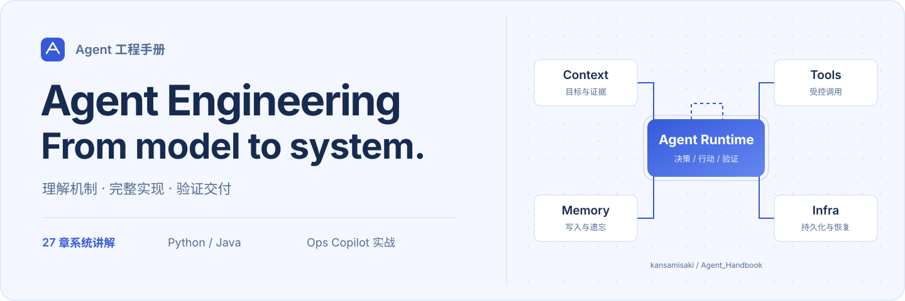
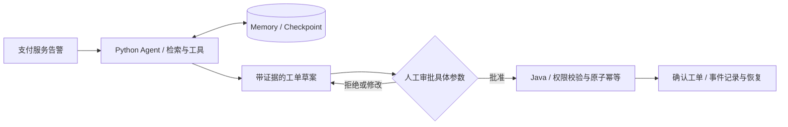

<div align="center">

<a href="https://kansamisaki.github.io/Agent_Handbook/">
  <picture>
    <source media="(prefers-color-scheme: dark)" srcset="docs/public/images/readme-cover-dark.svg">
    
  </picture>
</a>

# Agent 工程手册

**面向 Python / Java 后端工程师的 Agent 系统开发指南**

27 章系统讲解 · 70 张流程与架构图 · 一个贯穿全书的可运行项目

[在线阅读](https://kansamisaki.github.io/Agent_Handbook/) · [全书目录](https://kansamisaki.github.io/Agent_Handbook/guide/catalog.html) · [项目实战](https://kansamisaki.github.io/Agent_Handbook/project/overview.html) · [学习路线](https://kansamisaki.github.io/Agent_Handbook/guide/roadmap.html)

[](https://github.com/kansamisaki/Agent_Handbook/stargazers)
[](https://github.com/kansamisaki/Agent_Handbook/forks)
[](https://github.com/kansamisaki/Agent_Handbook/actions/workflows/deploy.yml)

[](https://github.com/kansamisaki/Agent_Handbook/commits/main/)
[](https://github.com/kansamisaki/Agent_Handbook/issues)
[](https://github.com/kansamisaki/Agent_Handbook/pulls)
[](https://github.com/kansamisaki/Agent_Handbook/graphs/contributors)

</div>

---

## 从一次模型调用，到一个可靠的业务系统

这本手册沿着一套运维 Agent 的实现过程，解释模型如何决策、记忆如何更新、工具如何受控执行，以及系统如何恢复、评测和交付。适合会 Python、具备 Java 或其他后端经验，希望转向 Agent 开发的工程师。

| 你会学到什么 | 你会做出什么 |
| :--- | :--- |
| **Agent 内核**：上下文、工具合同、规划、状态机与 Checkpoint | 能暂停、恢复、有预算和明确终态的执行循环 |
| **Memory 与知识**：写入、冲突、过期、删除、RAG 与检索评测 | 可追溯、隔离租户、避免旧数据复活的记忆系统 |
| **Infra 与业务**：Python / Java 协作、存储、队列、推理与观测 | 有审批、原子幂等、故障恢复和验证报告的参考工程 |

每章包含机制讲解、图例、实现取舍与故障案例。正文之外提供 **8 篇项目实战与验证说明、22 份完整源码导读**，章节与项目讲解合计约 **8.9 万汉字**。

## 知识地图

| 卷 | 章节 | 核心内容 | 阅读入口 |
| :--- | :---: | :--- | :--- |
| **模型与 Agent 内核** | 01–07 | LLM、结构化输出、Context、Tool Calling、Agent Loop、持久化运行 | [从任务定义开始](docs/chapters/01.md) |
| **记忆与知识系统** | 08–11 | Memory 分层与生命周期、RAG 数据工程、混合检索、重排 | [理解 Memory](docs/chapters/08.md) |
| **协作、协议与业务** | 12–16 | Workflow、Multi-agent、MCP、A2A、Skills、Python / Java、SSE | [理解协作边界](docs/chapters/12.md) |
| **平台与推理 Infra** | 17–18 | 多租户、存储、隔离、GPU、KV Cache、批处理、推理服务 | [进入 Infra](docs/chapters/17.md) |
| **质量、安全与交付** | 19–23 | Evaluation、Tracing、成本、可靠性、提示注入与数据治理 | [建立评测体系](docs/chapters/19.md) |
| **进阶、产品与求职** | 24–27 | 微调、偏好优化、多模态、Coding Agent、人机协作与面试 | [持续进阶](docs/chapters/24.md) |

**建议先读：** [如何使用手册](docs/guide/start.md) → [16 周学习路线](docs/guide/roadmap.md) → [完整目录](docs/guide/catalog.md)。

## 贯穿项目 · Ops Copilot

以**支付服务告警**为业务场景：查询证据、生成工单草案、审批具体参数，再由 Java 服务执行幂等提交。代码使用教学样本数据，业务边界可以在本机复现。



| Python 负责 | Java 负责 | 本地验证覆盖 |
| :--- | :--- | :--- |
| FastAPI、Agent Worker、模型适配、Memory、Checkpoint | Spring Boot、审批合同、身份校验、幂等事务、业务工单 | 真实 HTTP 联调、并发重复提交、写后崩溃恢复、记忆冲突与删除 |
| SQLite；默认确定性策略基线 | H2；JDK 17 | 已记录 32 项测试，详见报告与执行日期 |

**[开始运行](https://kansamisaki.github.io/Agent_Handbook/project/quickstart.html)** · [下载完整工程](https://kansamisaki.github.io/Agent_Handbook/downloads/ops-copilot.zip) · [源码导读](docs/project/source-index.md) · [实际验证报告](docs/project/verification.md)

> 本地闭环无需 Docker，默认运行无需付费模型密钥。HTTP 模型适配器已提供；真实模型质量、PostgreSQL、多机部署和 GPU 推理需要另外验证，正文已区分实现与扩展设计。

## 快速开始

### 阅读文档

直接打开 **[在线手册](https://kansamisaki.github.io/Agent_Handbook/)**，支持全文搜索、明暗主题、移动端目录、公式排版与图表放大。文档站是静态网站，Python / Java 项目需要单独下载运行。

### 本地开发

需要 **Node.js 22 + npm**。安装过程使用 `package-lock.json` 锁定依赖。

```bash
git clone https://github.com/kansamisaki/Agent_Handbook.git
cd Agent_Handbook
npm ci
npm run dev
```

开发地址：`http://127.0.0.1:5173/`。

### 构建与预览

```bash
npm run check:diagrams
npm run build
node verify-static.mjs
npm run preview
```

预览地址：`http://127.0.0.1:4173/`。构建产物位于 `docs/.vitepress/dist/`，不提交到 Git。也可以在构建后运行 `python3 serve.py`，或在 macOS 上双击 `打开知识博客.command`。

### 自动部署

推送到 `main` 后，GitHub Actions 自动完成：

```text
安装锁定依赖 → 校验 Mermaid → 构建 VitePress → 检查站内链接 → 发布 GitHub Pages
```

部署路径由 Pages 配置自动推导。Fork 后首次部署需要在 **Settings → Pages → Source** 选择 **GitHub Actions**；完整说明见 [DEPLOY.md](DEPLOY.md)。

## 仓库导航

```text
Agent_Handbook/
├── docs/
│   ├── chapters/              # 27 章正文
│   ├── project/               # 项目实战、源码导读、验证报告
│   ├── guide/                 # 路线、术语、面试与参考资料
│   ├── public/
│   │   ├── images/            # 站点与 README 视觉素材
│   │   ├── downloads/         # 完整 Python / Java 工程包
│   │   └── labs.html          # 交互实验附录
│   └── .vitepress/            # 导航、主题与首页组件
├── .github/workflows/         # 静态校验与部署工作流
├── CONTRIBUTING.md            # 内容与代码贡献约定
├── DEPLOY.md                  # 部署说明
├── verify-diagrams.mjs        # Mermaid 语法检查
└── verify-static.mjs          # 构建产物链接检查
```

## 项目状态

| 面板 | 数据来源与含义 |
| :--- | :--- |
| **Stars / Forks / Issues / Pull requests / Contributors** | 页首徽章读取 GitHub 仓库数据，由 Shields.io 缓存刷新 |
| **Docs build** | `main` 分支的文档构建与部署工作流；点击可查看实际运行记录 |
| **Last commit** | `main` 分支最近一次提交时间 |
| **工程验证** | [验证报告](docs/project/verification.md)记录的本地执行结果，独立于文档构建状态 |

徽章会自动更新，无需修改 README；GitHub 图片代理与 Shields.io 存在缓存，数据可能稍有延迟。离线时远程徽章不可用，文档正文不受影响。

## 参与完善

欢迎纠正技术错误、补充失败案例、改善图解和贡献可复现的 Python / Java 示例。提交前请阅读 [贡献指南](CONTRIBUTING.md)。

- **发现问题**：[提交 Issue](https://github.com/kansamisaki/Agent_Handbook/issues/new)，附章节、问题描述与复现步骤。
- **改进内容**：[提交 Pull Request](https://github.com/kansamisaki/Agent_Handbook/compare)，说明改了什么、依据是什么、做过哪些验证。
- **继续学习**：[60 个核心术语](docs/guide/glossary.md) · [官方资料与阅读顺序](docs/guide/references.md) · [面试准备](docs/guide/interview.md)。

<div align="center">

**把一个 Agent 做出来，也把它为什么可靠讲清楚。**

Built with [VitePress](https://vitepress.dev/) & [Teek](https://vp.teek.top/)

</div>
