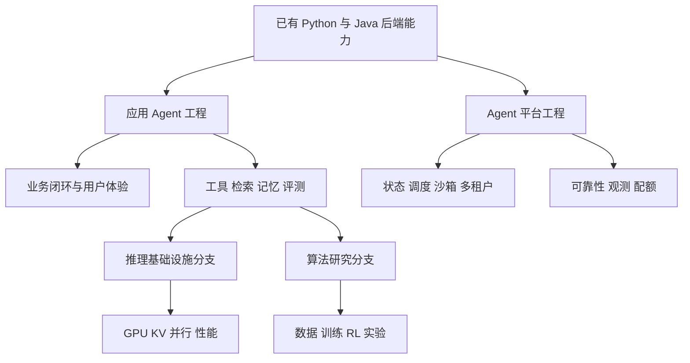
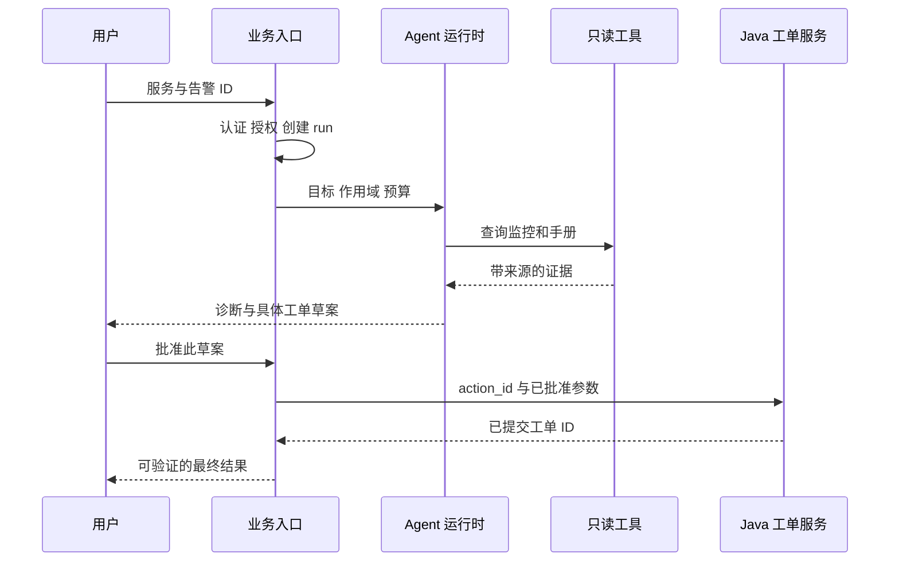

# 岗位地图与问题定义

<div class="book-meta">第 01 章 · 基础与模型 · 约 3,008 字 · 建议精读 14 分钟（含图解）</div>

<p class="chapter-lead">先明确要交付什么，再决定需要多少智能。你的后端经验会在权限、可靠性与系统集成上形成优势。</p>


一个会调用模型 API 的程序，距离可以交付的 Agent 系统还有多远？考虑一个具体需求：支付服务凌晨出现大量超时，业务希望助手检查监控、阅读运行手册、联系负责人并创建故障工单。演示版本可能在一分钟内写出一份像样的分析；生产版本却必须回答：读的是哪个租户的数据，证据是否过期，工单是否重复创建，工具超时后是否应该重试，以及谁批准了写操作。

这些问题正是 Python 与 Java 后端经验可以发挥作用的地方。你需要补的不是另一门“聊天机器人语言”，而是如何把概率性的模型决策，放进可控制、可恢复、可验证的业务系统。

## 1. 先识别岗位真正负责的交付物

“Agent 开发工程师”不是统一的职业标准。同样的名称，有的团队主要做企业应用，有的负责通用执行平台，有的实际招聘推理或训练工程师。不要先背几十个框架名字；先把招聘描述里的动词找出来：接入业务、设计评测、运行大规模任务、优化吞吐、训练策略，分别指向不同的工作。

| 方向 | 核心交付物 | 需要做深的能力 | 可证明能力的材料 |
| --- | --- | --- | --- |
| 应用工程 | 能完成业务任务的助手 | 工具、检索、上下文、评测、产品边界 | 一条真实闭环及其失败分析 |
| Agent 平台 | 可复用的任务执行基础 | 状态恢复、调度、沙箱、租户与治理 | 故障演练、隔离验证、平台合同 |
| 推理基础设施 | 满足质量与延迟目标的模型服务 | GPU、KV、批处理、并行、性能剖析 | 固定环境的压测与优化对照 |
| 算法与研究 | 可复现的能力改进 | 训练、强化学习、规划、统计与实验 | 独立测试集、消融、论文复现 |

对已有 Java 后端经验的开发者，合理起点通常是应用工程：利用现有业务知识做好工具和流程，再将持久化、幂等、权限、观测做深。平台能力会成为差异化优势。是否进一步学习 CUDA 或 Agent 强化学习，应由目标岗位与兴趣决定。



这张图表达学习依赖，而不是职位晋升阶梯。应用工程与平台工程都有复杂问题，也都可以做到资深。图中向下分叉意味着“按目标继续深入”，不意味着必须先完成所有分支才能开始求职。

## 2. Agent 与确定性工作流如何分界

一个固定流程可以包含模型，却不必成为高度自主的 Agent。例如“读取工单 → 分类 → 写入对应队列”，模型只负责分类，后续路径由程序控制。另一种任务是“找出异常的可能原因”：模型需要根据日志结果决定查哪份手册、是否分析最近发布、是否继续搜索，这时运行路径会受中间观察影响。

重要区别是决策权放在哪里。流程固定时，用普通程序通常更容易测试。路径需要动态变化时，可以把部分决策交给模型；但权限、预算和业务不变量仍由执行系统控制。实际产品常是混合架构：外层流程负责受理、审批和交付，内层 Agent 负责查证与诊断。

不要因为需求含有“自然语言”就选择 Agent。也不要把“全部自动完成”作为默认目标。判断标准应是：模型的动态决策带来什么额外价值，这些收益是否足以覆盖不确定性、延迟、费用和运维复杂度。

## 3. 把模糊愿望写成任务合同

“帮我处理告警”太宽。工程合同至少需要定义输入、资源范围、允许动作、成功终态、退出方式和预算。下面是教学示例，不是任何框架的专有配置格式。

```yaml
task: diagnose_payment_timeout
input:
  required: [service_id, alert_id, observed_at]
read_scope: [service_metrics, approved_runbooks, recent_changes]
write_scope: [draft_ticket]
approval_required: [create_ticket, notify_owner]
success:
  - diagnosis_has_evidence
  - ticket_draft_is_valid
  - no_unauthorized_side_effect
limits:
  model_steps: 6
  elapsed_seconds: 90
fallback: return_partial_result_and_request_human
```

这里的 `success` 应落实成检查器。例如“草案有效”可以检查服务 ID 是否存在、证据 ID 是否来自授权检索、字段是否完整；“无未授权副作用”则需要核对工具审计和业务系统终态。自然语言要求只有被转成可执行检查，才能成为稳定的交付标准。

注意 `notify_owner` 也是外部动作。读取资料与发送通知的风险不同，不能因为它们都包装成 tool 就使用相同授权政策。任务允许做什么，应来自可信的用户授权和组织规则，而不是模型生成的一句话。

## 4. 从一条任务走完系统边界

假设用户提交服务名和告警 ID。入口先认证用户，并核对他是否能访问该服务；随后创建 `run_id` 和总预算。Agent 检索到运行手册，发现当前现象可能由连接池耗尽引起，再读取最近配置变化。结果汇总成诊断与工单草案，用户确认后，Java 服务执行短事务创建工单。



读图时看两条边界：模型只在 Agent 运行时里提出决策；最终写入由业务服务完成。审批针对具体草案，不是永久授予任意写入权限。这样，即使模型误解了文档，业务系统仍有机会独立拒绝非法动作。

## 5. 如何判断“值得做”

先测人工或现有脚本的基线：一次任务需要多久，哪一步最耗时，哪些错误最常见。然后建立一个小任务集，覆盖常见情形、资料不足、工具失败和权限不足。比较时至少看成功率、总时长、人工审核负担、每成功任务成本与风险事件。

如果平均耗时下降，但用户需要逐句核对所有内容，收益可能没有想象中大。如果成功率很高，却在少量边界任务中错误修改生产数据，平均分也不能支持上线。质量指标应围绕业务终态设计，而不是只测回答是否流畅。

这里的“投入产出”还包括维护成本。一个由十五个角色反复讨论才能完成的流程，可能比单个受控 Agent 更难诊断。先保持最小架构，只有发现明确瓶颈时再增加规划器、专门记忆或多 Agent 协作。

## 6. 你的后端经验如何转化

参数校验对应工具 schema 与业务语义校验；事务与幂等对应写操作恢复；数据库建模对应 run、action、approval、memory；监控与链路追踪对应 Agent trace；灰度发布对应模型、prompt、工具与索引版本的联合发布。

新的部分在于：系统错误不仅来自异常，也来自“合法但不正确的输出”。模型可能返回格式正确的错误订单号，也可能选择一个允许调用但不适合当前任务的工具。因此，传统测试之外，还要建立任务级评测、数据切片和失败轨迹分析。

## 7. 常见错误与诊断方式

| 表象 | 经常被忽略的原因 | 优先检查 |
| --- | --- | --- |
| 演示很强，上线很差 | 演示只挑了顺利样本 | 真实任务分布与失败切片 |
| 工具越加越多，效果越差 | 功能重叠、说明模糊 | 工具职责与候选收窄 |
| 多 Agent 很忙却不完成 | 没有可验证的终点 | 状态、预算与完成检查 |
| 用户仍不愿使用 | 审核负担或接管困难 | 人工操作步骤与真实耗时 |

## 8. 动手练习与验收

选择你熟悉的一个 Java 业务，写一页任务合同，并准备二十条输入：十条正常任务、五条异常任务、五条需要人工接管的任务。至少实现一个固定工作流基线，再说明动态决策可能改善哪一步。

验收时，另一位工程师应能在不听口头解释的情况下判断：输入是否足够、允许访问什么、何时需要确认、什么算完成、失败后如何退出。每个成功标准都应能找到对应的验证来源，不能只写“模型表现良好”。

## 9. 面试追问

**问：为什么这个任务需要 Agent，固定工作流不行吗？**

先说明运行中哪些决定依赖未知证据，再给出固定流程的限制。例如诊断方向取决于监控和变更结果，无法事先枚举所有查证路径。随后比较两种方案的质量、延迟、成本和可维护性。如果没有可靠增益，保留固定流程就是合理工程判断。

**问：已有后端经验，最先补什么？**

先补模型限制、上下文构建、工具调用协议和任务评测。利用熟悉的业务做一个带授权、幂等和状态恢复的闭环，比先学习所有训练算法更能证明应用岗位所需能力。


<!-- PROJECT_DEPTH_V2 -->

## 项目落地：把岗位要求写成可验收的工程成果

贯穿项目是支付告警 Copilot。你负责的成果应分成业务能力与系统保证两部分：业务能力是读取指标、寻找依据、形成待复核工单；系统保证是身份隔离、可暂停、可恢复、审批绑定和业务幂等。没有第二部分，第一部分很容易停留在演示。

### 怎样拆解一份岗位描述

看到“熟悉 Agent 框架”，把它转换成能实现状态机、理解 checkpoint 边界、解释恢复窗口；看到“熟悉 RAG”，转换成能追踪文档版本、授权过滤和检索误差；看到“熟悉 Infra”，转换成能解释并发、超时、配额、连接池、持久化和部署。框架名称有助于沟通，能力证据来自行为。

你已有的 Java 后端经验能直接用在 TicketService 的事务与服务权限。Python 则负责快速实现模型适配器、状态控制和评测。优先补齐模型不确定性、上下文管理和任务评测，数据库与网络基础可以通过项目复习，不必重新从编程入门开始。

### 项目需求的反例同样重要

产品希望“告警后自动处理”，你应追问处理到哪一层：解释、提出方案、创建工单还是执行生产变更。本项目只到获准建单，因为回滚、重启和资金操作需要不同的权限与验证边界。把这个范围写清，是需求工程，不是能力不足。

验收时同时展示正常支付告警、缺手册的 inventory 和另一个租户的健康服务。三个分支分别验证完成、承认缺口和边界。参见[业务设计](/project/overview)。你的作品集应附上实际测试报告，并说明没有做生产部署或真实模型质量实验，避免把架构图中画出的能力写成已落地成果。

<!-- END_PROJECT_DEPTH_V2 -->

## 参考资料

- [Anthropic：Building effective agents](https://www.anthropic.com/research/building-effective-agents)：理解工作流与动态决策模式。
- [Applied AI Engineer, Enterprise 岗位样本](https://job-boards.greenhouse.io/anthropic/jobs/5057647008)：观察生产开发、评测、部署与协作如何组合。它只是一个岗位样本，不代表整个招聘市场。
