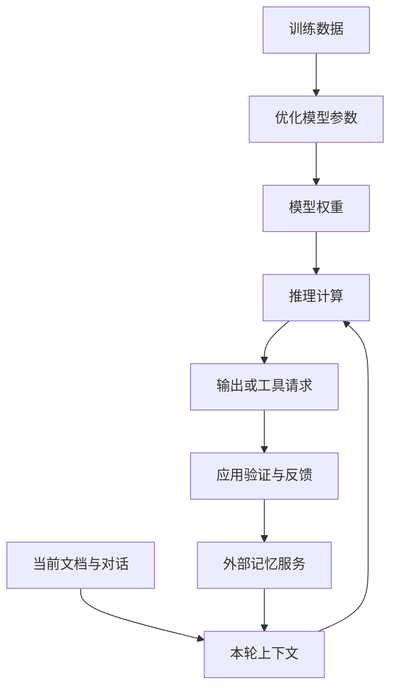

# LLM 原理与必要数学

<div class="book-meta">第 02 章 · 基础与模型 · 约 2,825 字 · 建议精读 13 分钟（含图解）</div>

<p class="chapter-lead">学到能解释模型为什么这样表现，并能做工程决策；算法岗位再继续深入推导。</p>


你让模型输出一个存在的订单 ID，它却生成了格式正确但查不到的编号。你把 temperature 设为零，重复执行仍偶尔出现不同结果。你把历史对话全部加入 prompt，正确率却下降。这些现象都提示：模型不是带自然语言入口的关系数据库，也不是天然确定性的规则引擎。

本章不要求先掌握完整训练理论。目标是建立足够准确的模型：文本怎样变成计算，生成怎样发生，哪些量具有数学意义，哪些工程结论不能从模型输出中直接推出来。

## 1. 从文本到 token：模型看到的不是汉字本身

Tokenizer 将输入转成整数序列。一个 token 可能是一个词、一段词、一个字符、标点或字节片段；同样的文本在不同 tokenizer 下会得到不同长度。代码、中文、英文、长数字和 JSON 的切分成本也不同。

因此，“保留最近一千字”不等于“保留一千 token”。上下文预算、费用估算和截断都应依据对应模型的 tokenizer 或实际 usage。不要先按字符任意截断，再假设结果仍是完整的工具消息或 JSON。

token ID 通过嵌入矩阵映射成向量。这个向量在后续网络中不断被更新，最终用于预测下一个 token。用于检索的 sentence embedding 与语言模型内部 token embedding 有联系，但不是同一个接口或同一种用途。


图中的回边是自回归生成的核心：每次新输出又成为下一次预测的条件。错误事实一旦进入上下文，可能影响后面的生成。应用应通过外部证据与工具验证纠正它，而不能假设模型会自动意识到先前错误。

## 2. 向量和余弦相似度到底表达什么

向量可以看成一组数值特征。两个向量的内积与长度共同决定它们在表示空间中的关系。余弦相似度只关注方向：

$$
\operatorname{cos}(x,y)=\frac{x^\top y}{\|x\|\|y\|}
$$

如果 embedding 模型把语义相近的文本放到相近方向，余弦值就可以辅助检索。但它不是“答案正确概率”。分数受模型、归一化方式、数据分布和查询类型影响。两份文档内容相近，也可能一份已过期，或者属于另一个租户。

下面的例子只计算几何关系，可以直接用 Python 标准库运行。它不是训练或调用真实 embedding 模型。

```python
from math import sqrt

def cosine(x, y):
    if len(x) != len(y):
        raise ValueError("dimension mismatch")
    nx = sqrt(sum(v * v for v in x))
    ny = sqrt(sum(v * v for v in y))
    if nx == 0 or ny == 0:
        raise ValueError("zero vector")
    return sum(a * b for a, b in zip(x, y)) / (nx * ny)

print(round(cosine([1, 0], [1, 1]), 4))  # 0.7071
print(round(cosine([1, 0], [-1, 0]), 4)) # -1.0
```

这个小例子的意义是训练直觉：相似度是表示之间的关系，不含权限、时间或业务正确性。检索系统必须在几何分数之外维护这些约束。

## 3. Attention：让当前位置选择相关信息

经典缩放点积注意力写作：

$$
\operatorname{Attention}(Q,K,V)=\operatorname{softmax}\left(\frac{QK^\top}{\sqrt{d_k}}\right)V
$$

可以把 Q 理解为当前位置“查找信息的表示”，K 是候选位置“提供匹配的表示”，V 是被汇总的内容表示。矩阵乘法产生匹配分数，softmax 将一行分数转成归一化权重，再对 V 加权求和。这只是帮助理解计算的类比，不表示网络内部真的使用人类可读的检索词。

多头注意力允许不同投影并行形成多组关系。前馈网络进一步变换每个位置的表示；残差连接和归一化帮助深层网络训练。位置编码或位置相关机制让模型区分顺序。没有顺序信息，“A 支付给 B”和“B 支付给 A”会很难正确区分。

经典全注意力包含与序列长度平方相关的配对计算，但现代系统还可能使用分组查询注意力、滑动窗口、稀疏或混合结构。工程估算应根据实际模型架构，不能把一个公式套到所有模型。

## 4. 概率分布、采样与 temperature

模型输出的 logits 经过 softmax 转成词表上的条件概率。temperature 可以在 softmax 前缩放 logits：较高温度通常让分布更平，较低温度通常更集中。不同接口还可能提供 top-p、top-k 等采样设置。

这影响的是输出选择，不是模型是否知道事实。一个模型可以非常确定地生成错误答案，也可以在多个同样合理的措辞之间分散概率。把 temperature 调低可能改善格式稳定性，却不会自动补齐缺失知识。

即使采用接近贪心的解码，端到端结果也未必完全一致。服务版本、硬件数值行为、并发与模型实现都可能影响结果。需要可复现比较时，应固定能固定的条件、保存版本与输入，并报告重复试验，而不是承诺绝对确定性。

## 5. 训练、推理与上下文学习

预训练通过大规模数据学习参数；监督微调用任务示例改变行为；偏好优化或强化学习进一步调整选择。推理阶段使用已有权重生成结果。把一份新运行手册放进 prompt，通常是在提供本次计算的条件，没有直接修改模型参数。

“模型在这段对话里学会了我的偏好”经常只意味着偏好仍在上下文中。如果下一会话没有重新提供，模型未必知道。跨会话记忆由应用存储与检索实现，和微调权重是不同机制。



图中训练路径与上下文路径是分开的。反馈写入外部记忆也不等于训练了模型。清楚区分这些路径，才能判断“新知识没生效”应该检查索引、上下文还是训练流程。

## 6. 必须补到什么程度的数学

| 领域 | 应用工程至少掌握 | 更深入的用途 |
| --- | --- | --- |
| 线性代数 | 维度、矩阵乘法、内积、归一化 | 注意力、低秩适配、模型并行 |
| 概率统计 | 条件概率、抽样、方差、区间 | 评测显著性、校准与实验设计 |
| 微积分 | 梯度、链式法则、优化直觉 | 微调训练与损失分析 |
| 信息论 | 交叉熵和预测分布 | 语言建模与训练目标 |

不必先把所有数学课完整重学。遇到工程问题时补对应知识：比较两个版本需懂抽样波动；解释向量召回需懂相似度；估算显存需懂维度与精度；做训练才需要深入优化与梯度。

## 7. 把原理用于实际排障

模型遗漏长文中的限制，不应立即归因为“模型不够大”。先确认信息是否真的进入上下文、是否被裁剪、是否与其他指令冲突、是否位置不佳，以及检索是否引入噪声。更长窗口只是容量，并不保证每条信息同样被有效利用。

模型编造业务编号，首先检查是否允许它自由生成标识符。更好的接口可能是“从候选 ID 中选择”，并由业务服务确认存在性。模型擅长语言与模式处理，精确状态应交给数据库、搜索和业务 API。

模型连续犯错时，也不要无限要求它“再仔细想一次”。如果没有新证据、不同验证器或更好的工具反馈，更多轮次可能只是继续沿着错误条件生成，并增加费用。

## 8. 动手练习与验收

完成三个小实验：用不同 tokenizer 比较中文、代码与 JSON 的长度；手算两组余弦相似度并和程序结果对照；对同一业务任务重复运行十次，记录格式、事实和工具选择的波动。使用实际 API 时记录模型标识、参数和 usage，不把示例数字当成性能结论。

验收标准是能够解释三个区别：token 与字符，表示相似度与正确概率，上下文学习与权重更新。你还应能说清一个“调低 temperature 无法解决”的失败，并提出对应的数据或工具验证方案。

## 9. 面试追问

**问：为什么相似度 0.9 不代表 90% 正确？**

它衡量表示空间中的接近程度，尚未定义“正确”事件，也没有用标签数据校准成概率。若业务需要置信度，必须定义预测目标、采集代表性样本并验证校准表现。

**问：LLM 为什么会幻觉？**

语言生成目标不等于查询事实真源。缺失知识、错误上下文、任务误解和采样都可能产生不受证据支持的输出。工程上应定位具体失败来源，再使用检索、工具、约束与评测，而不是把所有错误归于同一个抽象原因。


<!-- PROJECT_DEPTH_V2 -->

## 项目落地：把模型原理变成排障判断

`model.py` 将真实模型限制在一个很小的决策空间：选择只读工具、提出草案或者请求补充。这不改变模型仍在逐 token 生成的事实，只是通过协议与执行器把可能输出映射为可检查的动作。

### 为什么格式正确仍可能答错

一个响应可以完全符合 JSON Schema，却把“数据库 CPU 正常”和“连接池排队高”错误地归因为数据库过载。结构化输出约束的是表达空间，不是事实推断。项目对 evidence_ids 的检查只能证明引用确实被读取，不能证明因果结论正确，所以草案使用“疑似”并交给值班人员复核。

温度设为零也不应被描述为跨设备、跨版本严格可重现。服务端实现、算子、并行方式和模型版本都可能改变输出。需要严格复现运行时故障时，使用项目的 deterministic 策略；研究模型效果时，固定模型配置、任务集和重复次数，报告实际波动。

### token、字数和预算

中文字符数、UTF-8 字节数与 token 数不是同一个量。项目目前限制输入长度、输出 token 上限和总步数，没有把汉字数冒充精确 token 预算。接入真实服务后应使用对应 tokenizer 或 usage 计量，并预留模型输出空间。

做一个小实验：保持工具观察不变，只改变手册中的冗余段落长度，比较模型选择与延迟。若输入变长后漏掉关键变更，不要立刻得出“模型不懂运维”；先检查上下文组织与注意力分配。数学的用途在这里是帮助定位误差来源，而非只背公式。

<!-- END_PROJECT_DEPTH_V2 -->

## 参考资料

- [Attention Is All You Need](https://arxiv.org/abs/1706.03762)：经典 Transformer 与注意力机制。
- [Anthropic：Effective context engineering](https://www.anthropic.com/research/effective-context-engineering-for-ai-agents)：从应用视角理解上下文的选择与限制。
