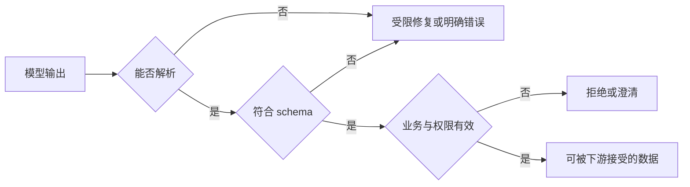
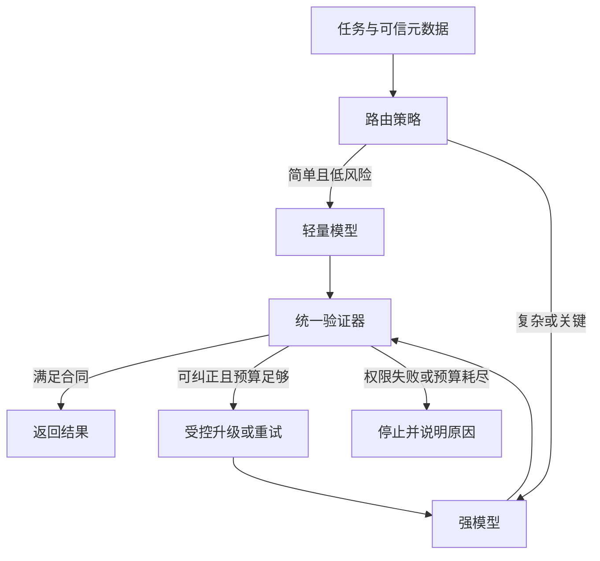

# 模型选型、提示词与结构化输出

<div class="book-meta">第 03 章 · 基础与模型 · 约 2,791 字 · 建议精读 13 分钟（含图解）</div>

<p class="chapter-lead">选择模型要看你的任务分布；提示词、工具合同和验收器要共同工作。</p>


同一个故障助手，换成更贵的模型后回答更长，却没有更少地创建错误工单；加了一段详细提示词后，普通任务变好了，越权测试却退化。这说明选型、提示词和输出合同不能独立评判。它们共同决定模型看到什么、提出什么动作，以及应用最终接受什么。

对工程师而言，模型选型不是寻找一个绝对最强的名字，而是选择一组能在目标任务、预算和约束下工作的配置。这个配置还包括 prompt、工具定义、上下文策略和业务校验。

## 1. 用任务分布选模型

先列出任务类型：简单分类、证据问答、长文分析、工具规划、代码生成、多模态理解。不同能力的权重不同。工单分类可能重视低延迟和稳定枚举；诊断助手可能更重视证据整合与正确工具使用；写操作代理则必须优先满足权限和终态验证。

建立一个代表性小数据集，所有候选模型用相同任务、同一工具环境和同样预算运行。分别统计任务成功、参数有效、无答案处理、延迟和成本。平均分之外还要检查关键切片，例如跨租户请求、旧文档与工具超时。

| 维度 | 应问的问题 | 证据形式 |
| --- | --- | --- |
| 任务能力 | 能否完成本业务而非仅解释概念 | 带初始状态的任务集 |
| 工具可靠性 | 名称、参数与调用顺序是否合理 | 工具轨迹与终态 |
| 服务条件 | 限流、地域、部署与数据要求是否满足 | 实际配置与合同核查 |
| 性能成本 | 在负载下是否满足 SLO | 压测、usage 与账单估计 |
| 可维护性 | 升级后如何回归和回滚 | 版本记录与发布流程 |

公开榜单适合发现候选，不能代替业务评测。某个模型擅长编码基准，不意味着它在你的中文运行手册、权限规则和长尾故障上也最好。

## 2. Prompt 是行为合同的一部分

一份有效提示词首先说明目标与边界，然后提供输入解释、工具使用原则、输出要求和停止条件。把稳定规则与动态证据分开，方便缓存、版本管理和排障。外部文档应明确标为资料，避免它在语义上混入高权限规则。

```text
目标：根据授权证据解释告警，并生成工单草案。

边界：只能读取当前服务的监控与运行手册。
不得执行生产变更。缺少证据时明确说明缺口。

工具原则：先核对服务与时间范围；每项事实保留来源 ID。
工具报权限错误时停止该动作，不换工具绕过。

输出：category、severity、evidence_ids、draft、needs_human。
完成条件：草案通过业务校验，或说明为何需要人工接管。
```

这段示意没有堆叠“世界顶级专家”等角色修饰，因为那些词无法清晰表达业务验收。它也没有把每条复杂业务条件都塞进 prompt；额度、库存、资源版本等确定性规则应该继续由业务服务验证。

少量 few-shot 示例能展示边界情况。例如一个证据充分的任务，一个无答案任务，一个需要拒绝的越权任务。示例应代表不同决策边界，而不是复制十个几乎相同的顺利案例。

## 3. 结构化输出能保证什么

Schema 描述形状与字段约束。例如严重级别必须来自固定枚举，证据字段必须是数组，是否转人工必须是布尔值。支持约束生成的接口可以提高结构稳定性，但具体支持范围、拒答与截断行为依服务而异。

格式正确不等于内容正确。`service_id` 可能不存在，证据可能不支持结论，工单描述可能包含敏感数据。你需要三层验证：语法解析、类型/结构约束、业务语义与权限校验。



图中最后一个检查不能省略。对 Java 后端来说，它与校验一个外部客户端请求相似：JSON 能反序列化成 record，只能说明字段可读，并不能说明用户有权操作这份订单。

## 4. 一个两层验证的具体示例

下面的 Pydantic 示例展示结构校验与业务校验的分工，需要安装对应依赖；它没有包含真实模型接口。完整项目还应处理日志脱敏、异常映射与 schema 版本。

```python
from typing import Literal
from pydantic import BaseModel, Field

class Diagnosis(BaseModel):
    category: Literal["capacity", "dependency", "unknown"]
    severity: Literal["low", "medium", "high"]
    evidence_ids: list[str] = Field(max_length=8)
    needs_human: bool

def validate_business(raw: str, allowed_evidence: set[str]):
    item = Diagnosis.model_validate_json(raw)
    if not set(item.evidence_ids) <= allowed_evidence:
        raise ValueError("unknown or unauthorized evidence")
    if not item.evidence_ids and not item.needs_human:
        raise ValueError("no evidence requires human review")
    return item
```

`allowed_evidence` 必须来自可信检索结果或服务端记录，不能也由模型自由填写。否则模型同时生成答案与验证依据，校验看似完整，实际没有独立约束。

如果第一次输出失败，可以把有限的结构错误反馈给模型重试一次。但修复过程不能悄悄补造证据，也不能扩大权限。达到重试预算后返回可处理错误，通常比无限修复更可靠。

## 5. 路由不是免费的能力增强

一种常见设计是让小模型处理简单任务，复杂任务升级到更强模型。这样可能降低平均费用，但分类器也会出错：把困难任务误判为简单，会损失成功率；把所有任务都升级，则失去节省。

路由可以根据显式业务类型、输入长度、工具需求和已有失败信号做决定。不要把模型自己声称的“我很有把握”直接当作经过校准的概率。使用真实任务集测升级率、漏升级率和最终成本。



两种模型后面使用同一套业务验证器，避免“降级模型”拥有更宽松的权限。供应商故障时也一样：备用服务必须满足相同的数据条件和关键能力，不能仅凭接口兼容就切换。

## 6. 怎样做一次可信的模型对比

先冻结评测样本与评分器，再准备模型 A、B 的配置。尽量一次只改变一个因素；如果同时换模型、改 prompt、增加 rerank，结果改善也难以归因。保存输入、输出、工具轨迹、模型标识、prompt 版本和 usage。

对随机性较大的任务重复试验。报告每个切片的样本数与失败类型，不只提供一张总分表。对关键写操作，使用数据库或沙箱终态评分；对语言质量，可以结合人工与经过校准的模型评分器。

将价格比较换算成每成功任务成本。例如一个模型每次便宜，但需要更多轮检索、更多重试与人工修正，它未必更省。这里没有通用的最优模型，只有在明确约束下更合适的组合。

## 7. 常见故障与排查顺序

输出经常缺字段，先检查接口是否真正启用了结构约束，再看 schema 是否在支持范围内、输出预算是否被截断。字段齐全但事实错误，检查证据与业务校验，而不是继续修改 JSON 指令。

模型频繁误选工具，检查工具名称、描述和职责是否重叠。工具说明如果只有“查询数据”，模型无法可靠区分。模型忽略当前用户要求，检查历史摘要和长期偏好是否覆盖了最新明确指令。

小模型成本没有下降，检查升级比例、输入历史增长、修复轮次与模型之外的工具费用。性能问题也可能来自排队或重排，不一定来自生成速度。

## 8. 练习与验收

建立一个包含三十条任务的小集合：正常分类、无证据、非法资源、模糊输入、权限不足各占一定比例。选择两个可用模型，用同一 schema 和业务验证器运行。记录结构通过率、任务成功率、拒绝是否正确、延迟和每成功任务费用。

交付一份对比报告，至少展示五条失败轨迹。验收重点不是哪个模型获胜，而是每个结论是否有样本支持、是否说明评测边界，以及当两个模型都失败时系统是否仍然安全地退出。

## 9. 面试追问

**问：用了严格 JSON 输出，为什么还要业务校验？**

Schema 约束数据形状，无法证明资源存在、证据真实或用户有权操作。业务服务必须使用独立真源检查这些条件。

**问：如何避免 prompt 调参越调越好看？**

保留不参与调参的测试集，记录版本并做成对对照。把真实失败补入开发集时，不能继续把同一批样本当作完全独立的最终评测。


<!-- PROJECT_DEPTH_V2 -->

## 项目落地：一个可以替换模型的决策合同

真实 HTTP 路径位于 `model.decide`，它提交受控上下文并解析 Decision。确定性策略和真实模型使用同一个返回类型，使你可以先验证系统正确性，再替换模型比较任务表现。完整代码见[模型适配器源码](/project/source-model)。

### 分层选择而不是一次选出万能模型

先让候选模型完成三类工具选择和草案引用，再比较格式合法率、证据充分性、最终任务结果、耗时与费用。若大多数任务只需四步，先验证小模型是否足够；复杂无答案任务再考虑路由到更强模型或人工。路由本身也需要评测，否则节省一次调用可能换来更多失败重试。

HTTP 适配器没有假定所有兼容服务都支持同一种 strict schema 参数，当前使用系统合同、输出 JSON 与本地 Pydantic 校验。若服务原生支持受约束解码，可以在适配器中增加供应商特定参数，但本地校验不能删除。服务端保证合法 JSON，也不保证资源存在、权限正确或引用真实。

### 提示词迭代应有版本和回归

修改 SYSTEM 后，同时保留任务集版本、模型版本和代码版本。一个看似更严格的提示可能提高工具格式合法率，却让无答案任务过度自信。每次改动至少比较正常、缺证据、注入与长上下文分组，不只看一次演示。

练习：让本地 mock HTTP 返回未知工具、额外 tenant 字段和合法 metrics 请求。确认前两种被 schema 拒绝，后一种能够执行。这是协议测试；只有真正连接模型并跑任务集，才是模型能力评测。两类结果应分别写进报告。

<!-- END_PROJECT_DEPTH_V2 -->

## 参考资料

- [Spring AI：Tool Calling](https://docs.spring.io/spring-ai/reference/api/tools.html)：理解模型请求、工具执行与应用责任的边界。
- [Anthropic：Demystifying evals for AI agents](https://www.anthropic.com/research/demystifying-evals-for-ai-agents)：任务、试验、评分器和环境结果的评测思路。
