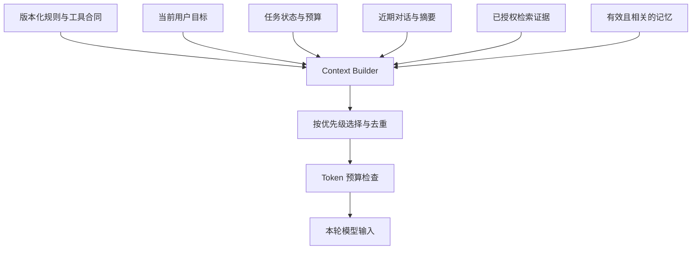
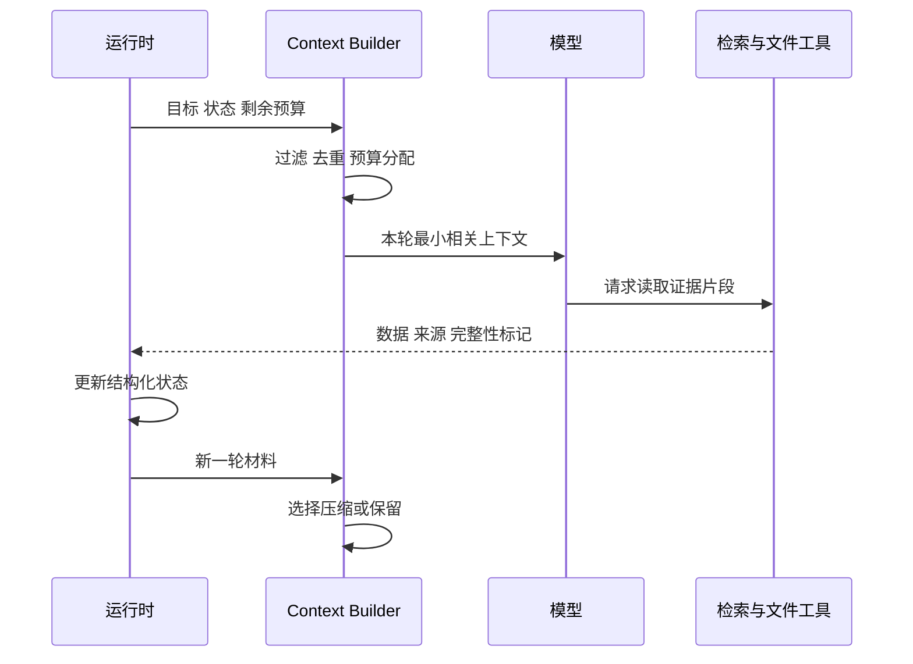

# Context Engineering：每轮让模型看到什么

<div class="book-meta">第 04 章 · Agent 核心 · 约 2,925 字 · 建议精读 13 分钟（含图解）</div>

<p class="chapter-lead">上下文是一个有预算的数据包，需要选择、压缩、排序和更新。</p>


故障助手已经检索了十份文档、执行了五次工具，还记着用户上个月留下的偏好。现在它需要判断是否生成工单。把所有材料原样送给模型，看起来最保险，却可能同时引入过期事实、重复日志和相互冲突的要求。上下文工程要解决的就是这个问题：在每个决策时刻，用有限容量提供足够且可信的信息。

Prompt 是上下文的一部分。Context engineering 还包括历史选择、工具发现、检索、记忆、任务状态、压缩与结果装配。它更接近一个数据供应系统，而不只是写一段措辞漂亮的系统提示。

## 1. 将“全部信息”拆成不同来源

先把输入分为稳定规则、当前目标、工具合同、结构化任务状态、近期交互、外部证据和历史记忆。每类信息有不同作用域、可信度和时效。用户当前明确要求通常需要与旧偏好区分；外部网页内容不能升级成系统规则。

结构化任务状态尤其重要。例如已经执行过哪些动作、哪个 action 正在等待批准、还剩多少预算，应来自运行时数据库，而不是让模型从两百条聊天消息里重新猜测。消息记录便于解释过程，结构化状态负责准确推进。



图中各输入不是简单拼接。Builder 先执行身份与时效过滤，再根据本轮任务选择信息，最后检查预算。不能先把未授权材料塞给模型，再希望它自行忽略。

## 2. 写出一张可计算的预算表

一种通用预算表达是：

$$
B_{input}=B_{window}-B_{output}-B_{protocol}-B_{margin}
$$

其中窗口和输出的具体计数规则依模型接口而异；部分接口还涉及额外推理预算。`margin` 是为估算误差和动态结果保留的余量。不要把某个供应商的计费规则当成所有模型共同规则。

假设某教学任务可使用 16,000 token，其中输出预留 2,000，协议和余量合计 1,000，那么材料最多使用 13,000。固定规则与工具占 2,000，当前目标和状态占 1,000，剩下 10,000 才能分配给历史、记忆与检索证据。

这不是推荐的固定比例。运行手册问答可能需要更多证据，长任务恢复可能需要更多状态。真正需要的是每轮能说明花费在哪里，并能解释某项材料为什么被保留或舍弃。

## 3. 优先级与完整性约束

最容易出错的做法是按时间倒序截断字符串。它可能切掉约束，也可能保留 `tool_call` 却丢掉对应结果。模型接口通常对消息关系有要求，应用还需要保留业务语义完整性。

可以将上下文看成带依赖的数据单元：一条工具请求与结果是一组；一个证据片段与来源 ID 是一组；一个批准动作与参数摘要是一组。选择和压缩时以单元为边界，而不是任意字符位置。

| 内容 | 常见策略 | 不应牺牲的部分 |
| --- | --- | --- |
| 安全规则与目标 | 固定保留并版本化 | 身份、授权、停止条件 |
| 当前任务状态 | 结构化摘要 | 已执行动作、待审批意图 |
| 近期对话 | 保留最近完整轮次 | 当前更正与未解决问题 |
| 长工具结果 | 摘要加引用，按需读取 | 关键字段、错误与来源 |
| 检索材料 | 去重、重排、相关片段 | 权限、版本、证据边界 |

## 4. 一个可解释的选择器

下面是策略示意：材料已经通过权限检查，token 数也已由实际 tokenizer 计算。示例展示按优先级装配，不实现真实 tokenizer，也不假装普通贪心选择就是所有任务的最优解。

```python
from dataclasses import dataclass

@dataclass
class Unit:
    key: str
    tokens: int
    required: bool
    priority: int

def pack(units: list[Unit], input_budget: int):
    chosen, rejected = [], []
    required = [u for u in units if u.required]
    used = sum(u.tokens for u in required)
    if used > input_budget:
        raise ValueError("required context exceeds budget")
    chosen.extend(required)
    optional = sorted((u for u in units if not u.required),
                      key=lambda u: u.priority, reverse=True)
    for unit in optional:
        if used + unit.tokens <= input_budget:
            chosen.append(unit)
            used += unit.tokens
        else:
            rejected.append((unit.key, "budget"))
    return chosen, rejected, used
```

生产实现还需要考虑相互依赖、重复内容、来源多样性与缓存布局。关键思想是：不可缺少的内容装不下时，应该明确失败或改变策略，而不是静默删除规则。

## 5. 压缩为什么可能破坏正确性

把“不能在工作日重启，除非值班负责人批准”摘要为“可由负责人批准重启”，就丢失了时间限制。把“没有发现数据库异常”压缩为“发现数据库异常”，则改变了否定。摘要是有损转换，不能仅以长度缩短评价。

将重要事实结构化保存通常更可靠：目标、不可违反条件、已确认结论、证据引用、未解决问题、已完成动作、待审批参数。摘要只负责缩减叙事冗余，不承担业务真源的全部职责。

压缩后应抽检事实一致性，并用任务评测比较三组方案：全量历史、仅最近轮次、结构化状态加摘要。若压缩省了 token 却提高了人工接管率，需要把这些代价一起计算。

## 6. 按需读取比一次塞满更灵活

对大型仓库或知识库，可以先返回标题、摘要、路径与片段，再在需要时读取原文。工具很多时也可以先选择候选能力，再加载详细 schema。这样能减少无关内容，但会增加额外回合和工具发现失败的可能。

因此，按需读取需要可观察的协议：结果是否完整、是否被截断、如何翻页、引用如何解析、下一次读取有哪些限制。模型如果只看到被截断的一半异常栈，却不知道它被截断，容易得出错误结论。



每轮都重新组装，而不是只在会话开始处理一次。工具反馈改变了可用证据，也可能改变下一轮需要保留的材料。这个循环才是上下文工程的运行形态。

## 7. 前缀缓存与业务记忆不要混淆

前缀缓存复用相同输入前缀对应的部分推理计算，主要影响性能或计费。长期记忆则保存用户或任务相关事实。缓存过期不应该让关键业务状态丢失；记忆更新也不会自动清除所有推理缓存。

为了提高命中率，可以考虑把稳定内容放在合适位置，但必须以具体服务规则为准。不要为了缓存而使用过期权限，也不要让不同租户共享带私人数据的缓存条件。性能优化必须服从身份与数据边界。

## 8. 一次上下文事故怎样复盘

假设用户要求“只分析今天发布后的错误”，最后答案却引用了上周的事故。先检查本轮上下文清单：今天的时间约束是否仍在必选目标中，检索结果是否带有效时间，历史摘要是否把“上次事故”误写为“当前事故”。如果这三处没有记录，只看最后回答很难判断错误从哪里发生。

建议为每个上下文单元保存来源 ID、版本、token 数、被选原因与截断状态。这里不要求日志永久保存全部敏感原文；可以根据审计需求保存受控引用。回放时在相同模型配置下，分别移除旧摘要、限制检索时间、恢复完整用户目标，观察哪项改变修复了错误。

这种排查比同时修改提示词、窗口大小和模型更有效，因为每个实验只验证一个假设。最终修复可能只是将时间约束移入结构化目标，并给证据增加生效日期过滤，而不是扩大上下文窗口。

## 9. 失败定位与练习

若模型“忘了要求”，检查该要求是否进入本轮输入，而不是先调整模型。若引用错误，检查来源 ID 是否在压缩中被丢失。若越跑越贵，检查每轮历史增长和重复工具结果。若召回很多仍答错，检查证据是否相互重复或版本冲突。

动手实现一个 context builder：输入十组带 token、来源、权限和时效的数据单元，输出被选内容与舍弃原因。故意制造必选内容超额、工具消息配对、过期偏好和重复片段等情况。

验收要求是：不会静默删除必选约束；不会拆散关联消息；每轮都有 token 账单；摘要与原始状态在关键字段上保持一致；相同任务用压缩和不压缩两种方案运行后，有可解释的质量对照。

## 10. 面试追问

**问：窗口变大后，还需要 RAG 和 memory 吗？**

大窗口提供容量；RAG 决定从外部材料中选什么，并处理更新与权限；memory 决定跨会话存什么、何时读与如何遗忘。容量扩大不会自动解决相关性、时效或删除治理。

**问：如何判断上下文压缩是否有效？**

同时比较 token、时延、任务成功与关键约束保留。先建立事实一致性检查，再用保留集做端到端实验，不能只比较摘要长度。


<!-- PROJECT_DEPTH_V2 -->

## 项目落地：每一步的上下文从哪里来

当前上下文由目标、固定 service_id、已取得 observations、有效 Memory 和输出 schema 组成。身份与签名密钥不进入模型消息。工具结果被当作数据传入，不能因为手册里写了一句“改用 beta 租户”就改变服务端 actor。

### 上下文分层与冲突顺序

稳定合同说明允许的工具和停止条件；任务输入定义当前目标；工具观察提供外部事实；Memory 只表达历史偏好。当前任务的明确要求与历史偏好冲突时，需要在产品合同中决定优先级。对于审批，已经展示的草案始终是独立冻结对象，不能在用户点击批准时重新读取 Memory 并悄悄改参数。

项目每轮重新读取有效 Memory，而不是创建 run 时复制一份永久快照。这样更正和删除能影响后续决策；同时 run 记录使用过的版本，便于复核。对强审计场景，还要区分“当时看到的证据快照”与“现在重新检索的最新内容”。只保存一个 URL 可能无法还原当时事实。

### 上下文压缩的保护字段

如果工具日志变长，先保留资源 ID、时间窗、版本、数值单位、证据位置和未解决问题，再压缩解释性文字。不要把“未发现变更”与“查询变更超时”压缩成同一个“无变更”。前者是观察，后者是未知，后续决策完全不同。

下一步扩展可把大日志放到对象存储，run 只保存摘要和引用；按需要读取片段。验收不是摘要更短，而是关键事实保留、结论不变、权限不扩大。参见[运行时上下文构建](/project/agent-runtime)。

<!-- END_PROJECT_DEPTH_V2 -->

## 参考资料

- [Anthropic：Effective context engineering](https://www.anthropic.com/research/effective-context-engineering-for-ai-agents)
- [vLLM：Automatic Prefix Caching](https://docs.vllm.ai/en/latest/features/automatic_prefix_caching/)
