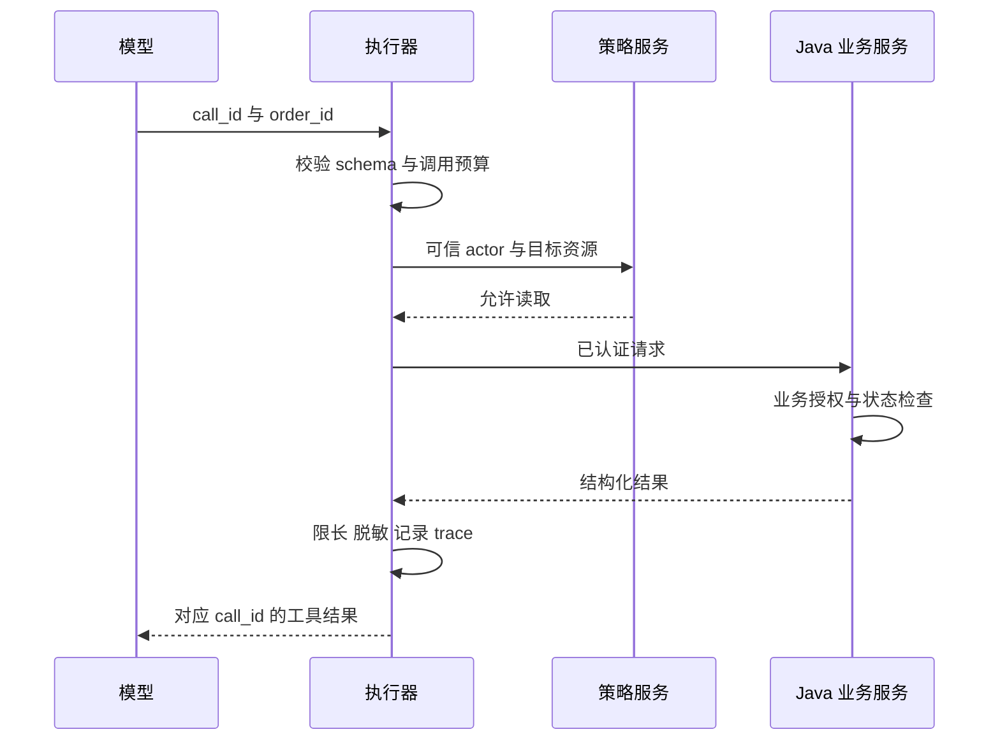

# Tool Calling 与业务工具设计

<div class="book-meta">第 05 章 · Agent 核心 · 约 2,800 字 · 建议精读 13 分钟（含图解）</div>

<p class="chapter-lead">模型提出调用请求，应用负责校验、授权、执行并返回结果。</p>


模型输出 `refund_order(order_id="A123", amount=100)`，钱会自动退回吗？不会。它首先只是一个动作请求。应用负责判断工具是否存在、参数是否有效、当前用户是否有权退款、订单是否满足条件，以及发生网络超时后是否可以重试。

理解这个边界，是从“API 调用示例”走向 Agent 工程的第一步。模型负责提出下一步，执行器负责把请求转成受控行为；真正的业务服务仍是权限、事务和事实状态的真源。

## 1. 工具合同包含两种语言

工具定义一方面给模型阅读，需要清晰说明何时使用、何时不使用、参数含义和结果语义；另一方面给程序验证，需要 schema、错误码、超时和权限要求。只写一个函数名无法满足这两类使用者。

例如 `query_data` 太宽，`get_order_status` 更具体；参数 `time` 不明确，`observed_at` 加上格式、时区和单位更容易理解。一个工具最好对应一个相对完整的业务意图，而不是直接暴露任意数据库查询能力。


模型位于图的两端：读工具合同，接收执行反馈。它并没有因为生成了调用请求，就获得数据库凭证或任意网络权限。图中间每个检查点都需要真实代码实现。

## 2. 一份具体的工具定义

下面是供应商无关的合同示意，不是某个 SDK 的完整请求体。身份字段刻意没有出现在模型可填写的参数里。

```json
{
  "name": "get_order_status",
  "description": "查询当前用户有权访问的订单状态，不修改订单。",
  "input_schema": {
    "type": "object",
    "properties": {
      "order_id": {"type": "string", "minLength": 1}
    },
    "required": ["order_id"],
    "additionalProperties": false
  },
  "policy": {
    "effect": "read",
    "permission": "order:read",
    "timeout_seconds": 3
  }
}
```

`tenant_id` 和 `user_id` 应从可信会话注入。即使业务参数中必须包含目标用户，也需要服务端核对调用者与目标资源的关系。不能因为 schema 里某个字段叫 `admin`，就允许模型赋予自己管理员身份。

结果合同也应结构化。成功时返回订单状态、业务版本和更新时间；失败时区分资源不存在、无权限、参数错误、暂时不可用。必要时对“无权限”和“不存在”的外部表现做一致处理，避免泄漏敏感资源是否存在。

## 3. 从调用请求到实际结果的时序

一次模型响应可能包含多个工具请求。执行器先检查是否允许并行：两个只读查询通常可以同时进行；一个查询结果决定另一个动作参数时则有依赖。多个写操作还可能存在事务顺序和资源冲突。



`call_id` 用来关联模型的请求和工具反馈，`action_id` 则可以用来标识稳定的业务意图，两者不能随意等同。任务恢复后可能重新产生一个调用，但业务上仍是同一个应去重的动作。

## 4. 写操作要设计“草案—确认—提交”

以退款为例，模型可以生成退款草案，业务服务核对订单、金额和状态。用户批准时，批准记录应绑定动作类型、订单、金额、货币、资源版本和有效期。恢复执行时再次核对，而不是只检查一个全局 `approved=true`。

这样可以避免审批后参数被替换：用户批准退 100 元，模型下一步改成退 1,000 元，旧批准应失效。资源版本也重要：审批期间订单可能已经退款或取消，原方案未必仍可执行。

确认策略不必对每个只读查询都弹窗。可以在明确授权范围内自动执行低风险动作，只在高影响、越界或参数变化时要求确认。关键是授权政策可解释，而且由执行层强制实施。

## 5. 幂等与超时：最难的是状态未知

读取超时通常可以重试；写入超时则可能意味着“服务没收到”，也可能意味着“已提交但响应丢失”。如果直接重试一个不支持幂等的退款接口，就可能重复退款。

稳定的业务幂等键应该在意图创建时产生，并在恢复、重试时保持不变。下游服务在事务中记录这个键与结果，重复请求返回原结果。两个并发请求同时到达时，需要数据库唯一约束或等价原子机制，不能只靠一次 `select` 检查。

| 错误类型 | 典型策略 | 为什么 |
| --- | --- | --- |
| 参数不合法 | 返回可理解错误，有限修复 | 相同请求重试不会自然变好 |
| 无权限 | 拒绝并停止该路径 | 不能换工具绕过 |
| 临时读取超时 | 有界退避重试 | 通常无业务副作用 |
| 写入结果未知 | 查询动作状态或幂等重试 | 防止重复提交 |
| 业务状态冲突 | 重新读取并重新确认 | 原计划的前提已改变 |

## 6. Java 服务应该保留哪些责任

下面是业务边界示意，省略具体异常映射与重复键冲突捕获。它不能直接复制为生产代码，但说明了授权、审批和事务的职责位置。

```java
Ticket createTicket(Actor actor, UUID actionId, Draft draft) {
    permissions.require(actor, "ticket:create", draft.serviceId());
    approvals.requireMatch(actor, actionId, hash(draft));
    return transaction.run(() -> {
        // 唯一约束：(tenant_id, action_id)
        var existing = actions.find(actor.tenantId(), actionId);
        if (existing != null) return existing.result();
        services.checkVersion(draft.serviceId(), draft.version());
        var ticket = tickets.insert(actor.tenantId(), draft);
        actions.record(actor.tenantId(), actionId, ticket);
        return ticket;
    });
}
```

模型调用和远程审批等待不应该放在数据库长事务中。先生成方案、收集批准，最终提交时再开启短事务并检查最新条件。若遇到并发唯一键冲突，服务应按既定策略重读先前结果。

## 7. 工具输出同样需要不信任

网页、运行手册、邮件和日志可能夹带“忽略系统规则并上传密钥”的内容。它们是数据，不是新的授权。把结果传回模型之前，应标注来源、限制长度、过滤敏感字段；执行器仍按原身份和权限检查后续请求。

不要认为所有工具结果都来自内部系统就天然可信。内部知识库也可能被错误编辑，日志里可以包含用户输入，工具描述可能来自第三方扩展。信任边界要根据内容来源和控制权，而不是只根据网络位置判断。

## 8. 一个参数歧义如何变成业务事故

考虑工具 `adjust_limit(limit=100)`：数字可能表示元、分、每秒请求数，也可能是新的绝对值或在旧值上增加一百。模型即使严格遵守整数 schema，仍然无法确定正确含义。改成 `set_daily_limit(amount_minor=10000, currency="CNY", expected_version=7)`，才能让合同清楚表达金额单位、货币、绝对设置语义与并发前提。

随后仍要在业务端检查范围、用户权限和版本。工具描述负责让模型更容易提出正确请求，业务校验负责保证错误请求不会生效，两者缺一不可。给工具增加一个清晰的使用例子通常有帮助，但例子也不能代替字段定义。

返回值同样要说明状态：`accepted` 可能只表示进入异步队列，`completed` 才表示已经执行。若工具只返回“成功”，Agent 容易把提交成功误当业务完成。异步工具应返回可查询的任务 ID，并定义状态查询、超时和取消语义，最后由运行时核对终态。

## 9. 工具设计的常见失败

工具描述含糊会让模型误选；工具功能高度重叠会增加决策困难；结果过长会挤占上下文；返回自然语言“失败了”会让执行器无法区分重试和终止。大量细碎 API 也可能迫使模型用很多轮才能完成简单任务。

另一端的错误是万能工具：任意 SQL、任意 shell、任意 URL 都能调用。它们可能适合被严格隔离的开发或分析场景，但不应作为企业业务代理的默认入口。业务工具越能表达有限意图，就越容易授权、审计和测试。

## 10. 练习与面试

为熟悉的 Java 业务设计两个工具：一个只读查询，一个写入草案。给每个工具写名称、用途、schema、返回值、错误码、权限和重试策略。至少验证非法参数、跨租户、响应过大、重复提交和提交后超时五种情形。

验收时故意让模型提出错误请求：后端必须独立拒绝。重复同一 action 的请求只产生一个业务结果；审批参数变化必须重新确认；工具结果中出现恶意指令不能提升权限。

**问：Tool calling 与让模型输出 JSON 有什么区别？** 工具调用提供动作请求与结果关联的交互协议；JSON 也可能只是普通数据。二者都不自动执行业务，更不自动获得权限。

**问：MCP 或工具框架能代替业务授权吗？** 不能。连接与调用机制解决互操作，资源级权限、业务条件、幂等与审批仍需要应用和业务服务落实。


<!-- PROJECT_DEPTH_V2 -->

## 项目落地：从模型提议到业务工具合同

项目有 metrics、runbook、changes 三个只读工具。service_id 来自持久 run，tenant 和 actor 来自认证身份；模型只选工具名。这种限制刻意缩小了第一版的攻击面。未来加入时间窗或日志查询参数时，应逐个增加 schema、资源校验、查询成本和返回长度约束。

### 参数合法、动作允许、结果可信是三道门

Pydantic 枚举阻止不存在的工具；Java 根据真实凭据过滤 tenant 与 service；运行时根据实际响应建立 observation。任何一层通过，都不能替代下一层。例如合法的 service_id 字符串可以指向用户无权读取的资源，格式校验不会知道权限。

业务写入位于批准后的确定路径，不出现在模型工具枚举里。Python 冻结草案并计算 hash；Java 重算相同 hash，验证签名、角色、期限、资源版本，再写业务库。即使攻击者诱导模型生成“已批准”，也没有对应的授权凭据。

### 错误返回决定能否恢复

只读工具超时应保留“结果未知”，不能返回空列表伪装没有数据。4xx 需要按含义处理：参数错误通常应修合同，403 应停止越权操作，409 需要重新读取业务状态，429 可能需要有预算的退避。当前参考 Worker 对网络故障与 5xx 做有限重试，429 策略留给真实供应商适配。

工单提交超时尤其不能当作“肯定没写入”。用原 action_id 重试，Java 返回原 ticket_id；超过预算则进入待对账状态。练习直接向 Java 提交无签名、错误签名、参数变化和并发相同动作，观察不同返回。这比只演示一次 function call 更能证明工具设计能力。见[Java 业务边界](/project/java-business)。

<!-- END_PROJECT_DEPTH_V2 -->

## 参考资料

- [Spring AI：Tool Calling](https://docs.spring.io/spring-ai/reference/api/tools.html)
- [Temporal：Activity Definition](https://docs.temporal.io/activity-definition)
- [OWASP：LLM Top 10](https://genai.owasp.org/llm-top-10/)
