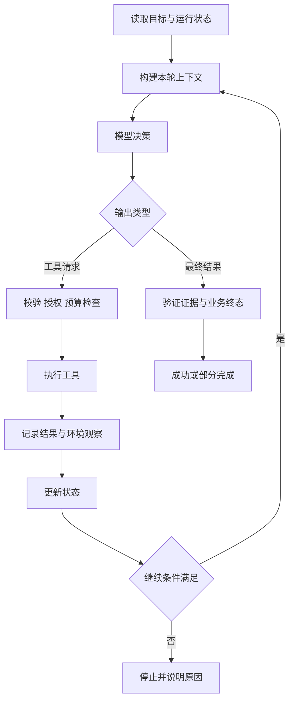
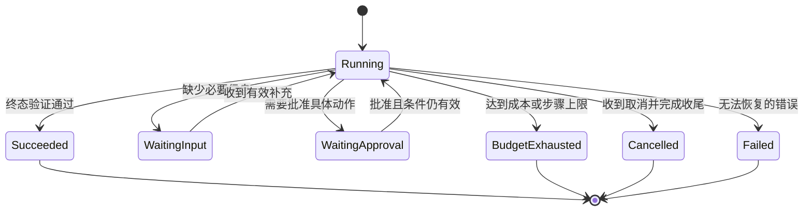

# Agent Loop、规划与停止条件

<div class="book-meta">第 06 章 · Agent 核心 · 约 3,212 字 · 建议精读 14 分钟（含图解）</div>

<p class="chapter-lead">一个可控的 Agent 是有状态、有预算、有工具和可验证终点的决策循环。</p>


假设助手检索不到故障原因，它可以继续搜索、换一个关键词、读取日志、请求补充信息，或者停止。哪一个决定是合理的？这个问题比“怎么调用模型”更接近 Agent 的本质：系统需要根据环境反馈选择下一步，并知道什么时候已经完成、什么时候应该交还控制权。

一个可用的 Agent 并不只是 `while True` 外面包一层模型。它需要明确状态、工具协议、预算、验证器和终止语义。这些围绕模型的基础结构通常称为 harness。

## 1. 最小循环有哪些责任

每轮开始时读取当前目标与状态，构建必要上下文；模型返回最终结果或工具请求；执行器验证请求并调用工具；观察结果进入状态；接着决定下一轮或结束。控制器负责推进，模型只承担允许它决定的部分。



图中的两个验证点不同：执行前验证动作是否允许，结束前验证任务是否真的完成。模型说“工单已创建”不能代替查询工单是否存在；格式正确的工具请求也不能代替权限检查。

## 2. ReAct 的工程含义

ReAct 常被用于描述决策、行动与观察交替的方式。实现时重要的是让下一次决策能够使用真实环境反馈，而不是只依赖模型自己写出的假设。检索工具返回空结果，应当成为明确观察；不能让模型把“应该有一份手册”当作“已经找到了手册”。

工程日志应记录调用请求、参数、结果、证据、状态和简短决策说明。系统不需要、也不应依赖能够获取模型私有思维链这一假设。用于排障的是可观察轨迹与业务结果，而不是一段看起来详尽的推理叙述。

同样，模型输出“我将检查日志”只表示计划。只有工具执行成功并返回日志，才能把这一步标记为完成。把承诺与事实混在一起，会让后续步骤建立在不存在的证据上。

## 3. 一个逐步运行的案例

支付服务告警任务可以经过以下过程：第一轮模型根据告警请求查询监控；返回结果显示连接等待时间升高。第二轮它检索连接池手册，得到两个可能原因。第三轮读取最近配置变化，发现连接数上限被调低。第四轮输出带证据的诊断与工单草案。

在这个例子里，第二轮的工具选择依赖第一轮观察；如果监控显示数据库本身异常，后续路径应该不同。固定脚本也可以覆盖常见分支，但面对开放式资料查证，动态路径可能更灵活。

如果第三轮工具超时，系统应记录“未知”而不是推断“没有变更”。它可以在预算内重试，或返回当前证据与缺口。Agent 的价值不在于每次都坚持输出确定结论，而在于能根据已有证据做合适的下一步。

## 4. 规划是暂时假设，不是已经完成的事实

复杂任务可以先生成计划，例如“检查监控、比对变更、查手册、提出方案”。计划有助于分解目标，但它可能包含不存在的工具、错误依赖或过大的步骤。每个步骤都要有前置条件、允许能力和完成标准。

执行中出现新事实时可以重规划。为了避免不断重写计划却没有进展，应记录已验证事实、完成产物和未解决问题。将“修改计划的次数”也纳入预算，尤其在长程任务中。

| 模式 | 适合情形 | 新增代价 |
| --- | --- | --- |
| 单循环 | 小型动态任务 | 状态简单，但长任务易膨胀 |
| 先计划再执行 | 多阶段且依赖较清楚 | 计划验证与重规划成本 |
| 固定工作流包 Agent | 业务边界严格，内部查证开放 | 需划分确定与动态部分 |
| 多 Agent 分工 | 独立子任务或权限域 | 通信、汇总、冲突与预算 |

优先采用能解释清楚的最小模式。只有观察到单循环被上下文、权限或并行性限制时，再增加复杂结构。

## 5. 停止条件应该成为显式状态

停止不只有成功和异常。任务可能缺少必要信息、等待批准、被用户取消、预算耗尽、遇到业务拒绝或只完成部分目标。不同终态决定用户看到什么、是否可以恢复、哪些副作用已经发生。



等待状态不是失败，也不应让 HTTP 线程一直阻塞。持久化当前状态后释放执行资源，等到新事件再恢复。取消也不等于撤销：此前已经创建的工单或发送的消息，需要另外定义补偿或撤销机制。

## 6. 用多种预算防止失控

总步数限制简单但粗糙；总耗时限制保护用户体验；token 与费用限制保护资源；工具重试次数限制保护下游。它们应该同时存在，并由执行层统一计数。模型自觉节约只能作为辅助提示。

还要检测无进展循环。例如同样的工具和参数反复返回相同内容；计划多次变化却没有新证据；模型不断生成格式错误结果。可以记录动作签名、结果摘要和任务进展，达到阈值时停止或切换策略。

不要把所有重试放在同一个层次。HTTP 客户端可能自动重试，工具包装器也重试，Agent 看见失败再重试，叠加后次数会远超预期。预算需要涵盖底层调用，并区分一次模型轮次与真实外部尝试次数。

## 7. 一个职责明确的循环骨架

下面是伪代码，用于说明接口边界。持久化、取消、超时和工具适配器需要在项目中实现。

```python
async def run(state, model, tools, store, policy):
    while state.can_continue():
        reply = await model.generate(build_context(state))
        state.charge(reply.usage)

        if reply.is_final:
            verdict = await verify_outcome(state, reply)
            return await store.finish(state.run_id, verdict)

        call = validate_tool_request(reply.tool_call)
        await policy.authorize(state.actor, call)
        action = await store.record_intent(state.run_id, call)
        if action.needs_approval and not action.approved:
            return await store.pause(state.run_id, action.id)

        result = await tools.execute(call, action_id=action.id)
        state = await store.append_result(state.run_id, result)
        if detect_no_progress(state):
            return await store.finish(state.run_id, "no_progress")

    return await store.finish(state.run_id, "budget_exhausted")
```

这里 `verify_outcome` 与模型分开，是因为完成与否应该有独立检查。`record_intent` 在执行前出现，是为了恢复时识别动作；但仅记录意图还不够，下游写操作仍需要幂等。

## 8. 将错误反馈变成下一步可用信息

工具失败后，只返回一句“出错了”会迫使模型猜测。结构化结果可以包含错误类别、是否可重试、已知副作用状态和安全的修复提示。参数格式错误可以允许重新构造一次；权限错误应停止该路径；写入结果未知则需要查询动作状态，而不是让模型随意重复提交。

这也说明反思必须连接可执行反馈。验证器如果指出“引用 ID 不在已授权证据中”，模型可以删除无依据结论或重新检索；如果只给一个低分，下一轮未必知道如何改进。反馈越接近真实违反的合同，纠错越容易被验证。无论反馈多具体，都不应绕过原有授权或增加无限重试。

## 9. 常见故障与定位顺序

Agent 反复搜索，先看每轮是否获得新证据、是否有明确完成标准。工具成功但任务失败，检查结果是否正确关联到调用、是否被上下文截断、是否被状态更新覆盖。任务报告成功但业务没变化，检查终态验证是否只是阅读模型文本。

规划越详细越慢，可能是计划粒度过细或每步重复读取相同上下文。反思循环没有收益，可能是评价器没有独立证据。调试时先缩短为可观察的单循环，用固定工具结果复现，再逐步增加真实环境变化。

## 10. 练习、验收与面试

实现最多六轮的运行手册助手。准备正常完成、空检索、工具超时、重复结果、用户取消、缺少批准六类案例。每轮输出结构化 trace，包含调用、结果、预算变化和状态转移。

验收时，任意一种失败都必须在有限时间内进入明确状态；不能因为模型持续请求而绕过预算；成功必须有可验证产物；部分完成要说明已做事项与未完成原因。再尝试移除计划步骤，比较是否真的影响成功率。

**问：无限反思是否能持续提高质量？** 不能保证。没有新证据或独立验证时，重复推理可能放大先前错误，同时增加费用。反思应有明确目标、可执行反馈和预算。

**问：为什么先手写循环再学框架？** 因为这样能区分模型协议、状态管理、权限与工具执行的职责。框架可以节省实现，但不能代替这些设计判断。


<!-- PROJECT_DEPTH_V2 -->

## 项目深挖：真正运行的 Agent 控制器

本章前面的循环骨架用于解释职责；项目中的 `Worker.step` 与 `Worker.once` 则是完整可运行实现。它们将模型决策、外部工具和状态提交拆成明确边界。逐段源码与状态表见[Agent 运行时](/project/agent-runtime)。

### 决策自由度需要由业务限定

当前模型只能选择 metrics、runbook、changes，或者返回 draft、needs_input。它不能直接请求工单提交。这样“先调查、后审批、再写入”的关键顺序由控制器保证；模型仍可以在调查内部决定下一步。确定性基线则固定同样的四步，方便隔离系统错误与模型错误。

自由度越大，越需要明确不变量。例如允许模型动态查询任何服务，必须增加资源授权；允许它调用 shell，必须增加沙箱与出口控制；允许多 Agent 分工，必须定义各自预算和结果合并。不能只增加 prompt 中的工具说明，却保留原来的权限边界不变。

### 观察不是推理文本

observations 存真实工具返回，未完成的计划不会伪装成观察。指标与变更带业务证据 ID，手册带版本与内容 hash。模型提交草案时，执行器检查所有引用属于已取得结果，并覆盖所需证据类型。

这是一种结构性验证。它不能证明“连接上限下降导致排队”这个因果判断，尤其在同时存在多个变更时。因此实际结果是调查假设，而不是自动回滚命令。语义质量通过样本评测和人工复核补足，不能靠一个 evidence_ids 列表宣布已解决幻觉。

### 无进展和有限重试为什么分别处理

重复选择已有工具意味着当前策略没有产生新信息，参考实现立即停止。网络错误则可能在重试后成功，两者不能共用同一个无限循环。失败的外部尝试被记录并受次数限制，等待时间持久化；参数错误和伪造引用不自动重试。

如果未来允许重查同一指标，应把时间窗纳入动作签名，只有时间或参数确实变化才算新观察。计划重写也应有次数限制。一个 Agent 不断“重新规划”并不表示它在前进，必须看到新证据或新产物。

### 停止条件要对用户负责

预算耗尽应展示已取得证据与尚未完成的部分；缺手册进入 needs_input；批准拒绝进入 cancelled；提交结果未知进入 reconciliation_required。不能全部折叠成一个 failed，因为用户需要知道是否可以安全重试、是否可能已经产生副作用。

动手修改 max_steps 为 1，确认任务只取得有限观察就停止；再让 mock 模型重复请求 metrics，确认不会无限打下游；最后运行真实崩溃测试，观察业务提交恢复。三个实验分别证明预算、进展与副作用边界。

<!-- END_PROJECT_DEPTH_V2 -->

## 参考资料

- [Anthropic：Building effective agents](https://www.anthropic.com/research/building-effective-agents)
- [LangGraph：Persistence](https://docs.langchain.com/oss/python/langgraph/persistence)
