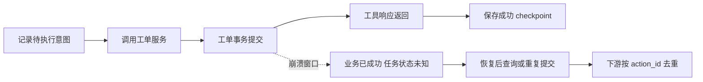
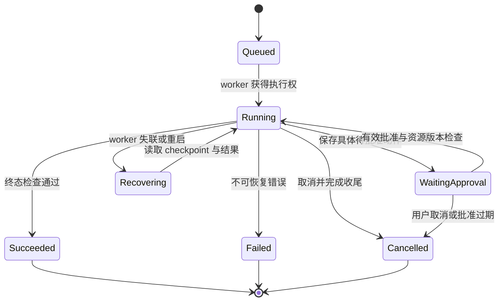

# 状态机、Checkpoint 与持久化运行

<div class="book-meta">第 07 章 · Agent 核心 · 约 3,092 字 · 建议精读 14 分钟（含图解）</div>

<p class="chapter-lead">将一次对话升级为能暂停、恢复、审计的任务。</p>


一个 Agent 已经成功创建工单，但在把工具结果写入任务状态之前，worker 被重启了。恢复后，它看见“创建工单尚未完成”，于是再创建一次。使用了数据库，也保存了 checkpoint，为什么仍然重复？因为任务进度和外部业务副作用属于不同的提交边界。

本章围绕这个崩溃窗口展开。目标是理解长任务如何建模、怎样暂停与恢复、框架能帮助什么，以及哪些一致性问题仍然必须由业务服务解决。

## 1. 先区分几个标识

`thread_id` 表示会话范围，`run_id` 表示一次执行，`step_id` 表示执行步骤，`action_id` 表示稳定业务意图。一个会话可以有多次 run；一个 run 可以重试多个 step；同一个 action 可能在重试中被多次提交，但预期只产生一个业务结果。

`tenant_id` 与 `actor_id` 来自可信身份，不由模型决定。把这些 ID 混为一谈，会让恢复、审计和幂等变得困难。例如每次重试都生成新的 action_id，就无法让下游识别“这仍是同一个创建工单动作”。

```json
{
  "run_id": "run_104",
  "thread_id": "thread_27",
  "tenant_id": "tenant_a",
  "state_version": 12,
  "status": "waiting_approval",
  "goal": "诊断支付告警并创建工单",
  "evidence_refs": ["metric_8", "runbook_17"],
  "pending_action": {
    "action_id": "act_501",
    "type": "create_ticket",
    "parameters_hash": "sha256:example"
  },
  "remaining_steps": 3
}
```

这是数据合同示意。真实状态还可能包含截止时间、预算、配置版本、最后事件序号和取消标记。大型工具结果不要全部塞入状态表，可保存对象引用与必要摘要。

## 2. Checkpoint 负责恢复运行，不代表业务已经提交

Checkpoint 是某个运行时刻的状态或进度记录。它可以让任务在故障后从最近保存的位置恢复，而不必重做所有模型调用和检索。但保存 checkpoint 的数据库，不一定与工单数据库属于同一事务。



图中最关键的是 C 到 E 之间：业务事实已经变化，任务进度还没确认。这不是罕见异常，而是分布式系统必须设计的正常故障模型。无论是否采用 Agent 框架，都需要处理它。

## 3. “恰好一次”要说清边界

队列至少一次投递、worker 重试和恢复重放，都可能导致动作被重复尝试。“只执行一次”很难跨任意外部系统直接保证。更实用的目标是：在明确业务边界内，通过稳定意图和原子去重，让重复尝试只产生一次期望副作用。

下游可以建立 `(tenant_id, action_id)` 唯一约束，在创建业务记录时一起保存结果。重复请求先查已有结果；并发冲突由数据库约束裁决，再读取胜出的结果。如果幂等记录与业务写入不在同一原子边界内，仍会出现新的崩溃窗口。

| 能力 | 解决的问题 | 不能自动解决 |
| --- | --- | --- |
| Checkpoint | 恢复编排进度 | 外部写操作重复 |
| 幂等键 | 识别相同业务意图 | 错误参数或错误授权 |
| 事务 outbox | 本地业务与待发事件一致 | 任意远程服务的原子提交 |
| 补偿 | 用业务动作修正已发生结果 | 让所有历史副作用消失 |

“用了 Temporal/LangGraph，所以恰好一次”不是完整回答。正确表述需要指出持久化边界、重试语义、外部动作去重方式及演练结果。

## 4. 状态机让暂停和恢复有明确语义

任务状态至少应该区分排队、运行、等待输入、等待批准、成功、失败、取消和预算耗尽。每条转换都有触发事件与校验条件。状态版本可以用于防止两个 worker 同时推进同一个任务。



批准不是“恢复任务”的充分条件。恢复时还要检查批准者身份、参数摘要、有效期和资源版本。如果工单草案在等待期间被修改，原批准不能继续适用。

## 5. 两个 worker 同时恢复怎么办

假设 worker A 暂时失联，调度器把任务交给 B；A 又恢复网络。如果二者都继续执行，会产生并发状态更新。可以使用租约和心跳判断执行权，但租约本身也要防止旧持有者在过期后继续写入。

一种方式是在状态更新中使用版本号或 fencing token：每次获取执行权产生更高的令牌，存储层拒绝旧令牌写入。简单场景可以采用乐观锁，只有预期版本一致时才更新。具体策略取决于运行时，但“一个 run 只有一个有效推进者”必须得到实现。

下面是条件更新示意，数据库语法可按实际系统调整。

```sql
UPDATE agent_runs
SET state_json = :new_state,
    state_version = state_version + 1,
    updated_at = CURRENT_TIMESTAMP
WHERE run_id = :run_id
  AND tenant_id = :tenant_id
  AND state_version = :expected_version;
-- 受影响行数必须为 1；为 0 表示冲突或记录不可访问。
```

冲突不能简单吞掉继续执行。应重新读取状态，判断动作是否已完成、执行权是否已转移，再决定退出或重新计算。

## 6. 重放与非确定性

模型输出、当前时间、随机数和外部 API 都具有非确定性。如果恢复时重新调用它们，可能得到不同计划。持久化系统通常需要明确哪些结果被记录，哪些计算可重放，哪些外部副作用必须放在受控执行单元中。

对 Agent 而言，至少保存已经接收并用于推进的模型结果、工具结果引用和业务动作 ID。不要只保存最终聊天内容，否则很难判断中间哪些动作已经发生。

可复现也不等于无限保存敏感内容。原文、摘要、hash 和对象引用各有不同排障能力与隐私成本。按任务需要选择，并设定访问控制和保留时间。

## 7. 升级代码时旧任务怎么办

长任务可能跨越多次发布。新代码可能无法解释旧状态字段，工具 schema 可能改变，prompt 可能采用不同规则。发布单元应包含代码、状态 schema、工具定义和关键配置版本。

可以选择让旧任务继续使用旧 worker，或设计显式状态迁移。迁移必须可测试，并保留足够信息判断是否能安全继续。不能把旧任务读失败统一当作新任务重新执行，因为旧任务可能已经产生外部副作用。

特别是 memory 或知识索引更新后，恢复的模型可能看到新的材料。是否允许使用新证据，应根据任务合同决定；关键审批和业务参数通常仍需与已记录版本对应。

## 8. 等待审批期间，系统到底保存什么

等待状态至少应保存动作 ID、参数摘要、目标资源版本、申请者、允许批准的角色、到期时间以及后续恢复位置。审批事件本身也可能被重复投递，所以恢复处理需要事件去重，并通过状态版本保证只有一次有效转换。

假设用户批准后又立即取消，两个事件几乎同时到达。系统需要明确顺序规则：以已持久化的事件顺序或业务状态版本裁决，不能让两个 worker 各自按本地到达顺序执行。若写操作已经提交，取消事件应转成“停止后续步骤，并说明已发生动作”，而不是伪造撤销结果。

还应区分任务截止时间与批准有效期。任务仍可继续，并不代表某个旧批准永远有效；批准有效，也不代表整个任务还有剩余预算。恢复入口应重新检查两类条件，并把不满足的原因返回给用户。

## 9. 故障演练要切到正确位置

最有价值的演练不是只在任务开始前关闭服务，而是在提交边界注入故障：工具请求发出前、业务已提交后、结果返回后、checkpoint 保存前，以及审批等待时。每个位置对应不同的不确定性。

观察三个真源：任务状态、工具审计、业务数据库。若任务显示失败而业务已经成功，系统需要查询与对账；若业务重复，则优先检查稳定 action_id 和原子去重；若状态回退，检查并发推进与版本控制。

## 10. 练习与面试

实现一个创建工单任务，提供“提交成功但响应丢失”的故障开关。分别运行四组：无 checkpoint/无幂等、有 checkpoint/无幂等、无 checkpoint/有幂等、二者都有。比较重做步骤数与最终工单数量。

验收标准：同一 action 不产生重复工单；审批等待不长期占用请求线程；重复恢复不会倒退状态；旧 worker 无法覆盖新版本；每次最终结果都能对上业务数据库。

**问：checkpoint 能防止重复扣款吗？** 不能单独保证。它保存编排进度，扣款服务仍需支持稳定幂等或相应事务协调，并验证提交后的崩溃窗口。

**问：取消任务为什么不能直接标为已撤销？** 取消只限制后续推进，已经发生的外部副作用需要独立的撤销或补偿动作；有些动作本身不可逆。


<!-- PROJECT_DEPTH_V2 -->

## 项目深挖：持久运行的三个原子边界

第一处原子边界是领取：选择任务与写入 owner、fence、lease_until 在同一短事务内。第二处是 checkpoint：保存新状态与事件同一事务提交。第三处是 Java 工单：业务内容、动作键和结果同一事务提交。三个边界之间存在网络和进程故障，不能假装它们组成了一个大事务。

### 为什么一个 lease 字段还不够

租约表示某段时间内允许某个 Worker 推进，但旧 Worker 不一定在到期时停止运行。保存结果时必须检查 fence。参考 `Store.save` 要求 owner、fence、未过期租约和允许状态全部匹配；更新零行就是失去执行权，而不是随意再试一次 UPDATE。

取消也会递增 fence，使正在运行的只读步骤不能在稍后把任务改回 queued。已经进入 committing 则不支持“取消后保证没发生”的接口语义，因为网络另一端可能已提交。UI 应提示先查询结果，再按业务流程撤销或关闭工单。

### 恢复点与重试点不是同一回事

每一步观察完成后保存 checkpoint，意味着恢复时不必重新调用此前成功的只读工具。但如果故障发生在工具返回之后、checkpoint 之前，这个工具可能再次读取。对动态指标应接受版本变化并记录实际结果；对写入则依赖稳定 action_id 去重。

项目在 run 创建时生成 action_id，而不是在每次提交函数中随机生成。测试让旧 Worker 成功调用 Java 后直接退出，此时状态停在 committing；新 Worker 等租约到期后重试相同动作，最终拿到同一个 ticket_id。这是可运行的恢复证据，见[故障演练](/project/troubleshooting)。

### Schema 演进也是恢复的一部分

假设版本 2 保存的新状态加入 waiting_external，版本 1 的 Worker 不认识它，直接回滚旧二进制并不能恢复。应该给状态或配置加版本，设计向前兼容读取、迁移和旧任务排空策略。当前项目记录代码版本，尚未实现跨版本自动迁移；这应作为部署前的明确工作项。

### Exactly-once 的准确表达

本项目不保证 HTTP 请求只发送一次，而是让同一个 action_id 在本地 Java 工单事务边界内只产生一个业务结果。队列与 Worker 可以重复尝试。对于外部通知、第三方 SaaS 或非幂等设备，必须重新设计结果查询与补偿，不能沿用一句“已经有 checkpoint”。

练习在领取后制造超时，再让新 Worker 推进，验证旧 fence 无法回写；然后将错误实现改为只按 run_id 更新，观察为何会覆盖新状态。对比比抽象背诵租约概念更有效。

<!-- END_PROJECT_DEPTH_V2 -->

## 参考资料

- [LangGraph：Persistence](https://docs.langchain.com/oss/python/langgraph/persistence)
- [Temporal：Activity Definition](https://docs.temporal.io/activity-definition)
