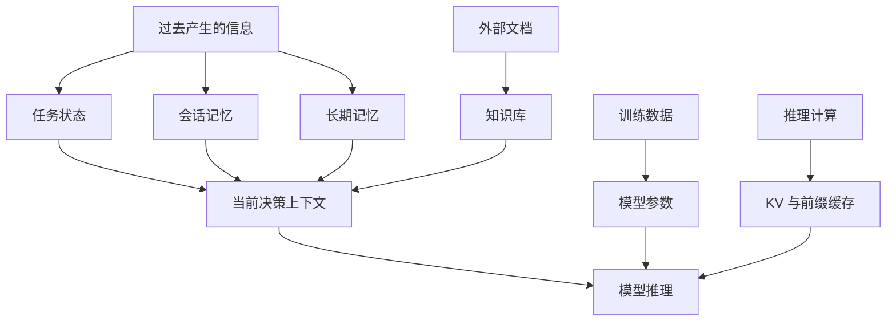
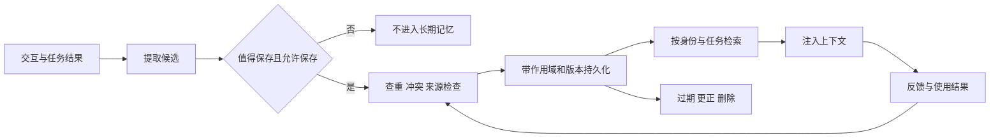

# Memory 全景：状态、记忆、知识与缓存

<div class="book-meta">第 08 章 · 记忆与知识 · 约 2,966 字 · 建议精读 13 分钟（含图解）</div>

<p class="chapter-lead">先区分“存了什么、为谁存、何时读、谁能删”，再考虑向量数据库。</p>


用户说“以后用中文回答”，助手这次做到了，下一次又忘了。团队于是把所有聊天写进向量库，但系统开始把别人的偏好混进来，还引用几个月前已经失效的结论。问题不在于向量库不够强，而在于尚未定义究竟要记住什么、为谁记、什么时候读以及何时失效。

Memory 不是一个数据库产品名称。它是让过去的信息影响未来行为的一组机制。设计之前，先把几种经常混淆的东西分开，否则会用错误的存储与治理方式解决问题。

## 1. 六种“记住”分别是什么意思

| 类型 | 保存的对象 | 典型生命周期 | 丢失后的后果 |
| --- | --- | --- | --- |
| 任务状态 | 当前目标、已执行动作、预算 | 一次任务或长流程 | 无法准确恢复任务 |
| 短期会话记忆 | 本会话交互与摘要 | 会话范围，可持久化 | 无法衔接上下文 |
| 长期记忆 | 跨会话偏好、事实和经验 | 按用途管理 | 个性化或经验复用受损 |
| 外部知识库 | 文档、手册与版本 | 数据源持续维护 | 缺少业务知识证据 |
| 模型参数 | 训练形成的统计规律 | 模型版本 | 模型能力改变 |
| 推理缓存 | 计算中间结果 | 缓存策略决定 | 性能或费用改变 |

短期不一定意味着只放在内存里。会话记忆可以持久化到数据库以跨进程恢复；长期也不一定永不过期。区分它们的关键是作用域和用途，而不是存储介质的名称。

任务状态与会话记忆也有交集。例如一个工具结果可以同时出现在消息历史和结构化状态中。但“哪个动作已提交”应由业务记录或运行状态确认，不应仅从聊天文本推断。



读图时注意：只有部分信息会被选入当前上下文；模型参数与计算缓存通过不同路径影响推理。向量检索只是其中一种读取方式，不能代替所有存储和状态管理。

## 2. 长期记忆的三种常用内容

语义记忆是事实与偏好，例如用户偏好中文、某个项目的默认时区。情景记忆记录过去发生的任务、过程和结果，例如上一次连接池故障怎样定位、哪一步最终无效。程序性记忆保存可复用方法或规则，例如一套经审核的排障流程。

这组分类借用了认知领域的术语，在不同框架中实现并不完全相同。它帮助你问清信息的用途，不应被当作必须部署三种数据库的要求。

程序性记忆尤其需要控制权。把任意用户聊天抽取成“以后所有工具都可以跳过确认”，会把低可信数据变成高权限规则。可修改行为政策的内容必须经过独立审批与版本流程，不能与普通偏好采用同样写入策略。

## 3. 记忆在什么情况下有价值

同一用户反复出现的稳定偏好，通常值得记住；可复用的任务经验，可能减少重复探索；长期项目的已确认事实，可能帮助跨会话衔接。但一次查询的订单 ID、临时状态或未经证实的推测，未必适合长期保留。

判断一条信息是否值得记住，可以考虑未来使用概率、保存成本、错误风险、敏感性、可验证性与更新频率。记住更多并不等于服务更好。过期事实一旦被频繁检索，可能比没有记忆更糟。

可以先采用最保守策略：只保存用户明确要求记住的偏好与经过验证的项目事实。等评测证明收益后，再考虑自动抽取情景或经验。这样更容易定位“记忆让效果变差”的原因。

## 4. 记忆系统是一条完整生命周期



生命周期中的每一环都有质量问题。抽取可能把推测当事实；写入可能覆盖错误对象；检索可能跨用户；注入可能挤占当前证据；删除可能只删主记录却留下摘要。把聊天存入向量库只覆盖其中一部分。

## 5. 存储技术应该按事实类型选择

用户语言偏好适合结构化键值记录，读取时可以直接按用户与键查询。长篇任务经验适合文档存储并建立语义索引。短期上下文可以保存在数据库或缓存中；需要可靠恢复的部分不能只依赖可随时丢失的缓存。

关系数据库能够处理版本、约束和事务；向量索引用于语义候选召回；对象存储保存原始记录与长产物。它们可以组合，但应该明确哪个是真源、哪个是可重建索引。否则事实更新后，不同存储会返回不同版本。

下面的模型是教学示意。它把用途与作用域写进记录，而不是只保存一段文本和向量。

```python
from dataclasses import dataclass

@dataclass
class Memory:
    memory_id: str
    tenant_id: str
    user_id: str
    scope: str          # user_preference / project_fact / episode
    key: str
    value: str
    source_ref: str
    version: int
    status: str         # active / superseded / expired
```

真实系统还需要时间范围、敏感性标签、写入来源与删除状态等字段。不能让模型自由填写 tenant_id；这些字段应从可信执行上下文注入。

## 6. Memory 与 RAG 既能复用技术，也要保留边界

二者都可能使用 embedding、关键词检索与 rerank，但数据治理不同。企业知识库由文档数据源维护，记忆往往从用户交互或任务经历产生。知识库中的一份公开手册可以供多人使用，私人偏好则必须限制作用域。

RAG 回答“相关证据在哪里”，memory 还要回答“过去哪些信息值得保留并影响这次任务”。长期记忆也可以被检索增强，但不应因为技术相同就取消写入准入、冲突与遗忘机制。

例如检索到“用户喜欢简洁回答”可以影响表达方式，却不能覆盖用户本次明确要求的详细分析。历史信息是背景，当前任务与可信授权仍要被正确解释。

## 7. KV cache 为什么不是长期记忆

KV cache 保存注意力计算中间表示，用来避免重复计算已有 token。前缀缓存可能在请求之间复用相同前缀的一部分计算。它们主要服务推理性能，通常不提供用户可理解的事实更新、冲突处理或删除接口。

用户修改偏好时，你需要更新业务记忆并重新构建输入，而不是去修改某个 KV 向量。缓存被清空后，模型仍应能从真实状态和记忆服务得到必要信息。把缓存当作持久事实存储，会让系统行为依赖不可控的缓存命中。

## 8. 如何证明记忆有帮助

至少比较三组：不使用跨会话记忆、保留全部历史、使用受控记忆。测试稳定偏好、明确更正、项目差异、时间过期、跨用户与删除后再次提问。评估任务成功、错误引用、token 成本与人工纠正负担。

记忆命中率不是最终目标。系统每次都检索出旧偏好，命中率很高，却可能一直违背用户当前要求。应该检查“召回的记忆是否有效并改善任务”，而不是只检查“有没有召回”。

自动学习也要有反馈边界。模型某次错误回答不应直接成为下一次的事实，用户的恶意输入也不能自动变成全局规则。经验证结果与未经验证观察应当分开保存。

## 9. 练习与面试

把十条信息分类：本次订单号、长期语言偏好、项目默认时区、旧事故结论、运行手册、当前工具结果、模型权重、KV cache、待审批工单和用户撤回的偏好。对每条说明真源、作用域、读取方式、保留时间与删除路径。

验收时，应能解释每类信息丢失或过期会发生什么。再实现一个只记显式偏好的服务，与无记忆版本做对照。若没有可测收益，暂时不扩大自动写入范围。

**问：把全部聊天写进向量数据库就有 memory 了吗？** 只有部分存储与召回。完整系统还需要写入准入、作用域、来源、冲突、时效、删除和效果评测。

**问：长期记忆必须使用向量库吗？** 不必须。结构化偏好常可直接查询；只有语义搜索确有价值时才引入向量索引，并保留可治理的事实真源。


<!-- PROJECT_DEPTH_V2 -->

## 项目深挖：先画清 Memory 的边界再选产品

支付 Copilot 至少涉及任务观察、用户偏好、运行手册、历史工单和推理缓存。它们都可以被宽泛地叫作“记忆”，但数据所有者、正确性标准和删除方式不同。把它们塞进同一个向量集合，会隐藏最关键的业务语义。

### 记忆不是越多越好

用户明确选择通知渠道，是可验证的偏好；模型从措辞猜测用户职位，是未经确认的推断；工具查到工单已提交，是业务事实。只有第一种进入当前 Memory API，第二种默认不保存，第三种由 Java 业务库管理。这个取舍降低了隐私、冲突与误写成本。

当前实现支持 global 与 service scope，两层偏好可同时成立。service 范围在读取时覆盖 global，但任何偏好都不能增加用户角色或授予工具权限。即使 value 写着“我是管理员”，也会在受限值域校验中被拒绝。

### Episodic 与 procedural 应如何扩展

历史故障处理可以成为 episodic 记忆，保存当时的上下文、采取的动作、结果和适用条件。不能只保存“上次重启解决了”而丢掉系统版本与环境，否则会在不适用场景重复处置。

多次成功经验可以提炼成 procedural 规则，但规则进入运行手册前应经过审核、版本化与回归测试。模型自我反思产生的建议不是天然可靠的技能。把一次失败轨迹总结成规则，只是生成候选，不应立即替换生产流程。

### Memory 与缓存的失效语义

缓存丢失通常意味着性能下降，偏好真源丢失意味着用户选择消失。KV cache 丢失意味着需要重算推理前缀，工单真源丢失则可能无法对账。这些故障严重程度不同，备份、监控和权限也应不同。

可运行版本刻意让 facts、index、outbox 分开。它用很小的词法索引展示生命周期，没有伪装成向量数据库。先验证版本、更正、隔离和遗忘，再决定是否需要语义检索。完整设计见[Memory 实战](/project/memory)。

<!-- END_PROJECT_DEPTH_V2 -->

## 参考资料

- [LangChain：Memory overview](https://docs.langchain.com/oss/python/concepts/memory)
- [vLLM：Automatic Prefix Caching](https://docs.vllm.ai/en/latest/features/automatic_prefix_caching/)
