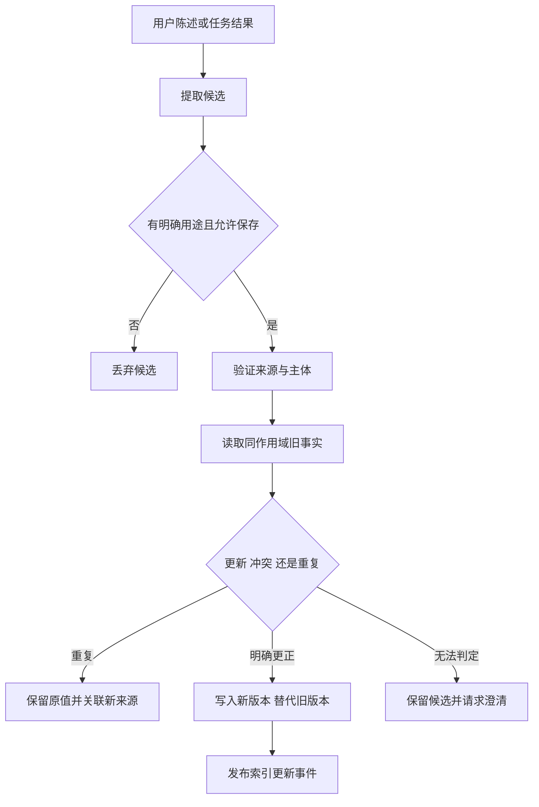
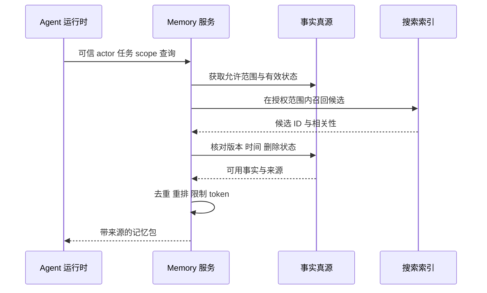

# Memory 工程：写入、冲突、检索和遗忘

<div class="book-meta">第 09 章 · 记忆与知识 · 约 2,929 字 · 建议精读 13 分钟（含图解）</div>

<p class="chapter-lead">一条记忆应该能被追溯、纠正、过期和删除。</p>


用户上周说“通知发邮件”，今天明确改为“以后只在站内提醒”。系统同时保存了两条向量记录，每次检索随机命中其中一条。于是某些任务依旧发邮件。这个问题不能靠换一个更强的 embedding 模型解决，因为缺少的是事实版本、作用域与更新政策。

Memory 工程应当按业务数据系统设计：每条记忆有身份边界、来源、时间、状态和版本；写入与读取都有准入规则；更正、过期和删除能够传播。模型可以辅助抽取和匹配，但不应成为唯一仲裁者。

## 1. 数据模型首先表达“谁的什么事实”

可以使用 `tenant_id + subject_id + scope + key` 定义事实的逻辑位置，再用 `memory_id` 与 `version` 标识具体记录。`subject_id` 可以是用户、项目或组织，但不同主体不能混淆。

```json
{
  "memory_id": "mem_204",
  "tenant_id": "tenant_a",
  "subject_id": "user_17",
  "scope": "notification_preference",
  "key": "channel",
  "value": "in_app",
  "source_ref": "message_782",
  "source_type": "explicit_correction",
  "valid_from": "2026-11-05T10:00:00Z",
  "expires_at": null,
  "version": 3,
  "status": "active"
}
```

时间字段需要区分事件发生时间与系统写入时间。离线导入一条旧消息可能在今天入库，但它不应自动覆盖用户昨天的明确更正。`confidence` 如果存在，应说明它只是系统评分；未经过校准的模型自评不能当作正确概率。

## 2. 写入准入：哪些内容根本不应记住

候选抽取可以由规则或模型完成，但候选不等于已接受事实。首先检查是否有合理用途、是否允许保存、是否包含敏感内容、来源是否可靠，以及信息是否具有未来价值。凭证和临时验证码不应因为“模型认为重要”就进入长期偏好库。

明确用户陈述通常比模型推断更可追溯。“我喜欢中文”与“用户可能是中国人”不是同一种记录。前者是表达偏好，后者是推断，既可能不准确，也可能不必要。尽量保存完成任务所需的最小信息。



图中的“请求澄清”很重要。系统不必每次都猜出唯一真相。对于金额、地址或关键业务偏好等高影响信息，承认冲突并询问，往往比自动覆盖更可靠。

## 3. 冲突并不总意味着其中一条错了

“工作项目用英语，个人学习用中文”可以同时成立，因为作用域不同。“上个月喜欢邮件，现在喜欢站内提醒”是时间演变。“用户说喜欢邮件，但模型摘要写成喜欢短信”则是来源矛盾。

处理顺序应先检查主体与作用域，再检查有效时间与来源，最后才判断覆盖。仅按最新写入时间覆盖，会让迟到数据打败新事实；仅按向量相似度覆盖，可能把两个相关但不同的事实混为一谈。

| 情形 | 建议处理 | 需要保留的信息 |
| --- | --- | --- |
| 同值重复表达 | 合并或补充来源 | 原值与新证据 |
| 同作用域明确更正 | 创建新版本，旧版失效 | 更正关系与时间 |
| 不同项目偏好 | 分别保留 | 项目作用域 |
| 不确定矛盾 | 暂不覆盖，必要时询问 | 两个候选与来源 |
| 敏感或越权写入 | 拒绝或按政策处理 | 最小必要审计信息 |

写入应使用事务或乐观并发控制，防止两个后台抽取任务同时把自己认为的最新值写进去。对于同一逻辑 key，可以限定只有一个 active 版本，或者明确支持多个候选及其状态。

## 4. 一个安全更新的伪代码

下面强调的是来源和版本，不是提供完整数据库实现。实际应用还需要敏感性策略、审计、索引同步和错误重试。

```python
async def correct_preference(actor, key, value, source, store):
    # actor 来自认证会话，source 必须属于该用户的真实消息
    await authorize_source(actor, source)
    await validate_memory_policy(key, value)
    async with store.transaction():
        old = await store.get_for_update(actor.tenant_id,
                                         actor.user_id, key)
        if old and old.value == value:
            return await store.attach_source(old.id, source.id)
        new = await store.insert_version(
            tenant_id=actor.tenant_id,
            user_id=actor.user_id,
            key=key, value=value,
            replaces=old.id if old else None,
            source_ref=source.id,
        )
        await store.enqueue_index_update(new.id)
        return new
```

`enqueue_index_update` 可以与事实变更一起写入 outbox，再异步更新索引。这样，主库已更新但索引服务暂时不可用时，系统仍有可恢复的待处理事件。读取时也应检查主记录有效状态，避免旧向量继续生效。

## 5. 读取管道先约束范围，再判断相关性

读取先取得可信身份与当前任务作用域，过滤状态和有效时间，再做关键词或语义候选召回、去重与重排。不能让模型自由输入一个 user_id 去检索全部记忆。共享项目记忆与私人用户记忆应有清晰授权关系。



图中再次核对事实真源是为了防止索引滞后。具体实现可以通过索引同步机制或查询过滤优化，但权限与删除不能只寄希望于向量结果恰好正确。

相关性也不只取决于语义相似度。任务类型、项目范围、有效期、来源可靠性都可能影响是否注入。若使用加权分数，需要通过评测选择权重，不能把任意公式当作通用最佳实践。

## 6. 注入上下文时保持“历史事实”的身份

给模型的记忆包最好包含简明值、作用域、来源和有效时间。例如“用户在个人学习场景偏好中文；来源为某次明确陈述”。这比把一段历史聊天直接拼进 system prompt 更容易保留边界。

当前用户明确要求“这次请用英文”时，应优先处理本次意图，而不是机械执行历史偏好。长期记忆是辅助上下文，不能因此扩大工具授权或修改系统政策。

还要限制注入量。召回十条相关记忆不意味着全部有必要。错误或冗余记忆会挤占当前证据，增加冲突。让每条注入都有可解释用途，并记录其是否实际改善任务。

## 7. 遗忘是一条传播流程

TTL 适合自动过期的临时信息，但不能代替用户更正与删除。删除路径应覆盖事实记录、搜索索引、缓存、派生摘要和后续上下文。对于备份，应按已定义保留与恢复策略处理，防止恢复旧备份后删除内容重新进入服务。

分布式删除通常不是瞬间完成。可以记录删除事件和状态，对读取立即施加不可用标记，再异步清理各派生副本。这个标记本身也需最小化保存内容，避免“删除审计”反而保留完整敏感值。

当摘要包含已删除事实时，只删除向量记录不够。你需要能够追踪摘要的来源，或在删除后重建受影响摘要。这也是保存 provenance 的工程价值，而不只是为了展示引用。

## 8. 评测 Memory 的正确方法

建立成组任务：第一次明确写入，第二次跨会话使用，第三次更正，第四次检查旧值失效，再切换用户验证隔离，最后删除后重复查询。额外加入迟到事件、项目差异、索引延迟和模型误抽取。

分别统计写入精确率、应记住事实的覆盖、过期/删除残留、跨域泄漏与最终任务成功。错误记忆比漏记某个低风险偏好更严重时，写入策略应更保守。不要只优化召回率。

做消融时可关闭自动写入、仅保留显式偏好、关闭语义检索或限制候选数。这样才能知道失败来自抽取、更新、检索还是上下文冲突，而不是把所有问题归因于“memory 模型不好”。

## 9. 练习与面试

实现两名用户、两个项目的偏好记忆服务。准备显式陈述、明确更正、迟到旧消息、作用域差异、TTL 到期、删除与索引滞后案例。数据不需要很多，但每个状态变化都应可审计。

验收标准：跨用户泄漏为零；旧消息不会覆盖新的明确更正；删除后任何查询都不能重新注入该事实；同一作用域的 active 状态符合设计；主库与索引短暂不一致时仍保持权限和删除约束。

**问：记忆让成功率下降，先查哪里？** 先检查错误写入、旧版本召回、作用域混淆和与当前指令冲突，再检查上下文拥挤。用消融定位具体环节，避免直接更换全部技术栈。

**问：为什么要保存来源？** 来源支持事实核查、更正仲裁、用户解释和派生数据删除。没有来源，系统很难区分用户陈述与模型猜测，也难以修复被污染的摘要。


<!-- PROJECT_DEPTH_V2 -->

## 项目深挖：一次更正如何穿过整个系统

Alice 初次设置 global.notification_channel=email，expected_version=0。API 在写事务中创建 version=1，并写入 outbox。随后更正为 in_app 时必须携带 expected_version=1；若另一个客户端已写入 version=2，旧请求返回 409，不能默默覆盖。

### 并发顺序与事件时间要同时考虑

version 解决“我读到的事实是否已被别人改过”；occurred 解决“这条消息是否比当前声明更早”。两者不同。一条迟到旧消息可以携带最新版本号，但仍然不该覆盖更新的声明。真实消息系统还需用 event_id 去重，并从可信消息源取得时间。

项目禁止远未来时间，限制 key 与 value 的枚举，source 由受认证 API 生成。这些约束让写入可追溯。模型自动抽取只能作为下一层候选生产者，不能绕过同样的准入规则。

### 索引异步更新时选择什么一致性

主记录已为 version=2，而索引仍指向 version=1，搜索时 JOIN 版本不匹配，于是返回空。它暂时损失召回，但不返回已失效值。outbox 消费后，索引指向 version=2，搜索恢复。这是一种有明确业务选择的最终一致性，而不是忽略不一致。

对于删除与权限撤销，通常更应该保守；对于低风险推荐，可能允许短暂陈旧。无论选择哪种，都应写成合同和测试，而不是让数据库同步延迟偶然决定产品行为。

### 删除为何保留 tombstone

删除清空 value/source，递增 version，移除派生索引。保留最小 tombstone 可以拒绝旧请求带 expected_version=0 重新创建。outbox 消费者每次读取当前事实，所以删除前排队的更新也不会让旧值复活。

审计只保存操作和版本，避免“删除日志”又复制完整敏感内容。备份与已有工单属于单独生命周期，当前实现没有物理擦除所有历史介质的能力。上线时应制定备份保留和恢复后删除重放流程。

### Memory 对业务输出的影响怎样验证

设置 email 后新建 run，检查草案 channel；更正为 in_app 后再新建，检查改变；跨到 Bob 读取，检查空结果；删除后消费所有旧 outbox，再搜索，检查仍为空。已经冻结的旧草案不应被静默改写，它要由用户按原 hash 审查。

完整实现与上述测试都在工程包中。建议先跑 `test_stale_index_cannot_return_replaced_value` 和 `test_delete_and_old_outbox_cannot_resurrect_memory`，再阅读代码解释每条断言保护了哪个不变量。

<!-- END_PROJECT_DEPTH_V2 -->

## 参考资料

- [LangChain：Memory overview](https://docs.langchain.com/oss/python/concepts/memory)
- [LangGraph：Persistence](https://docs.langchain.com/oss/python/langgraph/persistence)
- [OWASP：LLM Top 10](https://genai.owasp.org/llm-top-10/)
