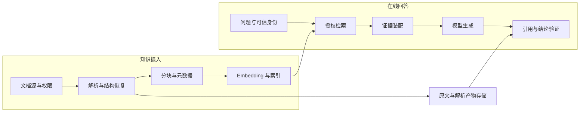
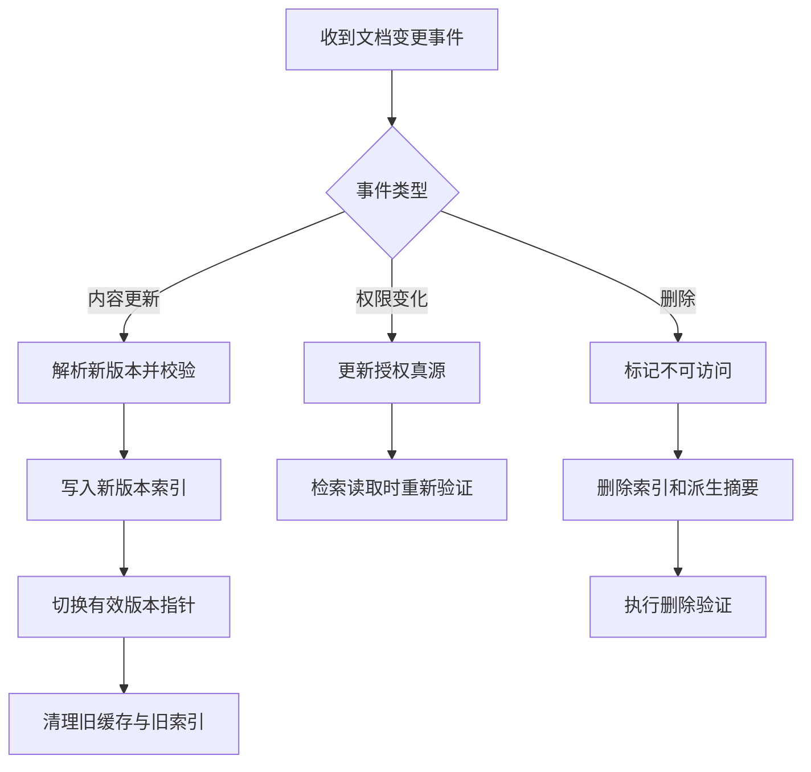

# RAG 数据工程：从文件到可引用证据

<div class="book-meta">第 10 章 · 记忆与知识 · 约 2,817 字 · 建议精读 13 分钟（含图解）</div>

<p class="chapter-lead">RAG 的下限由数据质量、更新链路和权限元数据决定。</p>


你把公司的运行手册放进向量数据库，模型却回答了已经废弃的操作步骤。这不一定是模型能力不足：可能是 PDF 表格被解析错了，也可能是新旧版本一起被召回，或者撤权文档还留在索引里。RAG 的工程问题从“怎样把问题变成向量”之前就开始了。

本章以运维知识助手为例，构建一条可以更新、删除、审计的证据供应链。目标是让答案里的每个重要结论都能追溯到当时有权访问、当时有效的原始资料。

## 1. RAG 的两个不同闭环

离线闭环把源文件转成可检索对象；在线闭环把用户问题转成答案。这里的“离线”不意味着只能每日跑一次，它也可以由文档变更事件持续触发。分开两条链路，是为了独立观察质量、时效与成本。



读图时注意两条跨链路依赖：检索需要索引，验证需要原文。只保存 embedding 而丢掉原始内容与版本，会使失败难以定位；只保存原文却不知道解析器版本，也无法解释同一个文件为何在两次构建后产生不同结果。

## 2. 文档不是一串文本

PDF、Markdown、网页、表格和代码承载的信息结构不同。运行手册中的“适用版本”“前置条件”“禁止操作”可能在标题、表格或脚注中。解析时只保留正文句子，会把这些条件丢掉。

应先得到结构化中间表示：文档由段落、标题、表格、代码块、图片说明等节点组成，节点带原文位置。对于扫描件，OCR 的字符准确率只是一个指标；表格列对应关系、单位和阅读顺序同样重要。把“连接数上限 200”解析到另一行服务名下，检索再准确也会给出危险结论。

可以给每份文档记录三类版本：源版本说明业务内容何时变化；解析版本说明使用哪个解析器与配置；索引版本说明使用哪个 embedding 模型及索引参数。它们解决的是不同问题，不能只用一个 `updated_at` 代替。

## 3. 分块为什么不能只背固定大小

假设运行手册包含一段故障现象、一段确认方法和一个重启条件。若按字符数硬切，确认方法可能进入块 A，而“只有确认连接泄漏后才允许重启”进入块 B。模型只看到 A 时，可能把重启当作通用方案。

更可靠的初始策略是按文档结构分块，给每个块补上必要的标题路径。过长章节再按段落切分；代码保持函数或逻辑段完整；表格保存表头，并在分割时携带必要列定义。Overlap 只缓解边界信息断裂，不能修复错误解析，也会增加重复召回。

| 策略 | 适合场景 | 主要代价 |
| --- | --- | --- |
| 固定 token 分块 | 结构简单的短文本，快速建立基线 | 条件与结论容易被拆开 |
| 标题与段落分块 | 手册、制度、技术文章 | 依赖结构解析质量 |
| 小块检索、父段展开 | 需要精确定位又需要完整上下文 | 在线装配和去重更复杂 |
| 表格或代码专用切分 | 参数表、数据库文档、仓库 | 需要类型专用处理器 |

选择方法时测两件事：相关证据能否进入候选，以及被送给模型后是否仍保留完整含义。只比较检索相似度，可能选出更容易命中但更容易误读的切块方案。

## 4. 一个证据块应该保存什么

下面是教学数据合同，不依赖特定向量数据库。真实 ACL 最好保存可验证的授权引用或由权限服务动态求值，不能相信来自模型的租户字段。

```json
{
  "chunk_id": "runbook-17:v4:section-3:chunk-2",
  "document_id": "runbook-17",
  "source_version": "v4",
  "source_uri": "internal://runbooks/17",
  "title_path": ["支付服务", "连接池耗尽", "确认方法"],
  "location": {"page": 6, "section": "3.2"},
  "tenant_id": "tenant-a",
  "acl_ref": "policy/runbook-17",
  "content_hash": "sha256-of-normalized-content",
  "parser_version": "parser-config-3",
  "embedding_version": "embedding-config-2",
  "status": "active"
}
```

`chunk_id` 应稳定表达“哪一个版本中的哪一个片段”。文档更新后复用旧 ID 却覆盖内容，会让历史答案的引用指向新的文字，破坏审计。可以保留版本化原文，或为历史运行保存证据快照与内容哈希。

## 5. 更新与删除如何真正生效

增量摄入不只是“发现新文件就追加”。需要识别新建、内容更新、权限更新、删除四种事件。权限更新可能完全不改变正文和 embedding，却必须马上影响在线可见性。



图中的“有效版本指针”把索引构建和对外可见分开。新版本尚未完整构建时继续使用旧版，构建成功后再切换，能够减少半更新状态。涉及敏感撤权时，应优先在授权真源阻断访问，不能等待异步索引清理完成才停止泄漏。

Embedding 模型升级通常也需要新索引，因为不同模型的向量空间不可直接混用。可以双建索引并用同一评测集比较，再切换流量。维度相同并不意味着两个模型的向量具有相同语义坐标。

## 6. 从检索结果到可验证引用

在线链路应把“证据 ID、内容、来源和有效时间”一起送入上下文。模型引用的是给定 ID，而不是自由编造一个 URL。生成后，先检查引用 ID 是否存在于本轮授权证据集合，再检查结论是否被所引内容支持。

这两种检查不能互相替代。一个引用可以真实存在，但并不支持模型给出的结论。例如引用说明“连接池满时会超时”，回答却断言“本次一定是连接泄漏”。前者是背景知识，后者需要监控或日志证据。

对于没有答案的问题，系统应明确“当前资料不足”，可以继续检索、追问或转人工。把无答案任务强行输出为完整建议，会让看似漂亮的演示掩盖风险。

## 7. 按失败层定位问题

| 现象 | 先检查 | 能帮助定位的证据 |
| --- | --- | --- |
| 文档里有答案，系统说没有 | 解析产物与分块 | 原文与解析文本对照 |
| 总回答旧版本 | 有效版本过滤和缓存键 | 文档版本、索引版本、缓存命中 |
| 召回正确但回答条件错误 | 分块边界和装配顺序 | 最终实际送入模型的上下文 |
| 删除后仍能回答私人内容 | 索引、摘要、缓存和运行快照 | 删除传播事件与授权检查 |
| 引用链接是真的但结论错 | 证据支持关系 | 逐项结论与引用标注 |

先确定哪个环节第一次偏离正确状态，再修改该环节。盲目更换生成模型，可能暂时掩盖问题，却不会修复数据管道。

## 延伸推演：一次索引发布应怎样验收

把索引当作可发布产物，而不是一个持续被随意修改的黑盒。构建完成后，先检查文档数、块数、空文本比例、来源缺失比例和权限元数据完整性，再用固定问题集查询。若一份文档突然从十个块变成一千个块，可能是解析器把每个字符当成独立节点；总向量数量上升并不代表知识覆盖更好。

新旧索引切换时，记录构建清单与有效源版本。抽取几条答案，验证其引用仍能回到对应原文。发布后的告警不仅看接口错误，还应看无结果率、旧版本命中率和引用缺失。这样才能在用户发现错误建议之前定位数据退化。

## 8. 练习、验收与面试

准备三十份脱敏手册，包含扫描件、参数表、重复版本、已删除文档和权限变化。写十个可回答问题、五个无答案问题、五个跨权限问题。记录解析成功率、更新延迟、引用有效率和任务正确性，不把它们合成一个无法解释的大分数。

验收时任选一条答案，能重建它当时使用的文档版本、分块、权限条件和生成输入；撤销权限后，新查询不能把该文档送入模型；更新一个参数后，能够说明何时开始对用户生效。

**面试追问：为什么 RAG 仍然会幻觉？** 检索只提供资料，资料本身可能缺失、过期、冲突或被误解；模型也可能从正确证据推导出过强结论。应分别验证数据、召回、装配和生成，必要时用业务系统直接验证关键事实。

原始研究可从 [RAG 论文](https://arxiv.org/abs/2005.11401)开始；它解释了参数化知识与外部检索的结合。本文的版本、权限与数据管道是面向企业系统的工程设计，不能把研究论文中的实验设置直接当成完整生产方案。

<!-- PROJECT_DEPTH_V2 -->

## 项目落地：手册从 JSON 到证据

项目的 `runbooks.json` 是受控源文档，摄入要求固定字段：id、version、tenant、service_id、title、content。相同文档同版本若内容 hash 改变，摄入拒绝，而不是悄悄覆盖。重复摄入相同内容则安全，最新数字版本成为 active。

### 为什么先做版本与 ACL

模型引用 rb-pool@2 时，系统能定位明确内容，而不是指向一个随时变化的标题。检索过滤 tenant、service_id 和 active，再返回片段与 hash。这个精确匹配基线用于验证数据链路，尚未实现复杂 chunking、OCR、BM25 或向量搜索。

当文档扩大到数千份，先增加摄入作业状态、失败隔离、来源权限、删除事件和索引版本，再选择切块。标题、列表、表格和代码块应保留结构，跨页表格尤其不能按固定字符数随意截断。每个 chunk 仍要带文档 ID、版本、位置和 ACL。

### 更新不是追加一个向量

旧手册撤销后，即使旧 chunk 仍在搜索引擎里，也不应继续进入回答。可以以主记录状态回查过滤，或在可证明的索引同步机制下使用版本门禁。发生权限变更时，还要考虑缓存和已经生成的摘要。

练习把 rb-pool 的 version 2 内容修改但不增加版本，确认摄入失败；再正确增加版本并摄入，确认检索只返回最新版。随后更改 tenant，验证不会被原租户召回。这组测试证明的是数据合同，而不是模型生成质量。见[完整知识模块](/project/source-knowledge)。

<!-- END_PROJECT_DEPTH_V2 -->
