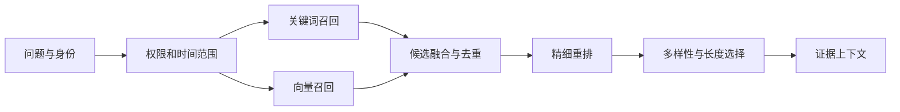
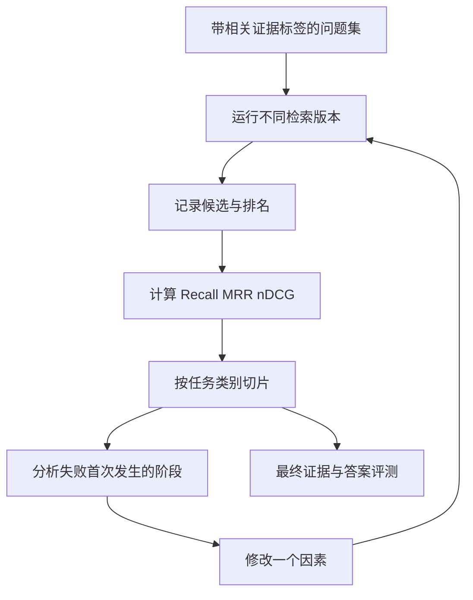

# 检索系统：Hybrid、Rerank 与搜索评测

<div class="book-meta">第 11 章 · 记忆与知识 · 约 2,794 字 · 建议精读 13 分钟（含图解）</div>

<p class="chapter-lead">检索要同时照顾语义表达、精确标识、权限和排序质量。</p>


用户问“PAY-1049 怎么处理”，向量搜索返回了一篇语义相近但错误码不同的文章；另一个用户问“订单提交后一直转圈”，关键词搜索又找不到标题叫“请求连接池超时”的手册。这两个失败分别说明：精确匹配和语义匹配解决不同问题，检索系统需要知道自己的输入分布。

本章从候选召回、融合、重排到最终证据选择，建立一条可测量的检索链路。不要以“装了向量数据库”作为完成标准，真正标准是授权的相关证据能否在预算内出现在模型眼前。

## 1. 检索是一个漏斗



图中每一步都可能丢掉正确答案。重排只能改变已经召回的候选顺序；上下文装配可能再次裁掉重要证据。因此应保存每层候选 ID，而不是只保存最终答案。

## 2. 稀疏检索与稠密检索

关键词检索把词项是否出现、出现频率以及文档长度等因素变成排序信号。BM25 是常见方法，它适合产品名、编号、报错文本和明确术语。它的困难是表达不一致：同一个问题可能使用完全不同的词。

稠密检索用 embedding 模型把问题与片段映射到同一表示空间，再按距离或相似度寻找候选。它适合语义改写，却可能对小差别不够敏感，例如版本号、否定、数字和相似接口名。向量距离是模型空间中的几何关系，不是答案正确概率。

对于归一化向量，余弦相似度可以写成：

$$
\operatorname{cos}(q,d)=\frac{q\cdot d}{\lVert q\rVert\lVert d\rVert}
$$

这个公式不会检查文档是否最新、是否属于当前租户、是否支持最终结论。权限和时效必须另行建模。

## 3. 为什么不直接把两个分数相加

BM25 分数和余弦相似度没有天然相同的量纲。某个查询的 BM25 最高分可能是十几，另一个只有几分；余弦值又受到 embedding 模型与语料分布影响。未经校准直接相加，可能让一条检索链路完全压过另一条。

一种容易建立的基线是倒数排名融合 RRF：

$$
\operatorname{RRF}(d)=\sum_{j}\frac{1}{c+\operatorname{rank}_j(d)}
$$

其中 `rank` 从 1 开始，`c` 是用于平滑排名差异的常数，不是最终返回条数。举一个教学算例，取 `c=60`：文档 A 在两路排名为 1 和 3，分数约为 `1/61+1/63=0.03227`；文档 B 排名为 4 和 1，约为 `1/64+1/61=0.03202`。两路都靠前的候选容易排到前面，但 `c=60` 只是常见起点，应在你的任务上验证。

下面的 Python 代码可独立运行，用于理解 RRF，不包含真实搜索或权限系统。

```python
from collections import defaultdict

def rrf(rankings, c=60):
    scores = defaultdict(float)
    for ranking in rankings:
        seen = set()
        for rank, document_id in enumerate(ranking, start=1):
            if document_id in seen:
                continue
            seen.add(document_id)
            scores[document_id] += 1.0 / (c + rank)
    return sorted(scores.items(), key=lambda x: (-x[1], x[0]))

print(rrf([["A", "C", "D", "B"], ["B", "D", "A"]]))
```

合并前保证候选 ID 指向相同的内容粒度。一个系统返回文档 ID，另一个返回段落 ID时，不能直接当作同一排序列表融合。

## 4. Reranker 为什么更贵但可能更准

双塔 embedding 通常分别编码问题与文档，文档向量可以预先计算。Cross-encoder 类重排模型同时观察问题和候选内容，能够处理更细的匹配关系，但每个问题都要重新计算候选对，成本随候选数量增长。

假设召回一百个候选，每段平均三百 token。直接全部给生成模型，会带来大量噪声和上下文开销。可以先用重排选出十个，再去重并按证据覆盖选择五个。这里的一百、十和五都是设计参数，应以召回率、延迟、成本的曲线决定，不能机械复制。

| 方法 | 解决什么 | 不能解决什么 |
| --- | --- | --- |
| 增大候选数量 | 缓解召回遗漏 | 数据源本身没有答案 |
| Rerank | 改善候选顺序 | 找回未召回文档 |
| 去重与多样性 | 减少同一内容占满上下文 | 判断事实一定为真 |
| Query rewrite | 补充术语、指代和表达 | 自动纠正所有用户歧义 |
| 图检索 | 利用实体关系和多跳路径 | 免除图构建和更新成本 |

## 5. 近似索引与权限过滤的相互影响

精确最近邻搜索易于理解，但大规模下可能成本较高。HNSW 等近似索引通过图结构减少需要比较的向量数量，用内存、构建时间与一定召回损失换速度。索引参数影响的是性能与近似程度，而不是业务相关性的定义。

权限过滤很严格时，先找到近邻再丢掉未授权结果，可能剩不下足够候选；如果先把私人候选发给模型再过滤答案，则已经越过数据边界。正确原则是未授权正文不能离开可信检索服务。具体数据库采用过滤索引、分区、扩大候选或迭代扫描等方式，需要按当前版本能力和实际数据分布测试。[pgvector 官方文档](https://github.com/pgvector/pgvector)可用于核对其索引与过滤行为。

## 6. 评测不能只看一个准确率



图中的回路要求一次尽量只修改一个因素，例如仅替换重排器。若同时改分块、embedding、候选数和 prompt，即使总分变好，也很难知道哪个变化有效。

Recall@k 是前 k 个候选命中的相关项数量除以全部相关项数量；Precision@k 是相关候选数除以实际考虑的 k 个位置。若一个问题共有三份必要证据，前五条找到两份，则 Recall@5 为 `2/3`，Precision@5 为 `2/5`。当系统实际返回不足 k 条时，应在报告里明确分母口径。

MRR 关注第一个相关结果有多靠前，适合“找到任意一个正确入口”的任务。nDCG 可以给“完全相关、部分相关、不相关”不同等级，并考虑位置折损。多跳诊断可能必须覆盖多个证据类型，因此首条很准仍可能无法完成任务。

数据集至少包含精确错误码、口语改写、多轮指代、版本敏感、无答案、权限隔离和多证据问题。按类别报告，避免大量简单题掩盖长尾失败。

## 7. 一次排障示例

系统对“最新版本是否允许自动重启”答错。先查看源库：新手册明确不允许，旧手册允许。解析产物均正确。候选列表同时出现新旧文档，重排器将旧文档排在首位；最终上下文没有版本字段。这里至少有两个问题：检索未执行有效版本约束，证据装配丢掉时效信息。

合理修复是把版本有效性变成服务端规则，并保留引用版本，然后重新评测。仅在 prompt 增加“请注意最新版本”，仍让模型在缺少元数据时猜测，效果并不可靠。

## 延伸推演：标签本身也需要质量控制

检索评测依赖“哪些文档算相关”的标签。如果标注者只看标题，可能把包含相同服务名的无关文档标成正确；如果只给一个标准答案文档，又可能错误惩罚另一份同样充分的证据。应明确相关性标准：仅含背景、提供部分必要条件、可以直接支持回答，分别如何计分。

对多证据问题，可以标注证据组。例如确认根因同时需要监控异常和近期变更，找到任意一份都不足以完成任务。此时可以额外报告证据组覆盖率，而不是仅看单文档 Recall。无答案问题也应有独立指标：系统是否克制地返回不足，而不是因为必须返回 top-k 就把不相关材料包装成答案。

评测查询必须与调参过程隔离。反复查看同一批问题并为它们手工调整规则，会逐渐把保留集变成开发集。保存真实失败用于迭代，同时定期补充未见过的时间窗口与业务类别，才能观察泛化能力。

## 8. 练习与面试

建立五十个带证据标签的问题，对比关键词、向量、RRF、RRF 加重排四个版本。固定同一语料、权限条件和分块策略，记录 Recall@5、MRR、端到端延迟与送入模型的 token 数。展示至少五个失败，不只展示最漂亮的问题。

验收标准是能解释收益来自哪里：语义召回补到了哪类问题，关键词补到了哪些精确标识，重排修复了哪些排序错误。所有跨租户案例必须在正文返回前被阻断。

**面试追问：为什么增加 top-k 有时降低答案质量？** 更多候选提高覆盖的同时也带来重复、冲突和无关材料，挤占上下文并增加模型选择负担。应观察召回收益是否抵得过噪声和成本，必要时扩大粗召回但保持最终证据精简。

<!-- PROJECT_DEPTH_V2 -->

## 项目落地：从精确检索基线升级到 Hybrid

当前 runbook 检索按租户、服务和 active 版本精确过滤，Memory 搜索使用小型词法索引。这样可以先证明授权与生命周期，再评估更复杂召回是否带来收益。不要把参考实现说成已经包含向量检索和重排。

### 一条合理的升级路线

先收集实际查询、相关文档和无答案样本，建立按服务、术语与任务分组的评测集。运行 BM25 基线，观察错误来自别名、语义改写、长文档还是权限过滤。只有关键词召回确有缺口时，再加入 embedding 检索，并用 RRF 等方式合并候选。

精确标识如 chg-104、错误码、配置键 pool.max 通常不能只依赖语义相似度。向量搜索可以找表达相近的概念，却可能把其他服务的相似故障排在前面。tenant 与资源授权应作为硬约束，而不是排序里的低权重特征。

### 重排前后的预算

召回 100 条再重排 20 条、最终注入 4 条，是一种待测配置，不是最佳常数。分别测 Recall@k、重排后排序质量、最终任务成功率和额外延迟。若重排改善文档相关性，却挤占模型时间预算导致更多任务超时，系统收益可能为负。

对无答案查询要保留“不足以支持结论”的出口。高相似度不表示一定有答案，更不表示事实有效。用 inventory 缺手册分支检验这一点，再逐步增加真实数据，避免用本来有答案的单一演示替代完整评测。

<!-- END_PROJECT_DEPTH_V2 -->
