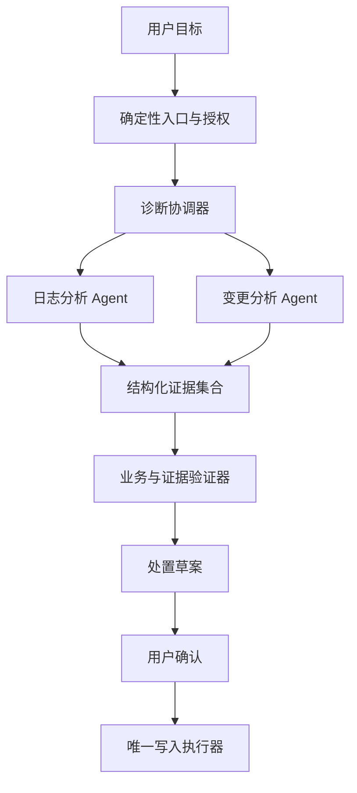
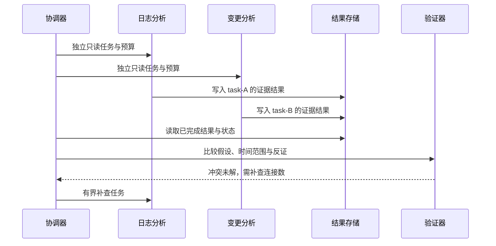

# Workflow 与 Multi-agent：组织多个决策单元

<div class="book-meta">第 12 章 · Agent 核心 · 约 2,745 字 · 建议精读 12 分钟（含图解）</div>

<p class="chapter-lead">多 Agent 的价值来自分工、隔离与并行，收益必须超过协调成本。</p>


“让一个 Agent 查日志，一个查变更，一个当专家，再安排一个经理汇总”听起来很像团队协作，但角色数量不是系统能力的可靠指标。多个模型可能重复读取同一份资料，传播同一个错误，最后用更多 token 得到相同结论。

本章讨论什么时候拆分任务、怎么传递结果、如何处理共享状态，以及如何证明拆分值得。你可以把已有的线程池、任务 DAG 和分布式协调经验带进来，但还要处理模型决策的不确定性。

## 1. 先分清控制流与决策单元

Workflow 指执行步骤和分支主要由程序预先定义；Agent 指某些下一步选择由模型根据观察决定。两者可以嵌套：固定流程中的“诊断”节点可以是 Agent；Agent 选择一个工具后，工具内部也可能是一条确定性工作流。

多 Agent 则意味着存在多个独立决策单元，通常拥有各自的目标、上下文、工具范围或执行状态。它不要求多个模型供应商，也不要求多个进程。一个进程里的多个有独立状态的执行器可以协作；给同一个 prompt 连续加上多个角色标签，却未必构成有意义的分工。



图中的两个分析任务只读，最后只有一个写入入口。这种不对称设计减少重复副作用，也使审批目标清楚。不要为了“分布式自治”让每个分析 Agent 都有创建工单和修改配置的权限。

## 2. 五种常用模式

顺序链适合阶段输出依赖清楚的任务，例如先提取信息，再验证，再生成报告。路由适合不同类别走不同处理器，例如账单问题与技术故障。并行适合独立的资料收集。评估器—优化器适合存在可靠评分器的任务。Planner-worker 适合子任务数量与内容需动态确定的场景。

| 模式 | 适用条件 | 主要风险 |
| --- | --- | --- |
| 顺序链 | 前一阶段产物明确 | 错误逐层传递、延迟相加 |
| 路由 | 类别边界可验证 | 路由误判导致进入错误工具域 |
| 并行 | 子任务无数据依赖 | 成本增加、资源争用、结果冲突 |
| 评估与修订 | 有有效评分标准 | 自评循环、奖励规则被利用 |
| 动态规划 | 运行中才能发现工作量 | 计划不可执行、过度拆分 |

选择模式时先问：哪一个决策必须由模型作出？如果分支条件就是业务状态枚举，直接写代码更容易测试。关于这些基本模式，可参考 [Building effective agents](https://www.anthropic.com/research/building-effective-agents)；框架只是承载模式的方式。

## 3. 子任务合同比角色名称重要

“你是日志专家”没有说明时间范围、目标服务、可用工具、预期产物和退出条件。一个有用的子任务合同至少包含任务 ID、问题、输入证据、访问范围、预算、截止时间和输出结构。

```json
{
  "task_id": "run-42/log-analysis",
  "goal": "判断支付服务超时是否与连接池耗尽相关",
  "time_range": ["incident_start", "incident_end"],
  "allowed_tools": ["query_metrics", "read_logs"],
  "max_model_steps": 4,
  "deadline_seconds": 20,
  "output_contract": {
    "hypotheses": [],
    "evidence_refs": [],
    "counter_evidence": [],
    "unresolved_questions": []
  }
}
```

这是业务合同示意，不是某个框架的真实 API。身份与授权范围由协调器从可信会话产生，不让模型任意填写。输出要区分事实、推断和待验证假设，汇总器才能识别两名 Agent 是真正矛盾，还是讨论了不同时间段。

## 4. 并行能够节省多少时间

若日志分析耗时八秒、变更分析耗时六秒、汇总耗时三秒，理想串行为十七秒，并行为 `max(8,6)+3=11` 秒。这个算例假定资源充足，忽略排队和协调开销。实际多 Agent 会增加模型并发、工具压力和 token 数；供应商限流时，理论并行可能变成更长的排队。

成本通常更接近各任务成本的总和，而不是最长任务成本。需要同时记录墙钟时间、模型调用次数、总 token、工具次数和最终成功率。只报告“并行后快了”，无法判断用户是否愿意支付新增成本。

并行也必须尊重依赖。例如先查订单所属租户，再查该租户的策略，是有依赖的两个步骤。猜一个租户并提前查询，不是优化，而是逻辑与权限错误。

## 5. 共享状态为什么容易出问题

两个 Agent 同时更新 `incident.status`，一个写“已确认根因”，另一个写“证据不足”，后写者覆盖前写者，会让最终状态依赖时序。更安全的方式是让子任务写入各自的结果空间，由协调器执行合并；需要共享修改时使用版本号与冲突处理。



这张图没有让两个 Agent 互相无限聊天。协调器把冲突变成一个具体待验证问题，再给出有限补查预算。结果空间按任务隔离，能够保留不同结论及其来源。

## 6. Handoff 与上下文传递

Handoff 是控制权或任务责任的转移，关键问题是下一位接手者需要什么。复制全部历史容易泄漏无关数据，并造成 token 膨胀；只传一句“继续处理”又会丢失约束。

建议传递目标、已确认事实、证据引用、已完成动作、未解决问题、剩余预算和权限范围。对于已经发生的副作用，应传递可验证业务 ID，而不是仅传自然语言总结。摘要如果丢掉“不得直接重启”的限制，接手者可能扩大操作范围。

跨团队、跨服务协作还需要身份、超时、取消、版本与错误合同。A2A 等协议可以标准化部分交互，但不会代替你设计业务责任归属。

## 7. 一个失败案例：多数票的幻觉

三个 Agent 都使用同一模型、同一旧手册和相似 prompt，最终一致判断“可以自动重启”。投票是三比零，但三个结果来自同一证据缺陷。它们的误差高度相关，并不是三份独立验证。

改进方向是引入独立真源：最新策略服务、实时资源状态、可执行验证器，或者不同角度的反证任务。模型数量增加不等于证据数量增加。评估器也可能被执行器的文字说服，因此重要评分应检查外部环境的实际状态。

为每个子任务设置独立的调用与时间预算，并保留全局预算。子任务预算之和不应无条件超过用户允许的总消耗；协调器重新规划时也要扣减已经使用的资源。

## 延伸推演：协调器也可能成为单点瓶颈

当子任务很多时，协调器如果每收到一条消息就重新读取全部历史并调用模型，开销会迅速增长。可以先用确定性代码收集状态，只在结果齐备、出现冲突或需要新增决策时调用模型。进度更新与推理决策不必一一对应。

子任务结果应带版本与完成状态。一个超时任务稍后返回结果时，协调器可能已经进入新计划；旧结果必须检查其 task ID、计划版本和适用时间，不能无条件覆盖当前判断。取消整个 run 时，应把取消传播给所有子任务，并明确哪些外部动作无法撤销。

还要防止权限通过汇总放大。某个专用 Agent 可以读取敏感数据，不意味着汇总器就应获得全部原文。可让它返回最小必要结论与受控引用，最终向用户展示时再次检查授权。职责隔离只有在信息传递也受约束时才成立。

## 8. 怎么验证多 Agent 的收益

建立三个版本：固定工作流、单 Agent、两名只读分析 Agent 加汇总。使用同一任务集、工具权限和总预算，比较任务成功率、尾延迟、成本、重复工具调用及冲突解决率。再做一次消融：移除其中一个分析任务，看看其贡献是否真实存在。

练习中加入一个子任务超时、一个结果矛盾、一个空证据和一次用户取消。验收要求协调器有明确策略：等待、接受部分结果、补查或停止；不能把未完成子任务默默当作成功。

**面试追问：什么时候应把多 Agent 改回单 Agent？** 当上下文和权限没有实质隔离需求、并行收益小、协调成本高、失败难以归因，且单 Agent 在相同预算下表现相当时，应降低复杂度。架构应服务任务，而不是服务角色数量。

<!-- PROJECT_DEPTH_V2 -->

## 项目落地：为何第一版采用单 Agent 与确定流程

本项目把调查过程交给受控决策，把批准和提交留在确定路径。它已经包含业务工作流与 Agent 的组合，不需要为了显得先进再加入多个会互相聊天的代理。

### 什么时候拆分才有收益

如果日志分析、变更审查和手册检索各需要大量独立上下文，或者由不同权限域的团队负责，可以把它们拆成独立子任务。每个子任务必须返回结构化证据、来源版本、缺口与状态；总控根据事实合并，而不是把三段自信的结论平均一下。

并行化会增加共享预算、取消传播、部分失败、重复写入和归因难度。总控不能把三个子 Agent 的各自成功误当作整项业务成功。例如指标分析正确但引用了别的租户，整个任务仍失败。

### 对照实验怎样做

用相同任务、相同工具和相同总 token/时间预算，比较单 Agent、固定并行工具和多 Agent。固定并行工具往往已经能降低独立读取的延迟，不一定需要额外模型决策。报告成功率、延迟分布、成本和冲突数量，尤其保留负结果。

在参考工程上扩展时，先让每个子任务只读并有独立 run/step 标识，把最终工单 action_id 留给唯一提交者。不要让多个 Agent 分别“帮忙建单”，否则业务去重必须先回答它们究竟是否属于同一个意图。

<!-- END_PROJECT_DEPTH_V2 -->
