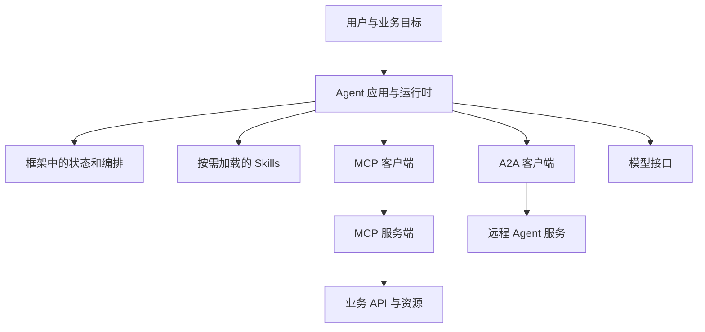
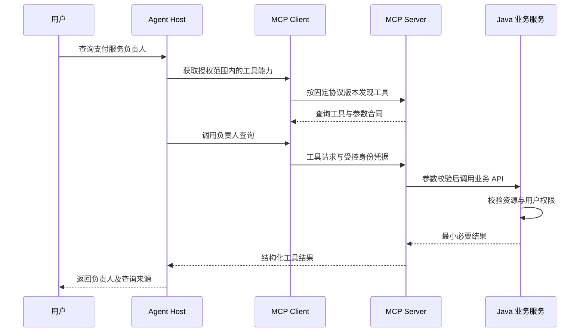

# MCP、A2A、Skills 与框架生态

<div class="book-meta">第 13 章 · Agent 核心 · 约 2,715 字 · 建议精读 12 分钟（含图解）</div>

<p class="chapter-lead">理解协议边界，避免把连接标准误当作完整 Agent 平台。</p>


学习 Agent 时很容易遇到一串名字：MCP、A2A、Skills、LangGraph、Spring AI。它们并不处在同一层。把它们都当作“Agent 框架”，会导致选型时重复建设，也容易产生“接上协议就自动安全”的误解。

本章先画清边界，再说明如何把一个 Java 查询服务接入 Agent。协议与 SDK 更新较快，下面强调稳定职责；涉及传输、发现、授权和消息字段时，应以项目固定的规范版本为准。

## 1. 先看一张分层图



这张图表达的是职责，不要求每个项目都部署所有模块。MCP 连接工具与上下文能力；A2A 面向 Agent 间互操作；Skills 封装任务知识与资源；框架帮助你组织运行过程。模型仍然负责语言理解与部分决策，业务系统仍然负责业务规则。

## 2. MCP 的参与者与能力

MCP 中的 host 是承载 AI 体验的应用，client 负责与某个 server 交互，server 暴露能力。工具通常描述可执行动作；资源用于提供可读取的信息；提示模板帮助组织特定交互。具体能力支持取决于所用规范和双方实现，不能因为名称相同就假定完全兼容。[MCP 架构文档](https://modelcontextprotocol.io/docs/learn/architecture)是核对这些边界的入口。

一个业务查询工具至少要表达名称、用途、参数结构、返回结构和错误。工具描述是模型选择动作的重要上下文，但描述本身不构成安全保证。即使描述写着“只读”，底层实现仍需真的限制写入；即使 schema 要求 `service_id`，该 ID 是否属于当前用户也必须由业务服务检查。

不要把“协议标准化”理解成“所有工具具有一致语义”。两个服务都叫 `search`，一个搜索文档，一个搜索订单，分页、时间范围和权限模型可能完全不同。客户端需要进行工具命名、冲突处理和上下文选择。

## 3. 一个只读工具的完整调用过程

假设现有 Java 服务提供 `GET /services/{id}/owner`。Agent 不应直接获得整个管理后台凭证，而应通过一个范围明确的适配层读取负责人。



图中进行了两层校验：协议适配层检查工具合同，业务服务检查真实资源权限。这样即使客户端错误暴露了一个工具，业务系统仍有独立防线。对于写操作，还需加入动作授权、幂等键和结果查询。

## 4. 工具定义与身份不能混在一起

下面是模型可见的业务参数示意。它只要求服务 ID，不让模型填 `tenant_id`、`role` 或管理员令牌。

```json
{
  "name": "get_service_owner",
  "description": "读取当前用户有权访问的服务负责人",
  "inputSchema": {
    "type": "object",
    "properties": {
      "service_id": {"type": "string", "minLength": 1}
    },
    "required": ["service_id"],
    "additionalProperties": false
  }
}
```

这段用于解释工具合同，不宣称是某个固定规范版本的完整报文。认证凭据来自安全连接与可信会话，服务端把它解析成操作者身份，再查询资源权限。把用户 ID 直接暴露为模型参数，会给身份混淆留下空间。

远程服务还要考虑令牌受众、作用域、过期、刷新、服务身份和网络边界。不要把为一个下游签发的令牌随意透传给另一个服务。工具返回的网页或文档仍是不可信数据，不能因其经过 MCP 传输就被提升为系统指令。

## 5. A2A 与工具调用的差异

一个工具通常提供相对明确的操作，例如查询订单。远程 Agent 则可能接受一个目标，自行经历多轮决策、等待信息、产生产物。A2A 关注这类跨 Agent 的能力发现和任务交互，具体消息与任务状态应查当前官方规范。[A2A 概览](https://a2a-protocol.org/latest/topics/what-is-a2a/)说明了它与 MCP、框架之间的关系。

不要用“是否调用了模型”作为唯一分界。对调用方更重要的是合同：一次函数式请求是否足够，还是需要跟踪长任务、追加消息、取消和接收产物。远程 Agent 返回“完成”时，仍需要验证它产出的业务结果，而不能把协议状态当作事实正确性的证明。

| 能力 | 更接近解决的问题 | 不自动提供的能力 |
| --- | --- | --- |
| MCP | 工具与上下文的标准连接 | 业务授权、正确规划、完整运行时 |
| A2A | 跨 Agent 的任务互操作 | 正确分工、冲突消解、结果真实性 |
| Skills | 可复用任务说明、脚本和资源 | 脚本安全、统一跨平台语义 |
| Agent 框架 | 消息、状态、编排和扩展点 | 业务幂等、安全策略、质量证明 |

## 6. Skills 应当如何治理

Skill 可以包含说明文档、脚本、示例和辅助资源，帮助按需加载能力，减少每轮上下文的无关信息。但它不是一个所有产品都遵循的统一通信标准，也不是天然可信的软件包。

引入第三方 Skill 时，应检查来源、版本、依赖、文件访问和网络行为。说明文件里的文字不能扩大用户已经授权的范围。包含脚本时，把它当作可执行代码审查；包含外部链接时，避免将私人上下文不必要地发送出去。更新 Skill 与更新程序依赖一样，需要回归测试。

## 7. Java 与 Python 框架如何选择

对于已有 Spring Boot 业务，Spring AI 提供模型与工具等集成抽象，便于沿用依赖注入、观测与配置体系。Python 生态通常更便于快速实验和组合研究工具。选择应看团队能力、业务依赖、部署运维和需要的模型特性，而不是认为某个语言才配做 Agent。

框架抽象越统一，越要确认是否隐藏了供应商特性或错误细节。应能回答：谁持有消息历史，谁真正执行工具，谁做重试，谁记录 checkpoint，取消由哪一层传播。遇到问题时只有包名知识，无法定位故障。[Spring AI 官方参考](https://docs.spring.io/spring-ai/reference/index.html)可用于核对实际能力；工程中固定 BOM 与依赖版本。

## 8. 协议升级的工程做法

维护一张兼容矩阵：客户端版本、服务端版本、规范版本、传输方式、身份方式、实际启用能力。升级前测试发现、参数验证、空结果、错误、超时、取消和权限撤销。不要因为基础调用成功就宣布兼容，边缘错误路径更容易出现差异。

工具 schema 变更也需要版本策略。把一个可选参数改成必填、改变时间单位或错误码含义，都可能破坏旧客户端和持久化任务。必要时并行保留旧合同，等旧运行结束后再移除。

## 延伸推演：工具数量增多后的发现策略

一个企业可能拥有上千个工具，把全部描述放入每轮 prompt 会增加上下文成本，也使名称相近的工具更容易被误选。可以先根据身份、业务域和当前任务筛出候选，再加载完整 schema。这里的第一层筛选必须保留授权边界，模型检索到工具名称不等于获得调用权限。

工具检索也需要评测：正确工具是否进入候选，描述是否区分相近操作，旧版本工具是否仍被误用。对于会改变外部状态的工具，可以要求更加明确的动作说明与结果合同。工具目录至少保存维护人、版本、权限、风险级别、超时和停用状态，避免平台接入后无人负责。

发生故障时，从客户端选择、协议请求、适配层转换、业务 API 到最终结果逐层追踪。若只记录“工具调用失败”，无法判断是协议不兼容、认证失效、模型参数错误还是业务拒绝。统一 trace 可以跨越协议边界，但日志字段与敏感数据仍需治理。

## 9. 练习与面试

把一个只读 Java 查询封装成工具，建立成功、参数非法、资源无权限、下游超时四个用例。再尝试在工具返回文本里加入“忽略用户限制”的句子，观察执行器是否仍按独立权限策略工作。

验收要求你能画出模型参数、用户身份和业务数据三条不同路径；能明确协议版本；能在不使用框架术语的情况下解释完整调用链。

**面试追问：用了 MCP 还需要 API 网关吗？** 两者职责不同。MCP 标准化模型应用与工具交互，网关可以处理认证、流量、路由和审计；业务服务仍要执行资源级授权。是否独立部署网关取决于规模，但这些职责不能消失。

<!-- PROJECT_DEPTH_V2 -->

## 项目落地：协议适配不能改变业务权限

当前 Java 工具用普通 HTTP 暴露，这是完整可运行的服务合同。以后可以在前面增加 MCP 适配器，把 metrics、changes 与知识查询发布成工具，但底层身份校验、参数约束和结果语义仍要保留。

### MCP 适配层应有多薄

适配器负责协议握手、工具发现、参数映射与错误转换；业务服务继续负责资源授权和事务。不要因为调用来自一个已连接的 MCP server，就允许模型提供任意 tenant 或用户 ID。协议连接成功只说明双方能通信，不表示所有工具都获得了业务授权。

本工程没有把一个函数名叫作 MCP 就宣称实现了协议，也没有包含 A2A 服务端。协议版本、认证方式与部署实现需要按官方规范单独验证。选型时先问连接需求是什么，再决定是否值得引入新依赖和信任边界。

### Skills 与动态工具的审查

运行手册、Skills 文件和工具描述可能来自第三方，应作为待审查内容。它们可以指导执行，但不应自己授予权限、修改预算或要求把凭据发往新地址。动态加载工具时，还需要版本锁定、来源验证和能力清单。

练习给同一 Java 工具写一个协议适配层，保持原有 HTTP 集成测试作为底座，再新增协议层契约测试。若切换框架后跨租户测试不再通过，应修复适配边界，不能把失败归结为“新框架就是这样”。

<!-- END_PROJECT_DEPTH_V2 -->
