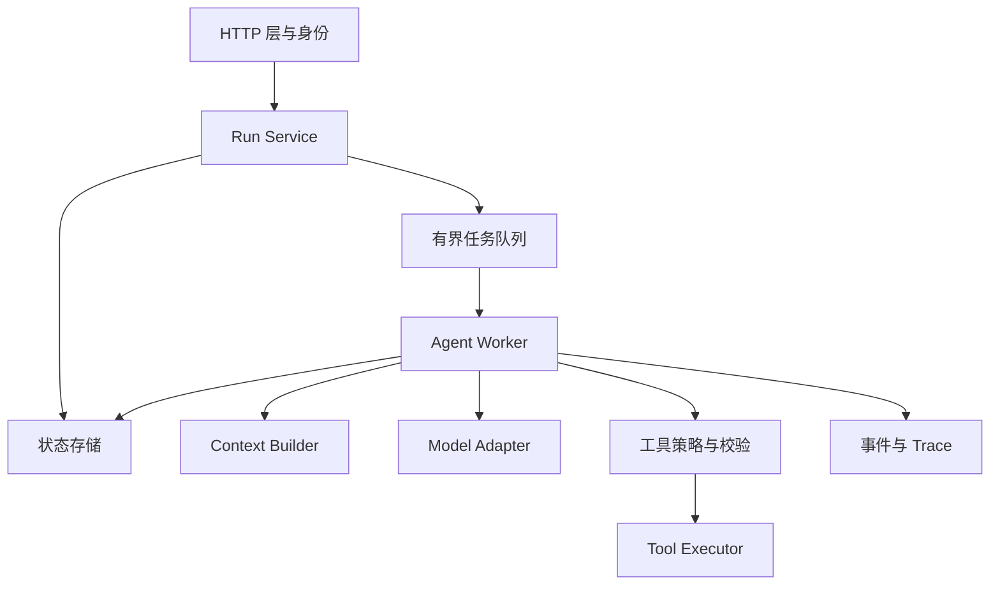
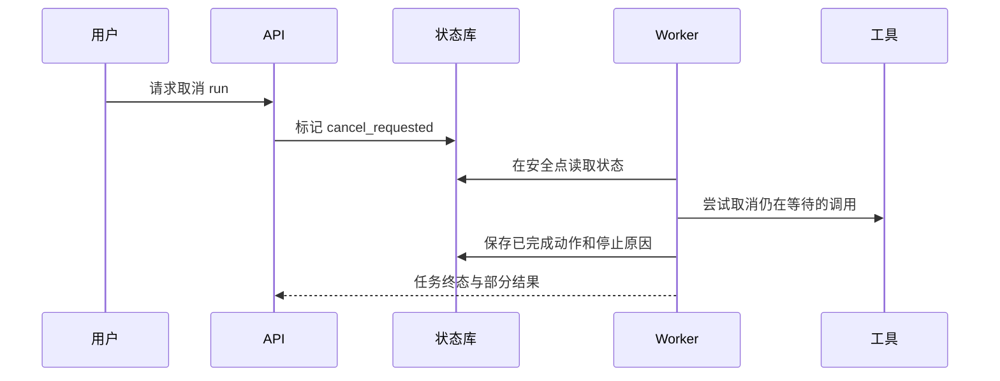

# Python Agent 服务：异步、类型与测试

<div class="book-meta">第 14 章 · 工程与基础设施 · 约 2,679 字 · 建议精读 12 分钟（含图解）</div>

<p class="chapter-lead">把实验脚本变成边界清晰、可运行、可维护的后端服务。</p>


一个在 Notebook 中成功运行的 Agent，可能在十个用户同时使用时卡住：同步 SDK 阻塞事件循环，模型请求无界并发触发限流，用户关闭页面后后台仍持续计费，服务重启又丢失任务。问题通常不在 prompt，而在服务的生命周期与边界。

你已经会 Python，也有 Java 后端经验。本章不重新讲语法，而是把 Agent 服务拆成可替换、可测试的模块，重点说明异步、取消、资源限额与测试分层。

## 1. 把模型调用放进服务结构



HTTP 层不应包含整个决策循环。它负责识别操作者、校验请求、创建任务和返回任务 ID；worker 负责执行；状态存储保证重启后仍能查询。小项目可以把这些模块放在一个进程，但边界应在代码上明确。

Model Adapter 封装供应商消息格式、usage 和错误；Context Builder 决定每轮内容；Tool Executor 负责真正的 I/O；Policy 检查允许做什么。这种拆分使你可以只替换模型，而不同时修改身份系统与业务工具。

## 2. 类型检查与运行时校验各管什么

Python 类型标注便于静态检查和阅读，但不会自动阻止运行时传入错误字段。来自 HTTP、模型和工具的数据都在信任边界上，应显式验证。Pydantic 等库可以提供结构校验；业务含义仍需额外检查。

例如 `amount: int` 只能表达类型，不能证明金额非负、币种一致、订单存在或当前用户有退款权限。不要让“JSON 成功解析”成为执行写操作的唯一前置条件。

模块间可以使用 dataclass 或协议表达合同。下面是示意接口，不依赖任何真实供应商 SDK：

```python
from dataclasses import dataclass
from typing import Protocol

@dataclass(frozen=True)
class ModelReply:
    text: str | None
    tool_calls: list[dict]
    input_tokens: int
    output_tokens: int

class ModelAdapter(Protocol):
    async def generate(
        self, messages: list[dict], tool_schemas: list[dict]
    ) -> ModelReply: ...
```

用统一回复对象有利于测试，但不要丢掉原始错误与请求 ID。否则供应商返回内容拒绝、截断或限流时，都被压成一个普通异常，恢复策略无法区分。

## 3. Async 提高的是等待期间的利用率

网络调用大部分时间在等待远程响应。`await` 让出执行权，事件循环可以推进其他任务；它不会让远程模型的单次推理天然变快。CPU 密集 OCR 或大规模文本处理如果仍在事件循环中执行，会阻塞所有协程。

同步 I/O 库可以在适当情况下放入线程池，但要理解超时的边界：取消等待线程结果，不保证底层阻塞操作真的停止。对于 CPU 密集任务，可以使用进程池或专用处理服务。方案选择取决于库是否释放 GIL、资源成本和需要的隔离程度。

下面代码可在 Python 3.11 及以上独立运行，演示有界并发和单次超时。它模拟只读工具，不调用真实模型。

```python
import asyncio

limit = asyncio.Semaphore(2)

async def read_tool(name: str, delay: float) -> dict:
    async with limit:
        try:
            async with asyncio.timeout(0.5):
                await asyncio.sleep(delay)
                return {"tool": name, "status": "ok"}
        except TimeoutError:
            return {"tool": name, "status": "timeout"}

async def main():
    async with asyncio.TaskGroup() as group:
        tasks = [
            group.create_task(read_tool("metrics", 0.1)),
            group.create_task(read_tool("changes", 0.2)),
            group.create_task(read_tool("logs", 0.8)),
        ]
    print([task.result() for task in tasks])

asyncio.run(main())
```

注意这里的超时从获得 semaphore 后开始，因此不包含排队时间。真实任务还需要总 deadline，防止请求在等待并发槽位时无限排队。关于 Task、TaskGroup 和取消的具体语义，以 [Python asyncio 文档](https://docs.python.org/3/library/asyncio-task.html)为准。

## 4. 三种预算应同时存在

单次工具超时约束某个调用；单次模型调用超时约束远程推理；任务总 deadline 约束整条链路。还需要步数、token 和费用预算。把每个工具都设置三十秒超时，却允许一百次循环，仍然可能耗费很长时间。

预算应由运行时检查，而不是让模型口头承诺遵守。调用前预估是否还能执行，调用后用真实 usage 更新。费用估计和服务端账单可能存在差异，应保留余量并对异常消耗设置硬停止条件。

重试也消耗预算。参数错误与无权限通常不应自动重试；限流和临时网络错误可以在总预算内退避；写操作超时必须先处理结果未知问题。不同错误不应共用一个“重试三次”的装饰器。

## 5. 取消如何沿调用链传播



“取消请求已收到”与“所有动作已停止”不同。某个远程写操作可能已经提交，取消本地协程不会撤销它。返回终态时必须说明已经发生的动作、未完成部分和是否需要补偿。

捕获取消异常时，应完成必要清理再传播，不要用宽泛异常处理把取消吞掉后继续重试。TaskGroup 可以帮助组织一组任务的生命周期，但业务层仍需决定子任务失败是否意味着整体失败，还是允许部分结果。

## 6. 配置、依赖与资源管理

在进程启动时创建共享 HTTP 客户端和连接池，在退出时关闭，避免每个模型调用都重新建立连接。明确连接数、读超时和总体超时。数据库会话同样要短生命周期，不要跨模型等待持有事务。

凭据来自环境或 secret manager，配置启动时校验。把开发配置、模型标识、prompt 版本和工具 schema 版本一起记录。依赖使用锁文件固定，升级时跑契约与真实模型小样本回归，避免 SDK 行为悄悄改变。

日志默认记录 ID、时长、状态和必要摘要。完整用户内容、工具返回和文件正文应按数据政策受控保存，不能因为排障方便就无条件输出到共享日志。

## 7. 测试如何覆盖模型的不确定性

| 测试层 | 适合验证 | 常见误区 |
| --- | --- | --- |
| 单元测试 | schema、预算、权限、状态转换 | 用模型生成的期望值测试自身 |
| 工具契约测试 | 请求格式、错误语义、幂等 | mock 与真实服务协议不一致 |
| 恢复测试 | 重启、重复投递、部分提交 | 只测试成功路径 |
| 模型评测 | 工具选择、事实、任务成功 | 把 mock 全绿当模型能力证明 |

录制回放适合稳定调试，却可能隐藏供应商接口漂移。真实模型评测不必每次跑很大规模，但关键发布应覆盖具有代表性的任务和失败边界。确定性测试和统计评测是互补关系。

异常日志还应保存供应商请求 ID 和内部 run ID 的映射。排查问题时先定位同一次执行，避免把不同重试的日志混在一起。对敏感正文使用受控采样和脱敏，不让调试日志形成新的数据泄漏通道。

## 延伸推演：重试为什么会形成放大效应

假设 HTTP 客户端重试三次，模型适配器又重试三次，外层任务再重试三次，一次业务动作最坏可能触发远超预期的调用。每一层看起来都在提高可靠性，组合后却会放大延迟、费用和下游压力。重试责任应明确归属，并在 trace 中记录 attempt 编号与总预算。

对同一个上游故障，大量请求同时重试还可能形成同步冲击。指数退避加抖动可以分散重试时间，但不能创造下游容量；仍需并发限制、熔断和背压。对长时间不可用依赖，应停止无效消耗并返回可恢复状态，而不是让 worker 永远睡眠重试。

Python 服务的优雅退出同样重要：停止接收新任务，让短任务完成，对长任务保存可恢复状态，并释放连接。直接结束进程前没有 checkpoint，会把部署变成一次人为故障。即使采用后台任务框架，也需要验证进程退出、租约到期和重投递之间的实际行为。

## 8. 练习与面试

把现有脚本改成三个接口：创建任务、查询任务、请求取消。限制同时运行的模型调用数量；加入一个慢工具；重启 worker 后仍能查询任务状态。再测试取消发生在排队、模型生成和工具写入三个位置时的区别。

验收要求慢任务不会阻塞所有请求，队列有上限，每个执行都能追踪到 run ID，取消后不会悄悄继续新一轮模型调用。对于已经提交的写入，系统能给出真实状态，而不是统一显示“已取消”。

**面试追问：为什么使用 async 后 p95 反而增加？** 可能是同时放出了更多远程请求，触发限流与排队，也可能是事件循环被同步代码阻塞。应拆分队列等待、连接等待、服务耗时和重试，而不是仅增加并发数。

<!-- PROJECT_DEPTH_V2 -->

## 项目落地：Python 服务的真实代码组织

FastAPI 的请求模型、Worker、Store、Memory 和模型适配器分属不同模块。API 创建任务返回 202，不在 HTTP 请求线程里跑完整 Agent。测试既有纯函数/存储层验证，也有实际 uvicorn、Java HTTP 与进程退出后的恢复。

### 为什么没有强行全部改成 async

参考 API 使用同步数据库连接和同步路由函数，让 FastAPI 在线程池中执行；Worker 是独立进程中的同步循环。这种方案降低了初版事务和取消语义的复杂度。它的边界是吞吐与并发受线程和进程数限制，SSE 长连接也会占用工作资源。

若要高并发，需一起换成异步 HTTP、合适的异步数据库驱动、受限任务池和可取消的生命周期，而不是只在函数前加 async。同步 sqlite 调用如果直接放进异步事件循环，会阻塞其他请求。

### 连接与测试资源由谁关闭

Store.db 每次事务完成后提交或回滚，并关闭连接；Worker 退出时关闭 HTTP Client；集成测试用 finally 终止 Java、API 和 Worker 子进程。失败路径也必须执行清理，否则测试通过后机器上可能残留端口和进程。

依赖在虚拟环境中安装，requirements.lock 记录本次实际版本。升级依赖先跑 schema、签名、并发和故障用例，再构建博客引用的源码。完整工程不是只给一个函数片段，而是包含入口、配置、数据初始化、测试与退出流程。

<!-- END_PROJECT_DEPTH_V2 -->
