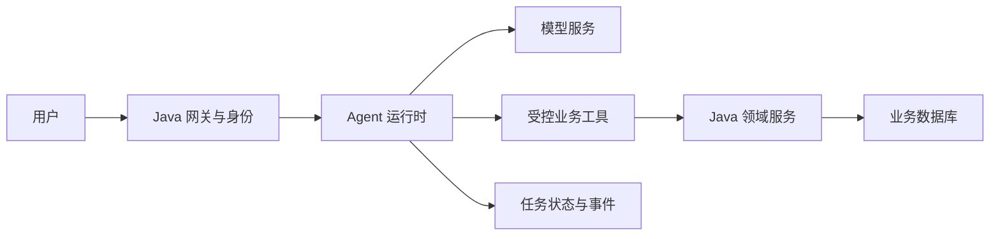
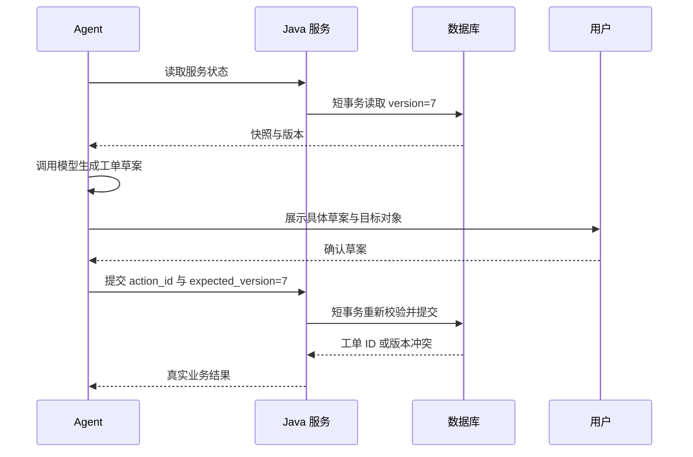

# Java / Spring 业务系统如何接入

<div class="book-meta">第 15 章 · 工程与基础设施 · 约 2,757 字 · 建议精读 12 分钟（含图解）</div>

<p class="chapter-lead">保留你熟悉的后端能力，把模型放在受控的业务边界中。</p>


你已经有订单、权限、计费和工单服务。引入 Agent 后，最重要的问题不是把所有代码改写成 Python，而是明确模型能请求哪些动作，以及这些动作如何继续受原有业务约束保护。

本章以“根据告警创建工单”为例，比较 Java 单栈与 Python/Java 双栈，并深入身份传递、事务边界、审批绑定和幂等。你的后端经验在这些位置具有直接价值。

## 1. 两种架构都合理



图中的 Agent 运行时可以用 Java，也可以用 Python。架构边界不取决于语言，而取决于职责。Java 单栈便于复用 Spring 配置、依赖注入、观测和团队运维；双栈便于使用 Python 实验生态，但增加跨服务协议、部署、追踪和故障处理成本。

| 选择 | 更合适的条件 | 需要付出的代价 |
| --- | --- | --- |
| Java 单栈 | 业务集成多，团队熟悉 Spring，模型需求较稳定 | 某些研究工具需适配或独立服务 |
| Python 编排 + Java 业务 | 快速实验多，已有成熟 Java 领域服务 | 双栈部署、接口版本和跨服务排障 |
| 独立 Agent 平台 | 多团队、多租户、统一治理需求明确 | 平台建设和运营成本明显增加 |

先在你熟悉的栈里完成可信闭环，再根据具体瓶颈拆分。不要把双栈本身当作架构成果。

## 2. 身份来自请求上下文，不来自模型

模型可以提供服务 ID、工单标题和证据引用，但不能决定自己属于哪个租户或拥有什么角色。网关验证用户身份，运行时携带受控的操作者上下文，业务服务再次检查资源权限。

仅在网关检查“登录成功”不够。某用户能查询支付服务，不代表能修改支付配置；能创建本租户工单，不代表能访问其他租户相同编号的工单。资源级授权应该与领域规则放在可信服务中，即使工具被其他客户端直接调用，也不能绕过。

工具适配层应将模型输入转换为窄接口。与其提供“执行任意 SQL”，不如提供“查询服务负责人”“创建工单草案”等明确操作。明确操作更容易校验、审计和限制副作用。

## 3. 不要把模型调用包在长事务里

传统后端中，一个本地事务通常只持续很短时间。模型调用可能耗时数秒到数十秒，还可能重试。如果在读取订单后一直保持数据库事务，直到模型决定操作再提交，会增加锁持有时间和连接占用。

更合适的方式是读取业务快照，关闭事务，生成方案；真正提交前开启新的短事务，重新验证权限、资源版本和状态。资源在等待期间发生变化时，应报告冲突或重新生成方案，而不是在旧快照上强行提交。



图中模型等待和用户等待都不持有数据库事务。`expected_version` 解决的是基于旧状态操作的问题；幂等键解决的是同一个动作重复提交的问题，两者不能互相替代。

## 4. 审批必须绑定具体参数

用户批准“创建一张连接池排查工单”，不能被解释为允许创建任何工单。审批记录应绑定操作者、动作类型、目标资源、规范化参数摘要、资源版本和有效期。恢复任务时重新检查绑定关系。

参数规范化很重要。同一个 JSON 对象的字段顺序不同，不应产生不同语义；但金额、接收人或目标服务变化必须使原审批失效。对于业务上重要的字段，最好直接保存结构化审批快照，而不是只保存一个难以解释的 hash。

审批记录也需要撤销与过期状态。等待数天后恢复旧任务时，用户权限可能已经变化，资源状态也可能改变。原先获得批准并不等于永远可以执行。

## 5. 幂等为什么不能只“先查再写”

两个 worker 同时收到同一个动作，都会先查到“没有执行记录”，然后各写一张工单。进程内锁不能保护多个实例；仅仅在代码中先查询也不能解决竞态。需要数据库唯一约束或等价原子机制。

下面是 PostgreSQL 数据约束示意：

```sql
CREATE TABLE agent_action (
    tenant_id text NOT NULL,
    action_id uuid NOT NULL,
    request_hash text NOT NULL,
    status text NOT NULL,
    ticket_id bigint,
    PRIMARY KEY (tenant_id, action_id)
);
```

同一个 `(tenant_id, action_id)` 只能出现一次。请求哈希用于检测“同一个幂等键却换了一份参数”的误用。执行器不能在每次重试时生成新键，否则业务服务看见的就是多个独立动作。

一种可行设计是在同一个本地事务中抢占动作键、创建工单、保存结果并写 outbox；事务提交后再返回。如果抢占失败，则读取已有动作结果或返回处理中。应明确失败重试策略，并处理事务隔离级别下的可见性；不能简单捕获唯一键异常后在已经失败的事务里继续查询。[PostgreSQL INSERT 文档](https://www.postgresql.org/docs/current/sql-insert.html)可用于核对 `ON CONFLICT` 的具体行为。

## 6. Java 服务合同示意

下面是职责草图，不是完整可运行代码。`atomicCreateOrRead` 必须真正用事务与唯一约束实现，而不是在内存里放一个 Map。

```java
record CreateTicket(String serviceId, String title,
                    long expectedVersion, List<String> evidenceIds) {}

TicketResult createTicket(Actor actor, UUID actionId,
                          CreateTicket command) {
    authorization.require(actor, "ticket:create", command.serviceId());
    approval.verifyExactCommand(actor, actionId, command);
    return actionRepository.atomicCreateOrRead(
        actor.tenantId(), actionId, canonicalHash(command), () -> {
            services.requireVersion(command.serviceId(),
                                    command.expectedVersion());
            var ticket = tickets.insert(actor, command);
            outbox.append("ticket.created", ticket.id());
            return ticket;
        });
}
```

这段结构强调：业务层仍然独立检查授权与状态，Agent 没有绕过业务规则的特权。真实实现还要定义重复请求参数不一致、处理中、业务拒绝和未知结果的响应语义。

## 7. Spring AI 在哪里发挥作用

Spring AI 可以帮助组织模型访问、工具定义和相关集成。模型请求工具，应用执行工具并返回结果；框架的便利不改变这一责任分界。[Spring AI 工具调用文档](https://docs.spring.io/spring-ai/reference/api/tools.html)可用于核对当前版本的执行方式。

工程中固定 Spring AI BOM、模型 SDK 与 Spring Boot 的兼容版本。对于自动工具循环，确认是否能插入审批、预算、观测与取消；如果需要自己控制循环，也要承担相关消息与错误处理。不要同时在多层重复管理历史和重试，造成消息重复或副作用放大。

参数摘要不能只用于去重，也要能够支持审计解释。记录规范化前后的必要业务字段，避免出现“哈希不同但不知道差在哪里”的排障困境，同时对敏感字段实施脱敏。

## 延伸推演：Outbox 与“已通知”不是一回事

在本地事务中同时写工单与 outbox，能够避免“工单提交成功但待发送事件丢失”的窗口。后续发布器读取 outbox 并投递消息，投递本身仍可能重复，因此下游消费者也需要幂等。Outbox 改善的是本地状态与发送意图的一致性，不是跨所有系统的神奇一次性事务。

若动作是给外部第三方发消息，业务库不能与第三方服务器共享同一个本地事务。需要对方支持幂等键，或者在超时后查询发送状态；没有可靠状态查询时，要显式保留未知结果并转人工处理。盲目重发可能比少发一次更有害，策略取决于业务风险。

Java 工程还应定义可观察错误合同，例如参数非法、无权限、资源冲突、动作处理中、依赖暂不可用和结果未知。Agent 可以对部分错误调整下一步，但不能自行绕过拒绝。把所有错误转换成 HTTP 500，会让模型和运行时失去采取正确恢复动作所需的信息。

## 8. 故障演练与面试

最值得做的实验是：业务工单已经提交，但响应在网络中丢失。Agent 看到超时并重试，业务服务应返回同一工单，而不是再创建一张。再测试两个 worker 并发提交、同键不同参数、审批过期、资源版本变化和跨租户请求。

验收要求数据库中每个业务动作最多产生一份预期工单；所有拒绝有可理解错误；trace 能从 Agent run 关联到 Java action 和工单 ID。若业务写入涉及其他系统，还需处理跨系统事务边界，不能把本地事务成功当成全链路成功。

**面试追问：Java 后端经验如何转化为 Agent 竞争力？** 你能够把不确定模型输出接到确定业务边界上，处理权限、并发、事务、幂等、状态与运维。再补足上下文、检索和评测，就能证明自己交付的是完整系统，而不只是模型接口包装。

<!-- PROJECT_DEPTH_V2 -->

## 项目落地：Java 的价值在业务真源

Spring Boot 服务提供指标、变更和工单接口，H2 保存实际工单。身份由 token 映射为固定 tenant/user/role；Controller 不接受客户端直接指定 tenant。Contracts record 负责字段校验，TicketService 承担事务、批准签名与原子幂等。

### Spring 事务边界需要真实代理调用

create 是独立 Service Bean 的公开方法，由 Controller 调用，因此 @Transactional 能通过代理生效。如果把事务方法放在同一个类里再自调用，或在异步线程中假设原事务自动传播，可能得到完全不同的行为。模型网络调用也不应放进业务数据库事务。

同一动作并发提交时，第一次查询可能都看不到记录。服务锁定相应资源行后再次查询，随后插入带唯一动作键的工单。第二次检查和唯一约束是并发正确性的一部分，不能为了减少一次 SQL 删掉。

### 未来接入现有系统

真实公司通常已有订单、工单、权限和审计服务。优先复用它们的业务合同，Agent 层只表达意图和上下文，不另建一套“模型专用数据库”绕过既有约束。若用 Spring AI 实现模型调用，可以替换 Python 的适配层，但业务权限和幂等仍在同一位置。

跨语言的难点常在细节：JSON 命名、UTF-8、时间单位、数值精度、超时与错误码。项目用中文与换行参数进行签名联调，确保两端 hash 一致；这比展示一个只含英文字符串的示例更有检验价值。见[Java 事务导读](/project/java-business)。

<!-- END_PROJECT_DEPTH_V2 -->
