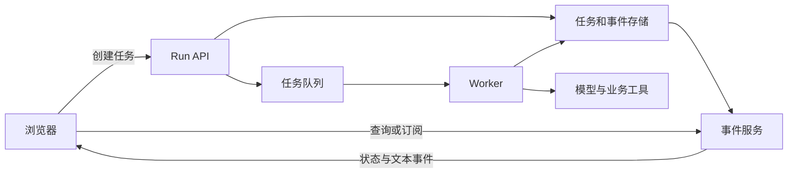
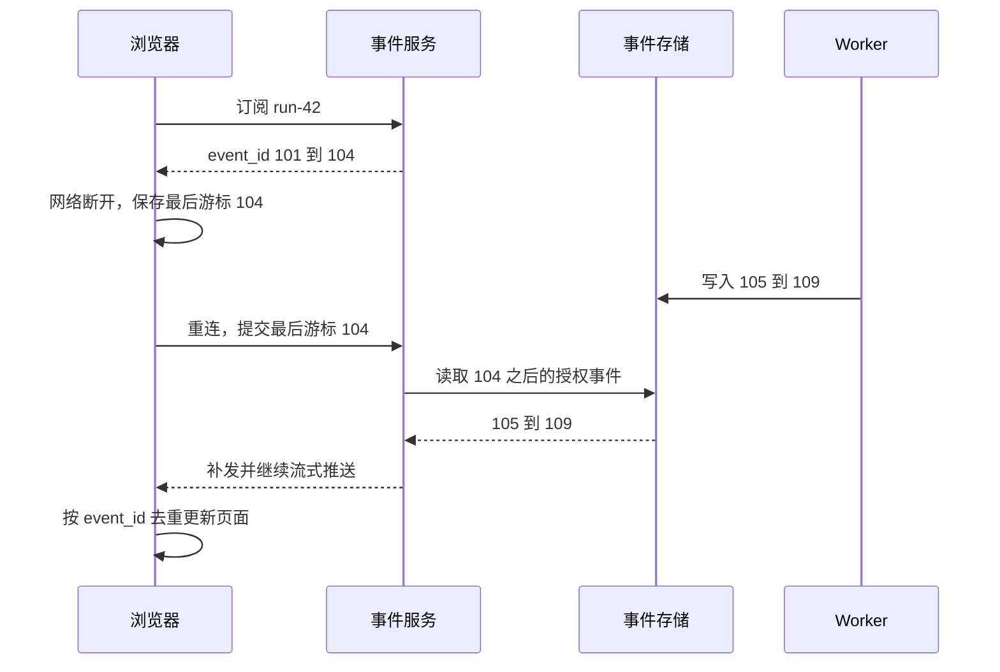

# 服务层：API、流式输出与长任务

<div class="book-meta">第 16 章 · 工程与基础设施 · 约 2,701 字 · 建议精读 12 分钟（含图解）</div>

<p class="chapter-lead">用户交互、后台执行和真实业务动作需要分开建模。</p>


用户点击“分析这次故障”，页面开始逐字输出。十秒后网络断开，用户刷新并再次点击，结果后台运行了两次，创建了两张工单。这个问题不能靠更好的 prompt 解决：服务需要区分用户请求、任务执行、事件显示和业务动作。

本章设计一套任务型 API，说明 SSE、队列、事件游标、取消和恢复怎样配合。目标是让页面离开、网络重连和 worker 重启都不会破坏任务语义。

## 1. 请求生命周期与任务生命周期

HTTP 请求通常持续几毫秒到几秒；Agent 任务可能持续更久，甚至等待用户审批一天。把两者绑定在一起，会遇到网关超时、连接中断和服务发布问题。

任务型接口先创建持久化的 run，再通过查询或事件流观察进度。连接断开只表示观察通道中断，不应默认取消任务；用户明确取消则通过独立命令处理。



读图时区分两条线：任务队列驱动执行，事件流驱动显示。浏览器重放显示事件，不能重新触发业务工具。消息里都出现“创建工单”不代表它们拥有相同的控制语义。

## 2. 一套可理解的 API 合同

| 接口示意 | 作用 | 关键语义 |
| --- | --- | --- |
| `POST /runs` | 创建任务 | 支持客户端请求幂等键 |
| `GET /runs/{id}` | 查询权威状态 | 身份检查与终态查询 |
| `GET /runs/{id}/events` | 接收事件 | 游标重连与保留期 |
| `POST /runs/{id}/cancel` | 请求取消 | 区分收到请求和已经停止 |
| `POST /actions/{id}/decision` | 提交审批 | 绑定具体动作、参数和身份 |

创建任务的幂等键与业务动作的幂等键不是同一个概念。前者防止刷新或客户端重试创建多个 run；后者防止同一 run 恢复时重复执行写操作。两层都可能需要。

创建接口可返回 `202 Accepted`、run ID 和查询地址，但不能把接受任务说成已经完成。任务列表也应显示 queued、running、waiting_approval、succeeded、failed、cancelled 等真实状态，避免用一个含糊的 loading 布尔值表示全部过程。

## 3. SSE 传什么，不传什么

SSE 适合服务器向浏览器单向推送文本事件。用户提交新消息、审批和取消仍然可以使用普通 HTTP。需要频繁双向实时数据时，可以选择 WebSocket，但会承担连接状态、心跳和重连协议等工作。

SSE 的基本事件可以表达为：

```text
id: 104
event: tool.completed
data: {"run_id":"run-42","step_id":"step-3","tool":"search_runbook","status":"ok"}

id: 105
event: run.waiting_approval
data: {"run_id":"run-42","action_id":"action-7","title":"创建排查工单"}

```

两个事件之间的空行具有协议意义。事件 ID 用于恢复与去重；业务 ID 用于关联，不要混用。浏览器 `EventSource` 的行为、事件格式和重连机制可参考 [MDN SSE 文档](https://developer.mozilla.org/en-US/docs/Web/API/Server-sent_events/Using_server-sent_events)。实际工程还要验证反向代理缓冲与空闲连接超时。

文本增量只是展示内容，不能当作可执行命令。一个 `tool.started` 事件说明开始尝试调用，不证明工具成功；一个 `run.succeeded` 事件必须来自任务状态机，不能由模型随口说出“完成”触发。

## 4. 断线之后怎样恢复



图中没有重启 Agent，因为任务一直在后台运行。若事件已超过保留期，服务应明确告诉客户端游标不可恢复，客户端再获取权威状态快照，而不是永远等待缺失事件。

事件顺序需要定义范围。可以保证同一 run 内按序，但不必承诺所有租户全局有序。多 worker 并行产生事件时，使用服务端序列或数据库版本建立一致展示顺序，客户端不要以自己的接收时间推断业务先后。

## 5. 队列、背压与公平性

当到达速度超过处理能力时，队列会增长。无界队列把短期拥塞变成长时间等待和存储压力；有界队列能让系统明确拒绝、排队或降级。对交互任务来说，过晚完成可能已经没有价值，因此 admission control 与 deadline 同样重要。

队列常提供至少一次投递，worker 可能收到重复任务。领取任务时通过状态版本或租约防止同一 run 被多个 worker 同时推进；即使租约失效后出现短暂并发，业务写入仍需幂等保护。心跳只说明执行器还活着，不证明它在取得有效进展。

多租户场景应限制每个租户的并发与累计消耗，避免一个大客户占满全部 worker。公平性可从简单的每租户 semaphore 和队列开始，规模上来后再研究加权调度与优先级。优先级需要防止低优先任务永久饥饿。

## 6. 取消、失败与部分结果

用户取消时，先持久化 `cancel_requested`，worker 在安全点检查并停止发起新动作。对于正在进行的模型或工具请求，尽可能传播取消；无法保证停止的远程操作，要查询最终状态并记录。

错误应区分可恢复和不可恢复。模型限流可能允许等待后重试；无权限应停止相关动作；工具参数错误可能需要有限修正；状态未知的写操作应先对账。不能对所有异常统一显示“稍后重试”，让用户无意制造更多副作用。

部分结果也需要合同：哪些证据已经获得，哪些检查未完成，是否有动作已提交。显示“任务已取消”时仍应保留已经创建的工单链接，避免让用户误以为外部状态已回滚。

## 7. 前端状态机与用户体验

客户端应消费结构化事件更新状态，例如从“正在检索”到“等待确认”。它可以在文本流未结束时逐步显示回答，但关键按钮是否可用应根据服务端状态，而不是从自然语言中查找“成功”两个字。

长时间无新事件时，展示最后更新时间和连接状态比伪造进度百分比更诚实。若系统只知道工具仍在运行，就显示“正在等待监控查询”，不要编造模型正在进行某种内部思考。人工审批页面应该列出对象、参数差异、证据和风险，而不是一个没有上下文的“允许”按钮。

## 8. 一个故障定位顺序

用户反馈“答案一直不出来”，先看任务状态是否仍在 queued，再看 worker 是否领取；已经运行则检查模型与工具 span；任务已完成但页面未更新，则检查事件存储、游标、代理缓冲和客户端去重。把这些层分开，才能避免所有问题都被归因于模型慢。

若重复事件导致文本重复，可以按事件 ID 去重；若重复任务导致两张工单，必须修复服务端动作幂等。前端去重只能修复显示，不能修复已经发生的外部写入。

## 延伸推演：事件的持久性应该分级

每个 token 都永久写入数据库未必值得。任务状态、审批和工具结果通常需要可靠持久化；细粒度文本增量可以按产品需求合并、短期缓存，最终完整文本再持久化。这样既保留恢复能力，也减少大量小写入。必须明确哪些事件可丢、哪些事件绝不能丢，不能让客户端自行猜测。

事件服务应检查订阅者对 run 的权限，包括重连和补发。仅知道 run ID 不是授权。若用户权限在长连接期间撤销，还要定义连接关闭或下一次读取重新验证的策略。连接数量本身也是资源，需考虑每用户上限、心跳与空闲回收。

对文本流的渲染要防止未完成 Markdown 或 HTML 带来的展示问题，最终内容也要安全处理。流式越早展示，越需要区分“尚未验证的生成内容”和“已提交的业务结果”。

## 9. 练习与面试

实现一个持续二十秒的测试任务，期间产生状态与文本事件。关闭网络五秒后重连，应看到补发事件与最终结果。再重复发送创建请求、重启 worker、让审批过期，并观察任务数量与工单数量。

验收要求同一创建请求不会产生多个 run，同一业务动作不会重复提交，事件断档有明确恢复策略，用户能区分“连接断开”“任务失败”“等待审批”和“取消处理中”。

**面试追问：SSE 连接断开后要不要终止 Agent？** 取决于产品合同，通常观察通道断开不代表用户取消。应通过独立取消操作表达意图，并根据任务价值与费用政策设置无人观察时的运行策略。

<!-- PROJECT_DEPTH_V2 -->

## 项目落地：HTTP 接受任务与业务完成分开

POST /runs 返回 202 和 run_id，表示任务已持久化，不表示诊断或建单完成。GET /runs/{id} 提供服务器确认状态；SSE 仅传递进度观察；批准通过单独 decision 接口提交。客户端不能直接写 state 或 status。

### 事件重连必须幂等

events 表使用递增 ID。客户端记住最后处理的序号，重连携带 Last-Event-ID，服务返回更大的事件。前端展示重复事件时可以去重，但事件回放绝不能重新触发 Java 写入。展示层与执行层应从职责上分开。

示例使用带 Authorization 的 curl 或 HTTP 客户端。浏览器原生 EventSource 不方便设置任意认证头，真实 Web 产品可使用同源会话 cookie 或支持流式 fetch 的客户端；不要为了方便把长期 token 放到查询参数里，让它进入访问日志和历史记录。

### 取消与撤销的语义

queued/running/waiting_approval 可以取消，并通过递增 fence 拒绝迟到回写。committing 不接受“取消即保证没建单”。此时应先对账，再由业务系统关闭或撤销已有工单。UI 的按钮文案必须反映这一区别。

当前 SSE 每次连接有界，客户端重连；大量长连接需要独立容量评估。API 健康不意味着 Worker 正常，应结合 pending age 和状态分布。所有端点合同可在本地 /docs 查看，完整源码见[API 实现](/project/source-api)。

<!-- END_PROJECT_DEPTH_V2 -->
