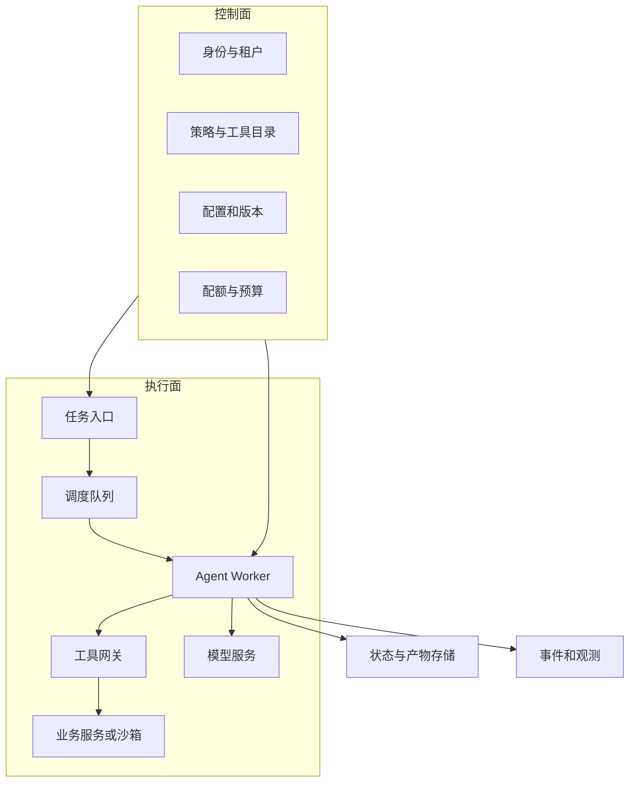
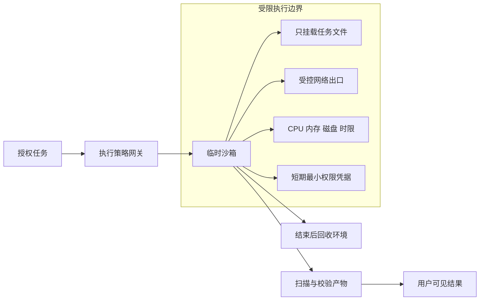

# 数据与平台 Infra：租户、存储与隔离

<div class="book-meta">第 17 章 · 工程与基础设施 · 约 3,127 字 · 建议精读 14 分钟（含图解）</div>

<p class="chapter-lead">基础设施的任务是把一次成功演示变成可持续服务。</p>


当第二个团队接入你的 Agent，原先写在脚本里的模型密钥、工具列表、记忆表和日志路径开始变成平台问题：谁能用哪个工具？一个租户是否能读取另一个租户的缓存？长任务崩溃后由谁恢复？不可信代码能否访问宿主文件？

Agent Infra 的职责是把这些能力做成稳定边界。它既包含传统后端基础设施，也包含模型与工具运行带来的新资源和风险。

## 1. 控制面与执行面

控制面管理租户、身份、工具目录、模型配置、预算、版本和发布政策；执行面实际处理任务、调用模型与工具、保存结果和发送事件。分开理解这两部分，有助于避免把管理员权限传入任务执行器。



图中的分离首先是逻辑分离，不强制初期就拆成许多微服务。单体应用也可以有清晰模块与数据权限；只有在规模、隔离或团队边界确实需要时，再独立部署。

## 2. 不同数据为什么使用不同存储

任务状态和审批需要事务与一致性，通常适合关系数据库；大文件、截图与长工具结果适合对象存储；向量索引适合语义近邻检索；缓存适合可重建的加速数据；队列负责调度消息。每个存储都有不同失效后果。

| 数据 | 推荐先考虑 | 失去它意味着什么 |
| --- | --- | --- |
| run、step、action、approval | 关系数据库 | 任务恢复与审计能力受损 |
| 文件、证据快照、产物 | 对象存储 | 无法复核或交付结果 |
| 向量与倒排索引 | 搜索/向量系统 | 检索能力受损，可从源数据重建 |
| 临时缓存 | Redis 等缓存 | 性能下降，正确性不应改变 |
| 待执行消息 | 可靠队列或数据库任务表 | 任务可能延迟或遗漏 |

不要让缓存成为唯一事实来源。若清空 Redis 后，系统忘记某笔退款已经执行，就说明把需要持久化的业务状态放错了位置。相反，所有状态都塞进一个巨大的 JSON 字段，也会让查询、并发更新和迁移变得困难。

## 3. 多租户是贯穿链路的属性

`tenant_id` 应出现在状态、记忆、文档、对象路径、事件、缓存与账单归因中，但字段存在并不等于隔离成立。关键是每一次读取和执行都使用可信身份求得访问范围，并且无法被模型参数覆盖。

以缓存为例，若 key 只有问题文本的 hash，两个租户问“上个月的收入”可能命中同一个答案。更完整的缓存语义需要考虑租户、资源范围、权限版本、数据版本、模型和 prompt 配置。某些个性化或高度敏感结果可能根本不适合共享缓存。

数据库行级安全、服务端过滤、独立 schema 或独立实例是不同强度的隔离方式。选择取决于风险、成本和规模。即使主数据库隔离正确，搜索索引、日志和对象存储仍可能成为旁路，必须绘制全链路数据流。

## 4. 调度与资源配额

Agent 消耗的不只是 CPU：还包括模型并发、token、供应商请求额度、工具 QPS、沙箱内存、磁盘和执行时间。一次用户任务可能放大成几十次调用，因此限流应同时覆盖请求入口与内部调用。

可以从三层预算开始：租户每天或每月总额度；单任务费用与时长；单工具或模型的并发。入口允许任务进入后，执行中仍要扣减预算并及时停止，避免根据过低预估接受任务后失控。

公平调度需要定义目标：按任务数公平不代表按资源公平。一个文档摘要和一个长时间代码任务成本差异很大。实践中可以设置资源类别、并发上限与优先级，并监测等待时间和被拒绝比例，再逐步优化。

## 5. 沙箱不是“用了 Docker”这么简单

当 Agent 能执行代码，它接触的是不可信输入与不可信程序。隔离要覆盖文件、网络、进程、凭据和资源。容器提供重要基础，但共享内核、宿主挂载、过宽网络和长期凭据都会扩大风险；高风险场景需要根据威胁模型选择更强隔离。



读图时注意，产物离开沙箱也需要检查。生成的 HTML、脚本或压缩包可能携带恶意内容、敏感信息或越界路径。沙箱保护宿主，不自动保证产物适合直接发布或执行。

网络默认范围应由任务决定。读取指定文档不需要访问任意内网地址；运行单元测试通常不需要生产数据库凭据。临时环境结束后清理文件和密钥，长任务恢复时重新验证授权，而不是无限续用旧访问令牌。

## 6. 状态、事件与产物的关联

每次执行保存 run ID、版本、操作者和预算；每个工具动作保存 action ID、参数摘要、结果引用与错误；大结果写对象存储，数据库保存引用和校验信息。这样既避免数据库膨胀，也能关联完整证据链。

对象引用不是永久授权。用户下载产物时仍要检查当前权限，或使用有时效的受控下载方式。不能把可猜测路径当作访问控制。删除文档时，还要检查由它派生的摘要、索引、缓存和公开产物是否需要同步处理。

下面是任务记录的字段示意，具体 schema 需按查询与恢复需求设计：

```json
{
  "run_id": "run-42",
  "tenant_id": "tenant-a",
  "actor_id": "user-7",
  "status": "waiting_approval",
  "state_version": 12,
  "config_version": "agent-config-5",
  "pending_action_id": "action-7",
  "budget_remaining": {"steps": 4, "cost_units": 0.2},
  "artifact_refs": ["artifact-91"],
  "trace_id": "trace-42"
}
```

## 7. 备份、恢复与版本迁移

能备份不等于能恢复。需要演练恢复后的任务是否会重放副作用，已删除数据是否会重新进入检索，旧状态是否能被新代码读取。主库、对象存储和索引的恢复点不同，还可能造成引用存在但对象缺失。

索引通常可重建，但重建期间是否继续提供旧索引、如何标记数据时效，需要提前决定。长任务升级时可保留旧版本 worker 或设计状态迁移，避免新版本直接解释旧结构。平台发布应同时关注代码、工具合同、模型配置和数据版本。

## 8. 从最小平台开始

首个项目可以用 PostgreSQL 保存任务与业务记录，使用一个 worker 池和对象存储，必要时加搜索索引。只有观察到任务量、隔离、延迟或团队协作瓶颈后，再增加独立队列、调度器和 Kubernetes。

技术组件越多，备份、告警、升级与故障排查成本也越高。平台能力的证明应是“故障发生时任务仍可恢复、租户仍隔离、成本仍受控”，而不是部署图上组件数量很多。

## 延伸推演：平台容量为什么要看任务分布

平均每个任务十秒，并不能说明所有 worker 配置相同。检索问答可能主要等待模型，代码任务可能消耗 CPU 和磁盘，多模态解析又有不同内存峰值。按任务类型建立资源画像，能避免少数大任务拖垮所有交互请求。

对长任务可以使用独立 worker 池，限制沙箱并发；对短交互任务保留容量。平台还应记录资源实际使用量与预估偏差，用于改进入场控制。若只有请求总数，没有模型轮次、token、工具时间和沙箱资源，就难以解释账单为什么增长。

这些设计应从可观察问题出发。先发现某类任务导致排队，再引入资源隔离；每增加一层调度都要有清晰指标验证收益。平台工程的成熟度体现在能够说明每个组件解决了什么故障，而不是组件越多越成熟。

## 9. 练习与面试

创建两个租户，让它们使用相同资源 ID 和相同问题，但拥有不同数据。依次检查数据库、检索、memory、缓存、事件与产物下载是否隔离。再让一个租户提交大量长任务，观察另一个租户是否仍有可接受等待时间。

验收要求能画出每个数据副本与删除路径；沙箱不能读取未挂载文件或越权联网；任务终止后资源可以回收；备份恢复演练不会产生重复业务动作。

**面试追问：控制面故障时任务是否应该继续？** 取决于策略缓存的有效期和风险。低风险已授权任务可以按已固定的配置有限继续；新授权、高影响动作和过期凭据应停在安全边界。必须明确策略，而不是默认永久信任旧配置。

<!-- PROJECT_DEPTH_V2 -->

## 项目深挖：Infra 从一致性边界开始

可运行版本包含 API、Worker、Java 工具、SQLite 状态库和 H2 业务库。每个组件都能解释它的事实责任：SQLite 说明任务走到哪里，H2 说明工单是否存在，派生索引只负责加速查找。先明确这些边界，再考虑替换成更多平台组件。

### 控制面参数怎样影响执行面

模型模式、允许工具、身份映射、超时和租约属于受控配置，不能由用户文本临时改写。当前配置从环境加载，便于本机演示。团队平台应引入版本化配置、发布审查、短期服务身份和凭据轮换，同时让每个 run 记录所用配置版本。

### SQLite 的边界必须说清

领取使用短写事务，适合同一主机上的参考实现。多个进程可在本机竞争任务，但不能把数据库文件挂到 NFS 后就称为多机调度。写入并发、磁盘与主机故障会成为扩展限制；这些限制出现时，应实现 PostgreSQL Store 适配器，迁移数据和索引，重跑故障测试。

项目交付了 PostgreSQL SKIP LOCKED 领取设计，但没有把未运行的 SQL 计入已实现能力。生产版本需要统一数据库时钟、按状态建立索引、选择锁策略、设置连接池和超时，并对旧 Worker fencing 做相同测试。

### 多租户隔离是全链路要求

run 查询同时过滤 id、tenant、actor；Memory 主键包含身份；手册检索过滤租户与服务；Java 工单按 tenant/actor 读取。之后增加缓存、对象存储、向量库与 trace 系统时，也要延续同样的作用域，避免主库正确但旁路泄漏。

若引入数据库行级安全，应理解 runtime role、连接池会话变量与事务范围，不能让上一个租户的 session context 留给下一个请求。独立实例隔离更强，但运维成本与资源利用率不同，需要根据数据风险和租户规模选择。

### 配额、排队与负载必须按任务放大估计

一个任务会产生多次模型和工具调用，失败又会放大流量。入口 QPS 限制不足以保护供应商额度和业务系统。先定义单任务步数、工具超时、重试次数，再增加租户 token 额度与工具并发。对超时未知费用需要保守记账，不能只统计成功返回 usage 的调用。

参考 /metrics 提供任务状态、最老待处理年龄和 Memory outbox 积压，便于定位消费停止。下一步再接 Prometheus 和告警；不要因为返回了几行指标就声称已拥有完整可观测平台。完整部署与迁移路线见[Infra 实战](/project/infra)。

<!-- END_PROJECT_DEPTH_V2 -->
