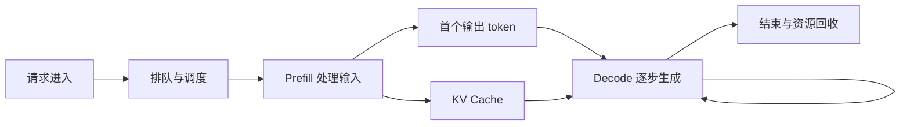
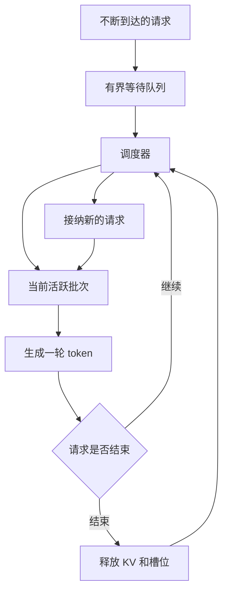

# 推理 Infra：GPU、KV Cache 与吞吐

<div class="book-meta">第 18 章 · 工程与基础设施 · 约 2,996 字 · 建议精读 14 分钟（含图解）</div>

<p class="chapter-lead">应用工程师要理解性能来源；推理岗位需要进一步实测与优化底层系统。</p>


“这个模型只有七十亿参数，显存应该够用”是模型部署中常见的误判。权重只是显存的一部分，长上下文与并发请求还会占用 KV cache、激活和运行时空间。一个能在命令行生成一句话的模型，不一定能稳定服务几十个用户。

本章从一次推理的时间与内存组成讲起，再讨论缓存、批处理、量化与并行。应用工程师应能据此判断容量与成本；推理工程师则需要进一步用真实硬件和工作负载验证。

## 1. 一次请求经历了什么



Prefill 处理整段输入，建立后续生成需要的表示；decode 反复生成下一个 token，并使用已有 KV 信息。长输入和长输出对性能的影响不同。模型服务还包含排队、网络与调度，因此用户感受到的延迟不等于 GPU 内核执行时间。

TTFT 是请求到首个 token 的时间，通常包含排队与 prefill，但报告时要明确测量边界。TPOT 描述输出 token 的生成间隔，端到端延迟还取决于输出长度。吞吐则表示单位时间完成多少 token 或请求；这些指标不能互相替代。

## 2. 权重显存如何粗估

最简单的权重估计是参数量乘以每参数字节。七十亿参数用两字节表示，约为十四十亿字节，即约 `13.04 GiB`。这里 `1 GiB=2³⁰ bytes`，不要把十进制 GB 与二进制 GiB 混为一谈。

四位权重的理想数据占用约为每参数半字节，但量化元数据、未量化层、对齐、运行时格式和工作区都可能增加实际占用。不能把理想公式直接当成显存采购保证。

模型训练所需显存与推理也不同。训练还要保存梯度、优化器状态和更多激活；推理中的 KV cache 又与实际请求长度和并发紧密相关。因此“某模型训练需要多少卡”和“推理需要多少卡”不是同一个问题。

## 3. KV Cache 的含义与公式

对于标准全注意力模型，可以用下面的近似式估计 KV 存储：

$$
M_{KV}=2\times L\times H_{KV}\times D\times T\times B\times S
$$

其中 `2` 表示 Key 与 Value，`L` 是层数，`H_KV` 是 KV 头数，`D` 是每头维度，`T` 是每序列已缓存 token 数，`B` 是并发序列数，`S` 是每元素字节。GQA 应使用 KV 头数，而不是查询头数。滑动窗口、压缩、混合架构和特殊缓存实现需要另行分析。

教学算例：三十二层、八个 KV 头、每头一百二十八维、每序列八千一百九十二 token、四条并发序列、两字节精度，计算结果为四 GiB。把上下文或并发翻倍，理想 KV 存储随之翻倍。

如果权重约十三 GiB、KV 四 GiB、其他开销暂估三 GiB，合计约二十 GiB。二十四 GiB 设备看似有余量，但真实峰值、内存碎片、内核工作区和请求长度分布还可能使它无法稳定运行。容量必须以实测验证。

下面代码可独立运行，帮助核对量纲，不代表实际服务内存分配器：

```python
def kv_gib(layers, kv_heads, head_dim, tokens, batch, bytes_per_value):
    total = 2 * layers * kv_heads * head_dim * tokens * batch * bytes_per_value
    return total / 2**30

print(kv_gib(32, 8, 128, 8192, 4, 2))  # 4.0 GiB
```

## 4. 前缀缓存为什么不是业务记忆

Prefix caching 复用相同前缀已经计算好的 KV，减少重复输入计算。它可能对固定系统提示、大量共享文档前缀或重复会话上下文有效。命中条件、缓存粒度、隔离和回收策略取决于服务实现。[vLLM 的官方说明](https://docs.vllm.ai/en/latest/features/automatic_prefix_caching/)可以用于理解其自动前缀缓存。

缓存不保存“用户喜欢什么”这种业务事实，也不负责跨会话记忆的冲突、删除或权限。它保存计算中间状态。清空缓存通常影响性能，不应改变业务正确性。

相同文字不一定意味着在所有配置下都可复用：模型、适配器、分词和相关执行配置也可能影响有效性。多租户缓存还需要考虑隔离，不能为了命中率把敏感信息暴露给不该访问的请求。

## 5. 批处理与排队的取舍



连续批处理允许结束的请求释放位置，并让新请求加入活跃集合，从而提高资源利用率。图中调度循环也说明为什么更高吞吐可能伴随更长等待：设备忙得更充分，不意味着每个用户都更快拿到答案。

短请求和长请求混在一起时，调度策略会影响尾延迟。大段 prefill 也可能影响正在 decode 的请求，因此一些系统引入分块 prefill 或更细调度。是否采用，应观察具体工作负载，而不是只看离线峰值 tokens/s。

Little 定律给稳定系统的平均关系 `L≈λW`：平均在途请求数约等于到达率乘平均耗时。例如每秒两次请求、平均十二秒完成，对应约二十四个在途请求。它不是 GPU 数量公式，也不直接保证 p95；系统过载或分布变化时，需要更完整排队分析。

## 6. 常见优化各自改变什么

| 技术 | 主要作用 | 必须验证的代价 |
| --- | --- | --- |
| 权重量化 | 降低权重存储与部分计算成本 | 任务质量、内核支持、实际速度 |
| KV 量化 | 降低缓存占用 | 长上下文质量与实现兼容 |
| 前缀缓存 | 减少重复 prefill | 命中率、隔离、缓存管理 |
| 连续批处理 | 提升设备利用率 | 排队与尾延迟 |
| 推测解码 | 草稿生成后由目标模型验证 | 接受率、额外开销、实现收益 |
| Tensor parallel | 将部分张量计算分到多设备 | 通信开销和设备拓扑 |

量化位数降低不保证所有设备上都更快，可能受内核和内存访问限制。推测解码收益依赖草稿接受率和额外计算开销，不是无条件加速。每项优化都要在相同任务质量约束下比较。

Pipeline parallel、data parallel、prefill/decode 分离等解决不同规模问题。跨设备或跨节点后，通信、KV 传输和调度可能成为新瓶颈。对应用岗位，先理解这些成本来源；对推理岗位，需要继续学习 GPU 架构、CUDA/Triton、NCCL 与性能分析工具。

## 7. 怎样设计可信压测

固定并记录模型版本、权重精度、KV 精度、硬件、驱动与服务版本。输入长度和输出长度分别设短、中、长三档，加入真实业务分布，并报告请求到达模式。只用相同短 prompt 连续请求，可能夸大缓存收益。

分别记录冷启动、预热后、低负载、目标负载和过载行为。指标至少包括 TTFT、TPOT、端到端 p50/p95/p99、成功率、吞吐、显存峰值与队列等待。说明是否包含失败和超时，避免只统计成功完成的快速请求。

进行开环到达率测试时，客户端按预设速率发送，更容易观察系统何时积压；闭环并发测试则由请求完成后再补发，适合探索特定并发下的吞吐。两种方式测到的现象不同，报告必须写清楚。

## 8. 托管 API 还是自托管

托管 API 可以让应用团队快速开始，减少硬件与模型服务维护；自托管可能满足特定数据、定制或稳定负载成本需求，但需要承担容量、冗余、升级和事故响应。比较的是总拥有成本，而不只是单次推理费用。

低利用率下，设备空闲成本可能很高；峰值负载又需要余量或弹性。多模型、多租户和不同延迟等级会使调度更复杂。先测业务需求，再决定部署方式，通常比先买硬件再寻找用途更合理。

## 9. 练习与面试

先用公式画出上下文长度与并发对 KV 的影响，再在可用环境中验证。设计一次仅开启前缀缓存的对照，分别使用共享前缀和随机前缀流量。解释为什么命中率改变时 TTFT 收益不同，而 decode 未必同比变化。

验收要求报告能被他人复现，并明确哪些数字是理论估算、哪些是实测。任何优化都同时展示质量、延迟、吞吐和资源变化，不能只摘取一个更好看的指标。

**面试追问：模型权重放得下为什么仍然 OOM？** 需要检查动态 KV、并发长度、激活峰值、内核工作区、碎片及服务预分配策略；参数量只是静态权重的一部分信息。定位时先观察分配来源，再调整上下文、并发、精度或分片策略。

<!-- PROJECT_DEPTH_V2 -->

## 项目深挖：把应用 Infra 与推理 Infra 接起来

本地项目默认没有 GPU 推理，真实 HTTP 适配器可以连接外部或自托管模型服务。应用层负责任务、权限和业务状态；推理层负责权重、token 调度、KV 管理和硬件利用率。两层的预算和排队必须协同，否则模型服务高吞吐不一定带来任务低延迟。

### 先区分 prefill 和 decode

prefill 处理已有上下文，通常受输入长度和计算影响；decode 逐步生成输出，批处理与 KV 访问会影响吞吐。长运行手册增加 prefill，冗长决策解释增加 decode。项目只要求受控 JSON 决策，避免为了“看起来会思考”产生大量无用输出。

端到端时间还包括模型队列等待、网络、工具和 checkpoint。只看服务端生成 token/s，无法解释用户为何等了很久。至少测首个有效结果时间、整项任务完成时间及 p95/p99，并按输入长度、工具轮数和失败类型分组。

### KV 容量的可运行估算

运行 scripts/capacity.py。默认 32 层、8 个 KV heads、head_dim=128、8192 token、每元素 2 字节，理论单序列 KV 为 1 GiB。公式中的 2 表示 K 与 V；GQA 应使用 KV heads，而不是 query heads。权重、临时激活、分页碎片和运行时开销还没计算，不能拿这个数字直接确定能同时服务多少用户。

多个 Agent 共享系统前缀时，prefix cache 可能节省 prefill，但前缀顺序、模板和缓存策略会影响命中。个性化 Memory 混入很长的公共前缀之前，可能降低复用；反过来，为缓存命中而不当地共享敏感上下文，会引入隔离风险。

### 连续批处理与长尾

continuous batching 能把不同请求的生成动态组合，提高设备利用率。但超长请求、不同输出长度和抢占会改变延迟分布。应设置队列长度、输入/输出上限、租户公平性和取消传播，避免一个长任务挤压所有交互请求。

量化可能降低显存和带宽压力，但格式合法率、工具选择与引用质量是否变化，需要在相同任务集验证。不要只比较通用 benchmark 或模型文件大小。自托管还要计入空闲 GPU、扩缩容冷启动、模型加载、镜像与驱动维护成本。

### 故障如何向应用层反馈

GPU OOM、服务重启、超时和限流都必须映射为有意义的错误。模型重试不是免费操作，输入重放会再次消耗计算和预算。达到重试上限后停止或转人工，不要让 Worker 无限回到队列。当前交付没有执行 GPU 压测，因此容量脚本是透明估算，不能当作硬件实测结果。

<!-- END_PROJECT_DEPTH_V2 -->
