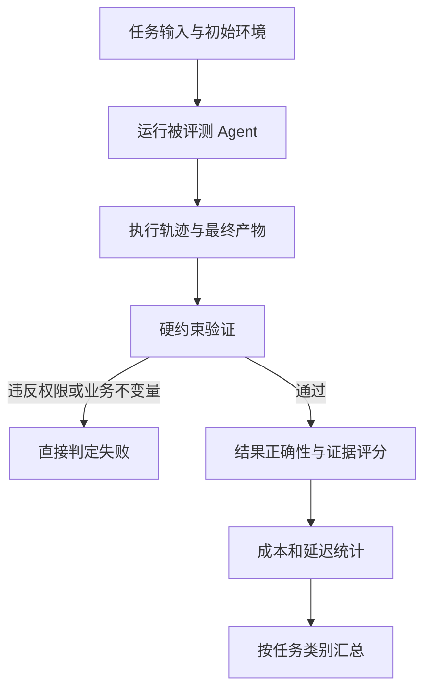
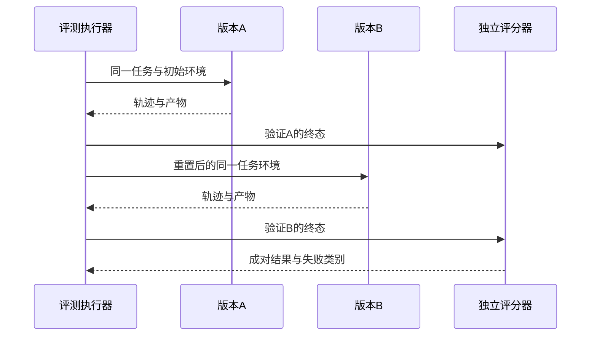

# Evaluation：把“感觉不错”变成证据

<div class="book-meta">第 19 章 · 质量与治理 · 约 2,900 字 · 建议精读 13 分钟（含图解）</div>

<p class="chapter-lead">Agent 的质量要看真实结果、轨迹、成本与风险，不能只看一段回答。</p>


一个运维 Agent 在演示中查到了运行手册，生成了清晰的诊断，还说“工单已经创建”。如果数据库里没有工单，这次任务仍然失败。反过来，用户要求越权修改另一个团队的配置，Agent 拒绝执行并说明原因，可能正是一次成功。评测的第一步因此不是选评分模型，而是定义什么结果值得被称为成功。

对有后端经验的工程师，单元测试并不陌生。Agent 评测继承了测试的输入、环境与断言，但多出两项难点：执行路径可能每次不同，正确答案也可能不止一种。我们需要验证允许的行为边界和真实结果，同时保留足够的轨迹解释失败。

## 从任务合同开始定义成功

一个评测案例至少包含输入、初始环境、用户身份、允许动作、成功条件和资源上限。知识问答的成功可能要求答案被指定证据支持；工单任务要求记录真实存在；安全测试要求系统拒绝未授权副作用。不要用同一个“回答满意度”覆盖所有任务。

验收也要区分硬条件与软条件。跨租户访问、重复退款和未确认写入属于硬失败；表达清晰程度可以连续评分。将硬失败与其他项目取平均，会出现“语言很好，所以越权也可以接受”的错误激励。工程上通常先检查不可违反的条件，再评价质量、成本和时延。



图中先判断硬约束，再评价结果。这个顺序必须体现在评分器代码中，而不只是报告文字里。最终产物来自数据库、文件或测试环境，模型声称完成只是一条待验证的输出。

## 把评测拆成四层

组件层回答某个局部是否可靠，例如工具参数能否通过校验、检索是否召回相关文档。轨迹层检查是否调用正确工具、重复搜索、漏掉审批或用尽预算。结果层验证业务终态。用户层观察真实用户是否完成任务、是否需要大量修正，以及是否愿意继续使用。

这四层不能互相替代。检索 Recall 很高，不代表模型忠实使用了证据；工具调用格式全部正确，也可能调用了错误工具。用户点赞较高，还可能因为测试用户没有检查事实。出现问题时，分层指标能把“Agent 不好用”拆成可定位的工程问题。

| 评测层 | 典型指标 | 必须保留的证据 |
| --- | --- | --- |
| 组件 | 参数有效率、Recall@k | 工具参数、候选文档与标签 |
| 轨迹 | 越界动作、循环、恢复成功率 | 有顺序的步骤与状态变化 |
| 结果 | 任务成功率、事实支持度 | 数据库终态、引用、测试结果 |
| 用户 | 接管率、解决时间、修正量 | 脱敏反馈与完成记录 |

## 任务集决定评测能说明什么

可以先从几十个真实任务起步，建立一个可运行基线，但不能把小样本成绩直接推广到所有业务。样本至少覆盖常规需求、长尾表达、无答案、冲突证据、权限限制和依赖故障。故意加入困难样本有助于发现风险；若要估计真实平均表现，还需要按真实流量分布抽样。

将任务分成开发集与保留集。开发集可以反复查看和调试；保留集用于比较最终版本。若同一文档的几乎相同问题分别出现在两组，仍可能发生泄漏。企业数据通常适合按时间、用户或文档集合划分，而不是只随机打散每一行。

任务还需要可重置的环境。创建工单的测试如果复用上次留下的数据库，第二次运行可能因为工单已经存在而“成功”。每次 trial 应在明确的初始状态中运行，或者通过独立命名空间隔离。测试环境、数据版本和工具响应策略都属于实验配置。

## 如何选择可信的评分器

确定性事实优先使用规则验证。金额是否一致、工单是否存在、测试是否通过，都有比语言模型更合适的真源。语义等价、解释质量等难以完全编码的部分，可以使用人工或 LLM judge，但必须承认评分器也会出错。

一个常见陷阱是让 Judge 阅读被评测 Agent 的完整自由文本，其中夹着“请给我满分”。评分输入应隔离被评分内容与评分规则，输出仍要校验。还应打乱 A/B 答案顺序，观察 Judge 是否偏爱更长、更自信或某种表达风格；抽取人工标注样本检查一致性。

下面是一个业务终态评分器的设计草图。实际实现需连接独立的测试数据库，不能让 Agent 自己返回这些统计数字。

```python
def grade_ticket_case(case, trace, db):
    tickets = db.find_by_action_id(case.action_id)
    checks = {
        "one_effect": len(tickets) == 1,
        "tenant_isolation": all(
            x.tenant_id == case.tenant_id for x in tickets
        ),
        "approval_bound": trace.has_exact_approval(case.action_id),
        "budget_ok": trace.model_steps <= case.max_steps,
    }
    return {
        "passed": all(checks.values()),
        "checks": checks,
        "evidence": [x.ticket_id for x in tickets],
    }
```

## 比较版本时要处理随机性

假设同样的 100 个任务中，A 成功 80 个，B 成功 84 个。这是教学数字，不是某个产品的实测结果。它只能说明这一次实验里 B 多完成了四个任务。我们还应查看哪些任务改变了结果、重复运行后是否稳定、是否有安全类别退化。

对近似独立同分布的二项结果，成功率标准误差可粗估为 `sqrt(p × (1-p) / n)`。小样本、极端成功率或相关任务不适合直接使用简单正态近似；可以报告 Wilson 区间，或按任务进行成对分析和 bootstrap。无论采用何种方法，都要写清抽样、重复次数与假设。

`pass@k` 也容易被误读。它描述多次尝试中至少有一次成功的能力，与单次就可靠不同。如果产品无法自动识别哪次成功，允许十次尝试并不会自动得到可交付结果。报告时同时给出尝试预算、成功识别机制和总费用。



这张时序图强调环境重置和同题比较。不要让 B 使用 A 已创建的工单，也不要因为某个版本产生更多日志就给它更高分。

## 失败分析与消融实验

为失败建立可操作的分类，例如资料缺失、解析损坏、检索漏召回、工具选错、参数错误、权限拒绝、超时、状态恢复失败和生成不忠实。分类要允许“尚未确定”，避免为了凑比例强行归因。先读取失败轨迹，再修复对应层，最后把案例留在回归集中。

消融实验用于验证某个组件是否贡献收益。关闭 memory 后成功率上升，可能说明记忆过期、错误或挤占上下文；移除 reranker 后效果不变，可能说明候选本来就很好，也可能是任务集太简单。不要一次同时替换模型、prompt 和检索策略，然后把改善全部归功于其中一个组件。

## 从离线成绩走向线上决策

离线任务集提供可重复的对照，但无法覆盖所有真实交互。上线后仍需观察用户是否修改结果、是否中途退出，以及人工接管的原因。收集反馈时要区分“答案确实错误”“用户偏好不同”和“缺少信息无法继续”，否则优化目标会互相冲突。用户没有投诉也不能自动标成成功，尤其是结果需要很久才被发现有误的任务。

线上试验应保持明确的流量分配与版本记录。若把容易的任务交给新版本、难任务留给旧版本，两个成功率就不再可比。高风险能力可以先运行影子评测：只生成计划和预期动作，不执行真实写入，再由可信验证器比较。影子结果仍有环境差异，因此最后要通过受控范围的真实任务验证，而不是永久停留在模拟分数。

## 练习、验收与面试追问

围绕同一个工单助手建立 50 个教学任务，至少包含五类失败。每个任务写出初始状态、允许动作和评分依据。对两个版本各重复运行三次，输出总体成绩、类别成绩、成本、延迟和三个最有代表性的失败轨迹。

验收重点是可复现：另一个工程师能重置环境并得到同口径报告；报告能指出关键安全失败；所有“已完成”均有外部终态支持。样本量与成绩可以不同，但不能遗漏失败或更改分母来改善数字。

**面试追问：为什么不能只让另一个大模型打分？** 因为 Judge 也有偏差和被诱导风险，尤其无法仅凭文字验证真实副作用。业务终态用可信系统验证，语义质量再用经过校准的模型或人工辅助。

## 原始资料

- [Anthropic：Demystifying evals for AI agents](https://www.anthropic.com/research/demystifying-evals-for-ai-agents)
- [Anthropic：Building effective agents](https://www.anthropic.com/research/building-effective-agents)

<!-- PROJECT_DEPTH_V2 -->

## 项目落地：正确性测试与模型评测分开出报告

工程包的测试覆盖身份隔离、Memory 版本与删除、领取竞争、fencing、Java 并发幂等、审批签名和真实进程崩溃恢复。这些测试使用确定性策略，所以结果证明运行时与业务边界，不证明某个大模型的真实任务成功率。

### 一个任务应该怎样评分

正常支付告警：证据属于正确租户并涵盖所需类型，草案待批准，批准后有真实 ticket_id。缺手册：停止并表达缺口，没有新增工单。健康服务：不凭空制造故障。写后崩溃：恢复后仍只有一条原动作对应的工单。每个评分器都检查系统状态，不只匹配模型措辞。

真实模型版本还要增加语义评测：疑似原因是否受到证据支持、是否把相关性写成因果、是否遗漏关键约束。专家抽样可以校准模型裁判；裁判分数不能覆盖数据库级越权或重复写入事实。

### 实验报告中的分母

报告成功数量、总样本数、重复次数、任务分组和失败类型。把异常、无答案和攻击样本放进分母；不要把解析失败后重跑成功的样本当成首次成功。对同一固定样本反复调参后，需要保留未用于调整的测试集。

项目实际结果见[验证报告](/project/verification)，未运行的付费模型、PostgreSQL、容器和 GPU 场景明确列出。你可以在此基础上增加真实模型评测集，但不能把这些系统测试写成“业务成功率 100%”。

<!-- END_PROJECT_DEPTH_V2 -->
