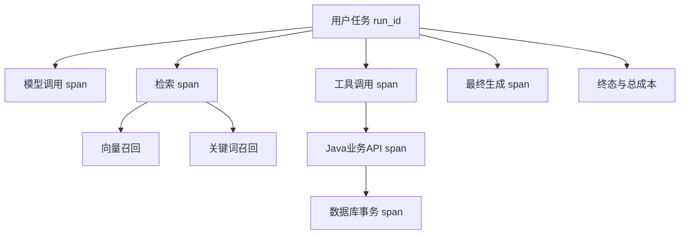
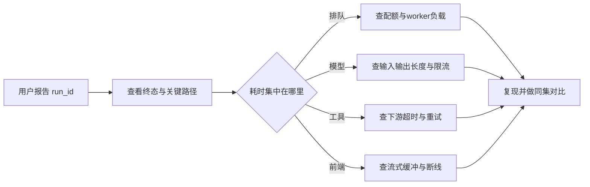

# Observability 与成本：从一次失败追到根因

<div class="book-meta">第 20 章 · 质量与治理 · 约 2,760 字 · 建议精读 12 分钟（含图解）</div>

<p class="chapter-lead">把运行事件、模型行为和业务结果连接起来，才能优化。</p>


用户只会说“刚才那个任务卡住了”，但系统内部可能已经完成三次模型调用、两次检索和一次业务写入。普通 HTTP 日志如果只记录入口返回码，就无法解释卡在哪里，更无法知道重试是否造成重复操作。Agent 的可观测性需要把用户任务、模型行为、工具调用和业务结果连接成同一条证据链。

对 Java 后端工程师，trace、metrics、logs 仍然是基础。新的部分是模型版本、上下文版本、token 用量、工具选择和任务终态。设计目标不是保存尽可能多的文本，而是让工程师在合理的访问范围内回答：发生了什么、为什么发生、影响多大、如何复现。

## 从请求追踪升级到任务追踪

HTTP request 可能很短，但 Agent run 可以持续数分钟甚至等待一天的审批。因此 request_id、run_id、thread_id 不应混为一个标识。一个会话可能包含多个 run，一个 run 又可能跨多个请求和 worker。每个模型调用、工具调用与业务 API 调用可以作为独立 span，保留父子关系。



图中的层次描述因果关系，不一定等于串行时间顺序。并行检索可以共享父 span；人工审批则可能通过事件关联恢复后的 trace。应保留稳定 run_id，避免一次断线让整个任务失去关联。

基础事件字段可包含 `trace_id`、`run_id`、`step_id`、`tenant_id`、开始结束时间、状态、错误类别、模型标识、prompt 版本、工具 schema 版本和 usage。记录可观察的调用与结果摘要即可，不要依赖可获得模型私有思维链，也不要把想象中的“思考过程”写进日志。

## 指标分成业务、质量和资源三类

业务指标观察任务完成率、人工接管率、用户修正量和解决时间；质量指标观察证据支持、工具参数错误、循环、越权拦截和预算耗尽；资源指标观察请求量、队列长度、并发、token、供应商限流与费用。三类指标应能按任务类型、模型版本和租户切片。

一个常见误区是只优化 token 速度。生成很快但最终答案不可用，会增加用户重试和人工审核，总解决时间可能更长。另一个误区是只看平均值。少数工具耗时很长，平均延迟变化不大，但 p95 和用户投诉可能急剧恶化。

| 指标 | 回答的问题 | 解释时的限制 |
| --- | --- | --- |
| TTFT | 用户何时看到首个输出 | 必须说明从客户端还是服务端开始计时 |
| p95 总耗时 | 较慢的一批任务有多慢 | 不同任务类型不宜直接混合 |
| 接管率 | 有多少任务需要人工继续 | 主动安全接管不一定是负面结果 |
| 每成功任务成本 | 完成一件事实际花多少 | 需计入失败、重试和相关工具费用 |

## 一次完整的故障定位

假设用户报告一个工单任务耗时 40 秒，而平常是 10 秒。这些是教学设定。先用 run_id 找到终态与总耗时，再查看关键路径：如果检索只用了 200 毫秒，模型用了 4 秒，剩余时间集中在业务工具，就不应先改 prompt。

进一步检查工具 span，发现第一次请求等待 15 秒超时，第二次又等待 15 秒。业务系统已经写入工单，只是响应丢失。这里既有超时预算问题，也有不确定提交问题。优化方向是让业务服务按 action_id 返回既有结果，而不是增加模型反思次数。



沿图定位的重点是先找耗时证据，再选择优化对象。模型调用变慢可能只是排队，不一定是模型本身的计算速度变差。

## 建立可解释的成本账本

一次尝试的模型成本可以写为各轮成本之和：未缓存输入 token 乘单价、缓存输入 token 乘缓存价、输出 token 乘输出价，再加工具和检索等费用。供应商对推理 token、缓存和批处理的计费方式可能不同，实际账本必须映射具体接口返回的 usage 与账单规则。

以虚构教学单价为例，每百万未缓存输入 2 个货币单位，缓存输入 0.5，输出 8。每轮平均输入 2500 token，其中 40% 命中缓存，输出 500 token；四轮模型成本约为 0.03。若每轮工具再花 0.001，一次尝试合计 0.034。平均尝试 1.1 次，最终成功率 85%，每成功任务成本约为 `0.034 × 1.1 / 0.85 = 0.044`。

这个估算使用平均值，未模拟历史随轮数增长。真实系统应逐次累加 usage，而不是永远用“第一轮 token × 轮数”。如果允许重试，必须明确平均尝试数和最终成功率是否已经包含重试，避免在公式中重复计算。

```python
# 教学账本：金额建议在生产中使用 Decimal 或最小货币单位。
def attempt_cost(calls, tool_cost):
    total = tool_cost
    for c in calls:
        total += (
            c.uncached_input * c.input_rate
            + c.cached_input * c.cache_rate
            + c.output_tokens * c.output_rate
        ) / 1_000_000
    return total

def cost_per_success(total_cost, successful_tasks):
    if successful_tasks == 0:
        return None  # 不能把零成功任务解释成零成本
    return total_cost / successful_tasks
```

成本归因应同时支持 tenant、任务类型、模型和版本。否则某个租户引入超长文档后，团队只会看到总账增长，却不知道是谁、为什么、是否产生业务收益。

## 采样、隐私和观测开销

全量保存原始 prompt 很方便，也可能把个人信息、业务秘密和密钥复制到日志平台。建议将默认观测设计为元数据与结构化摘要，原文按明确用途、权限和保留期受控采样。错误日志尤其需要检查，因为异常对象可能意外包含请求体或认证头。

采样还要避免只留下成功案例。可以对一般成功请求低比例采样，对错误、预算耗尽和安全拦截保留更多诊断信息，但敏感字段的限制仍然有效。采样策略应写入报告，否则基于样本计算的失败率可能失真。

跨 Python 和 Java 服务时，可以使用 OpenTelemetry 传播上下文并输出 span。具体 GenAI 属性名与稳定性要核对所用版本；不要为了跟随文档更新而让旧仪表盘突然失去字段。日志 schema 也应版本化并保持兼容。

## 预算如何在运行时真正生效

显示一个费用仪表盘只是事后观察，生产系统还需要在每轮执行前检查剩余预算。可以分别设置每任务、每用户和每租户的限制，并把可用模型、最大输出和工具范围纳入策略。估算预算用于决定是否继续，服务端实际 usage 用于最终记账，两者不应混成一个不可修正的数字。

并发任务共享租户预算时，还要考虑竞争。两个 worker 同时读取“还剩一点预算”，然后各自启动昂贵调用，会超过预期上限。可以预留额度、在调用结束后结算和释放，或采用允许小幅超额的明确策略。精确程度取决于供应商能否提前确定费用与任务的业务要求，不能仅靠进程内变量作跨实例限制。

缓存也需要可观测性。分别记录候选命中、可安全复用的命中与实际计费命中，不要把三者混为一谈。应用答案缓存应受租户、权限、数据版本和时效约束；模型前缀缓存则是计算复用机制。相同问题的答案可能因用户权限不同而不同，缓存收益必须在隔离正确的前提下评估。

告警应指向可行动的问题。例如“某租户过去十五分钟预算耗尽比例上升，主要集中于新文档任务”比“token 数增加”更有帮助。告警阈值必须结合流量、任务结构和维护窗口，避免正常批处理触发大量噪声。值班人员需要能从告警直接进入相关任务与运行手册，而不是重新手工拼接标识。

## 优化前后如何证明收益

优化必须有质量约束。减少文档条数可以降低输入成本，却可能漏掉关键证据；换便宜模型可能增加重试；缓存可能引入过期答案。每次优化应在同一保留集上同时比较成功率、风险、费用和延迟，必要时分任务类别路由。

练习时，为毕业项目生成一条跨模型、检索和 Java 工具的完整 trace。选出最大的耗时或成本来源，只修改一个因素，重新跑同一批任务。验收要求能够从用户 run_id 定位到具体步骤，账本包含失败与重试，日志中没有未脱敏密钥。

**面试追问：平均延迟正常，为什么用户仍然觉得慢？** 可能是尾延迟、首 token 延迟、排队或流式代理缓冲。应从客户端与服务端分段计时，按任务类别切片，再追踪最慢的关键路径。

## 原始资料

- [OpenTelemetry：GenAI semantic conventions](https://opentelemetry.io/docs/specs/semconv/gen-ai/)
- [Spring AI：Observability](https://docs.spring.io/spring-ai/reference/observability/index.html)

<!-- PROJECT_DEPTH_V2 -->

## 项目落地：排障信息必须能定位阶段

Worker 输出结构化日志，带 run_id、tenant、fence、事件名和耗时；events 表保存实际状态变化；Java 返回真实业务 ID。三者共同构成最小证据链。项目没有记录模型私有思维链，也不把原始凭据写进错误日志。

### 先把延迟拆开

接受时间到首次 claimed 是调度等待；模型 HTTP 与工具调用属于执行；等待审批是人机协作时延；Java 提交与状态保存是最终确认。把这几类时间混成平均响应时间，会把“人尚未批准”误报成系统故障。

当前 /metrics 暴露状态数量、最老未完成任务年龄与 outbox 积压。它们是低基数指标，适合告警。不要把 run_id、用户输入或任意 service 查询放进 Prometheus label；高基数和敏感数据会同时带来成本与治理问题。详细个案留在有权限控制的日志/trace 系统中。

### 成本需要按成功任务计算

模型费用、重试、GPU 空闲、数据库、检索与人工复核共同形成成本。某个便宜模型如果经常输出非法工具、导致多次重试或人工接管，成功任务成本可能更高。没有真实 usage 和价格快照时，不编造金额。

进阶时可接 OpenTelemetry，传播 W3C trace context，并将 run/action 与 trace 关联。先验证跨 Python/Java 链路能找到同一请求，再添加采样和脱敏策略。参考日志只是接入基础，不能替代完整追踪后端。

<!-- END_PROJECT_DEPTH_V2 -->
