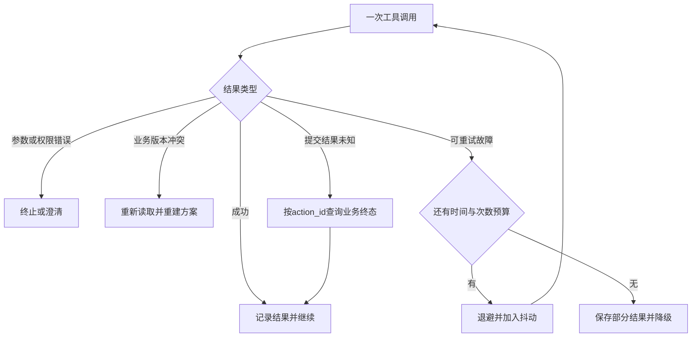
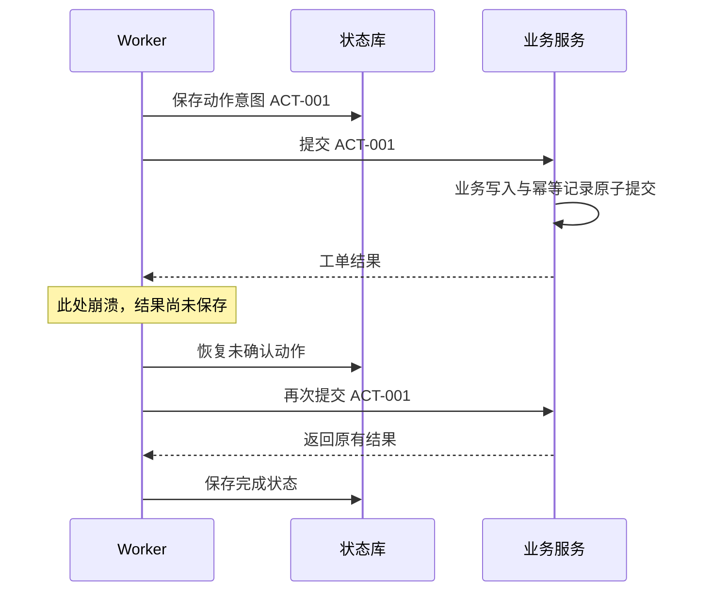

# 可靠性、部署与发布工程

<div class="book-meta">第 21 章 · 质量与治理 · 约 2,864 字 · 建议精读 13 分钟（含图解）</div>

<p class="chapter-lead">模型不确定性之外，分布式系统的老问题一个也不会自动消失。</p>


Agent 演示经常只运行在一个进程里，成功路径很短：接收输入、调用模型、执行工具、返回结果。生产环境却会遇到 worker 重启、网络超时、依赖限流、用户取消和发布迁移。模型不确定性没有替代分布式系统问题，反而会让执行时间、路径和资源消耗更难预测。

可靠性设计的目标并非让所有任务永远成功，而是让系统在可预期的预算内工作，失败时保留事实、避免重复副作用，并能清楚地恢复、降级或交给人。

## 先写故障模型，再写重试代码

外部调用可能返回明确失败，也可能处于“结果未知”。读接口超时通常可以有限重试；写接口超时却可能已经完成提交。将所有异常统一重试，会把网络抖动变成重复工单甚至重复交易。

至少区分参数错误、权限拒绝、业务冲突、限流、暂时故障和结果未知。前两类通常不应原样重试；业务冲突需要重新读取状态；限流应遵循服务策略并控制总体并发；结果未知应先凭业务动作 ID 查询终态。错误分类应来自结构化状态，而不是让模型猜一段异常字符串是什么意思。



图中的“查询终态”很关键：它将恢复建立在业务事实之上。不要把“没收到成功响应”解释成“没有发生写入”。

## 超时预算必须沿链路分配

如果用户任务总 deadline 为 30 秒，每个工具却允许等待 30 秒并重试三次，系统的实际边界就已经失效。为任务设置总时间预算，再为模型、检索和工具分配子预算；每次调用前计算剩余时间。等待人工审批属于另一种持久化状态，不应占用请求线程或无限延长一个活动连接。

指数退避可以降低持续故障下的压力，抖动可以避免大量请求同时重试。但这两者不能替代并发限制、队列上限和熔断。无界任务队列只会把失败延后，同时占用内存并使等待时间不可控。系统应明确何时拒绝、排队或降低服务级别。

Little 定律 `L ≈ λW` 可以帮助理解稳定系统的平均在途量。若每秒到达 2 个任务，平均运行 12 秒，平均在途量约为 24。这个教学估算不是 worker 数建议：一个异步 worker 可处理多个等待中的任务，GPU 并发还受显存与调度影响，尾延迟也需要压测。

## 持久化执行与幂等各管什么

Checkpoint 保存任务进度，使 worker 重启后知道从哪里继续；业务幂等保证同一个动作重复提交时，不重复产生副作用。若工单写入成功后、checkpoint 保存前崩溃，恢复时仍可能再次调用工具。两种机制缺一不可，不能因为使用了某个编排框架就宣布端到端 exactly-once。

稳定 action_id 应在执行意图创建时生成，并在重试与恢复时保持不变。业务服务用租户与 action_id 建立唯一约束，将幂等记录与业务写入放在自己的短事务中。遇到并发重复提交时，需要捕获唯一约束冲突并读取既有结果，而不是向用户返回一个不可解释的数据库错误。



这张图不是宣称所有外部系统都支持幂等。如果下游没有动作 ID 查询或去重能力，就要设计补偿、对账或人工处理，承认无法自动消除的窗口。

## 什么才是一次完整发布

Agent 的行为不仅由代码决定，还受 prompt、模型选择、工具 schema、知识索引、memory 策略和配置影响。发布单元应记录这些版本之间的组合。只回滚容器镜像，却继续使用新 prompt 或新索引，可能无法复现旧行为。

| 发布对象 | 典型风险 | 回滚前需要考虑 |
| --- | --- | --- |
| 代码与依赖 | 协议变化、运行时错误 | 旧任务状态能否被读取 |
| Prompt 与模型 | 工具选择、拒答、格式漂移 | 同一评测集是否仍通过 |
| 工具 schema | 参数缺失、语义改变 | 未完成任务使用哪个版本 |
| 知识与记忆策略 | 旧事实、错误写入、权限变化 | 是否需要修复已产生的数据 |

发布通常经过确定性检查、离线任务评测、小流量验证和逐步放量。小流量不是把所有风险交给第一批用户；关键权限与副作用测试应在此前完成。上线指标需要同时观察质量和资源，不能只看 HTTP 200 比例。

## 长任务升级与资源治理

长任务跨越发布窗口时，可以让旧 worker 排空现有任务，新 worker 处理新任务；也可以保持兼容并迁移状态，但迁移必须有明确版本和验证。不要在部署时直接把所有旧状态反序列化到新类中，再期待字段刚好兼容。

最小部署可以从容器、数据库、队列和一个 worker 服务开始。健康检查应区分进程存活与能够接收新任务；依赖暂时故障不一定意味着反复重启进程有帮助。资源限制包括 CPU、内存、执行时长、并发模型调用和租户配额。扩容指标应考虑队列与瓶颈，而不只是 CPU。

以下配置只是服务边界的示例，不是任何框架的通用配置文件。

```yaml
task_policy:
  total_deadline_seconds: 45
  max_model_steps: 8
  max_tool_retries: 2
  max_inflight_per_tenant: 5
  queue_capacity: 200
recovery:
  checkpoint_after_each_step: true
  stable_action_id: true
  unknown_write_result: query_business_state
release:
  prompt_version: p12
  tool_schema_version: t7
  state_schema_version: s3
```

## SLO、降级和人工接管

服务目标应该描述用户关心的结果。例如对只读知识问答，可以同时设定成功返回比例和延迟目标；对写操作，还要单独约束重复副作用和未授权动作。示例目标必须经过业务协商与历史基线确认，不能照搬另一家公司的一组数字。模型输出了文字并不一定算可用，回答完全无证据时也不应计入成功返回。

降级需要保持业务语义。模型供应商故障时可以使用经过相同安全测试的备用模型，也可以退回检索结果列表、保存草案或转人工。不能为了恢复成功率而移除审批，也不能把数据发送给不符合原有处理条件的新服务。不同降级模式应在界面和事件中明确标记，便于用户判断结果。

取消同样需要边界。取消信号可以阻止尚未开始的步骤，并尝试中断可取消调用；它通常无法撤销已经提交到外部系统的操作。任务状态应区分“收到取消请求”“执行已停止”和“需要补偿”。对于已经创建的工单，可以返回其标识并说明是否仍需关闭；不要显示一个笼统的取消成功掩盖已发生的事实。

事故发生后，复盘应从时间线和系统条件出发。找出哪个假设失效、哪项检测缺失、哪个恢复步骤依赖个人经验，并把改进变成具体测试、指标或流程。将一次错误归咎于“模型不听话”无法形成可执行改进；把失败样本加入评测、将动作权限收窄、缩短未知提交窗口才是工程结果。

## 故障演练如何落地

至少演练 worker 被终止、工具超时、模型限流、审批过期、重复消息和数据库短时不可用。每次演练明确注入点、预期行为、可观察信号和恢复步骤。只随机关闭服务却不知道期望结果，不是有效测试。

恢复文档要写给没有参与开发的人：如何判断任务仍在运行、怎样查询未知提交、哪些动作可重放、哪些必须人工处理。备份也需要恢复演练；“备份任务执行成功”不能证明数据能够按目标时间恢复。

练习时，在工单已提交但 checkpoint 未保存的位置杀死 worker。重启后重复消费同一消息，确认只存在一个工单，再将审批设为过期，确认系统没有继续写入。验收还包括总时间和重试次数确实受控，以及用户能看到部分完成状态。

**面试追问：为什么 prompt 改动也应进入发布流程？** 因为它可能改变工具选择、授权询问和输出语义，是系统行为的一部分。需要版本、评测和回滚策略，不能只靠人工试问几个问题。

## 原始资料

- [LangGraph：Persistence](https://docs.langchain.com/oss/python/langgraph/persistence)
- [Temporal：Activity Definition 与幂等](https://docs.temporal.io/activity-definition)

<!-- PROJECT_DEPTH_V2 -->

## 项目深挖：从测试通过到可部署之间还有什么

本项目已经在本机真实执行 Python/Java 联调与进程恢复；容器文件、PostgreSQL 领取 SQL 和 GPU 容量分析则属于可审查方案。部署状态应诚实区分，不能把“文件存在”写成“线上运行稳定”。

### 发布需要考虑状态兼容

新版本可能修改 Decision、state JSON、Memory 字段或审批签名合同。先增加兼容读取，再迁移数据，最后删除旧字段。滚动发布时新旧 Worker 会同时存在，因此不同版本能否解释同一 run，需要明确定义。

模型、提示词、工具 schema 和检索索引也属于发布版本。一个应用二进制没有变化，模型版本变了，任务行为仍可能显著改变。每次 run 应能关联版本组合，评测门禁也应围绕这个组合，而不只是 Git commit。

### 回滚与补偿不能混用

应用回滚是恢复代码行为；业务补偿是处理已发生的工单或外部动作。把应用退回旧版本不会自动删除工单，也不应删除审计记录。若错误动作已经发生，要经过业务授权的关闭、撤销或修正流程。

### 恢复演练从提交窗口开始

现有测试覆盖 Java 已提交而 Worker 未保存结果的窗口，并验证同一业务效果。下一层演练可以增加数据库不可用、磁盘满、进程暂停和长时间网络分区。每种故障要定义恢复点目标、恢复时间目标以及允许的数据丢失范围。

SQLite 一致备份通过 backup API 完成，恢复到独立目录后再验证语义。双库恢复时间点不一致时，必须按 action_id 对账。只证明备份文件能打开，或者进程能重新启动，不是完整灾难恢复证明。详细步骤见[Infra](/project/infra)与[排障手册](/project/troubleshooting)。

<!-- END_PROJECT_DEPTH_V2 -->
