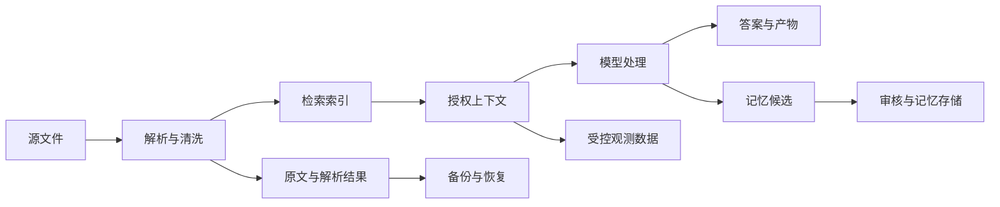
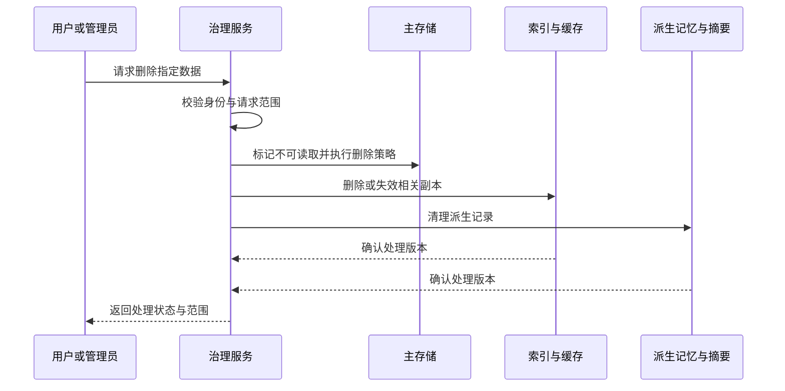

# 数据治理、隐私与企业交付

<div class="book-meta">第 23 章 · 质量与治理 · 约 2,824 字 · 建议精读 13 分钟（含图解）</div>

<p class="chapter-lead">企业落地还要回答数据从哪里来、去哪里、保存多久、谁能查看。</p>


企业接入 Agent 后，数据会走过比传统查询接口更长的路径：文件被解析成文本，文本被切块并向量化，片段进入模型上下文，结果进入 trace，偏好又可能被提取为 memory。用户在界面上删除了一条消息，并不意味着这些派生副本已经消失。

数据治理的工作就是把这条链路变得可解释、可授权、可更正、可删除和可审计。它不是给系统贴一个“私有部署”标签，也不是在最后加一份说明文档。本章讨论通用工程方法，具体法律、合同与组织要求必须在实际项目中核查。

## 先画数据流，再讨论存储选型

逐项列出输入、原始文件、解析文本、文档块、embedding、模型请求、工具结果、日志、产物和备份。为每一类数据回答：来源是谁、用于什么目的、在哪里处理、谁能访问、保留多久、怎样删除。不能只盘点数据库表，索引和对象存储往往承载同样敏感的信息。



图中的每个节点都应有负责人和生命周期规则。尤其要注意“观测数据”和“记忆候选”：它们经常被当作附属数据，却可能包含最完整的用户上下文。

数据分类不必一开始就极其复杂。可以先区分公开资料、内部资料、业务敏感资料、个人信息和凭证，再根据组织要求细化。分类结果应影响可用模型服务、日志采样、存储位置和访问权限，而不是只写在表格里。

## 身份与授权必须沿派生链传播

用户能打开原文，不代表所有用户都能检索它。文档解析和切块后，应保留稳定文档 ID、源版本和权限元数据；检索服务根据可信身份过滤；产物与引用也应继承必要的访问限制。把所有 chunk 放入一个索引，再在回答末尾提醒用户注意保密，并不能阻止泄漏。

权限变化比初始授权更容易被忽略。员工调岗、离职、文档撤权后，主业务系统可能已经拒绝访问，但向量索引、缓存和长期记忆仍保存旧信息。需要建立变更传播机制，必要时在读取时再次检查权威权限服务。更新滞后要有可观察指标和明确降级策略。

| 数据层 | 典型授权依据 | 常见遗漏 |
| --- | --- | --- |
| 源文件 | 文档所有者与组织权限 | 索引更新后仍保留旧 ACL |
| 检索片段 | 用户身份与文档版本 | 只过滤标题，没有过滤正文 |
| 答案缓存 | 租户、权限范围、数据版本 | 只用问题文本做缓存键 |
| Memory | 用户、任务或组织作用域 | 个体偏好被注入其他用户 |
| 日志与产物 | 运维职责与任务参与者 | 日志平台比业务系统权限更宽 |

## 最小化不是简单截断

数据最小化意味着只向某个处理环节提供完成任务必需的信息。查询订单状态可能只需状态与更新时间，不必提供完整地址；故障诊断可能只需脱敏日志片段，而非整个数据库转储。截断长度只能控制大小，不能替代字段级选择和敏感信息识别。

脱敏也需要考虑可关联性。删除姓名但保留唯一订单号和精确事件时间，仍可能让接收方识别具体个人。是否足够匿名取决于可获得的其他数据与用途，不能凭一个正则替换就作保证。开发与评测数据应优先使用经审核的脱敏样本或合成边界案例。

对接外部模型服务前，核查所用账户、区域、合同、数据使用与保留设置。相同品牌下不同产品或配置可能有不同条件。工程师应把实际选项记录下来，并让负责安全、法务或采购的人按组织流程确认，而不是笼统宣称某个供应商“默认合规”。

## 删除需要传播到派生数据

删除可以从一个稳定的主体 ID 或文档 ID 发起，找到原文、片段、向量、缓存、摘要和 memory 的关联。没有来源链，后续往往只能扫描全库或留下遗漏。因此摄入阶段保存 lineage，不仅为了引用，也是为了治理。



先阻止继续读取，再逐步处理派生副本，可以缩短风险窗口。删除流程可能跨多个系统，适合使用可重试事件和状态记录，而不是一串没有结果跟踪的最佳努力调用。

备份要按实际保留和恢复策略处理。某些备份不能逐条即时修改，但恢复流程必须避免让已删除的数据重新成为可用记录。应记录删除事件或相应控制信息，在恢复后重新应用。具体保留要求和例外依项目政策决定，不能由模型临时承诺。

## 审计记录要证明什么

审计应回答谁在什么身份下、何时授权了什么动作、作用于哪个资源版本、产生了什么结果。它不等于普通调试日志。记录应具备访问控制、完整性保护、适当保留和可查询性；高影响动作还需要关联审批参数摘要与实际提交参数。

下面是一个审计事件合同示例。字段取舍需与业务、安全和隐私要求共同确定，不能把敏感原文全部复制进去。

```json
{
  "event_id": "audit_001",
  "run_id": "run_102",
  "actor_id": "user_17",
  "tenant_id": "tenant_a",
  "action_id": "ACT-001",
  "operation": "ticket.create",
  "resource_ref": "service/payment",
  "approved_payload_hash": "sha256:example",
  "resource_version": 12,
  "decision": "allowed",
  "outcome_ref": "ticket/T-104",
  "policy_version": "policy-7"
}
```

哈希只在输入规范化、算法选择和验证流程明确时才有意义。它可以帮助发现审批与提交参数不一致，但不能单独证明操作者身份，也不能代替原始业务状态的可靠记录。

## 企业验收中的非功能要求

企业交付通常涉及单点登录、网络边界、密钥管理、租户隔离、容量、可用性、成本归属和故障响应。应把这些转成可验证条件，例如“撤销权限后，检索和缓存读取均拒绝”“生产密钥不进入模型上下文”“恢复测试能在目标时间内完成”。只写“支持企业级安全”没有验收价值。

还要明确系统的责任边界。Agent 提供建议、生成草案和提交操作是不同能力，涉及不同批准条件；输出面向内部专家还是终端用户，也影响解释、审查与接管流程。需求确认应包含不能自动处理的情况，并为它们安排真实的负责人。

## 治理策略如何进入实际代码

策略可以从少量明确规则开始，例如敏感字段禁止进入通用日志、撤权文档禁止作为缓存命中、用户偏好只在本人作用域读取。规则应有版本、执行位置和测试案例。若某条政策只存在于说明文档，工程师无法知道由谁执行，也无法在发布时检测回归。

对跨系统流程，记录每个组件已经处理到哪个变更版本。索引服务失联时，系统能够识别权限传播尚未完成，并暂时拒绝相关读取或回源检查。治理故障也需要告警、重试和负责人；否则删除请求可能在某个失败队列里长期停留，而用户只看到入口接口成功。

## 把治理做成持续流程

项目上线后，数据源、权限和模型配置都会变化。新连接器上线前要更新数据流图；新增日志字段要重新检查敏感性；memory 策略改变要验证旧数据的兼容与删除路径。治理材料必须跟随实际系统，而不是交付时生成后长期不再维护。

练习时，为运维 Copilot 画出包含日志、索引和备份的数据流。选择一份被撤权文档、一条被更正的偏好和一位被停用的用户，分别测试它们在所有读取路径上的结果。验收要求能够解释传播延迟、失败重试和最终状态，而不只是主数据库里查不到一行。

**面试追问：私有部署能自动解决隐私问题吗？** 不能。内部越权、错误缓存、日志泄漏、记忆污染和备份恢复仍然存在。私有部署改变部分数据边界，治理仍需覆盖完整生命周期。

## 原始资料

- [OWASP：LLM Top 10](https://genai.owasp.org/llm-top-10/)
- [LangChain：Memory overview](https://docs.langchain.com/oss/python/concepts/memory)

<!-- PROJECT_DEPTH_V2 -->

## 项目落地：数据治理要落到表和生命周期

运行状态、用户偏好、源文档、日志和工单有不同目的。当前 Memory API 只接受两类明确偏好，source 表示受认证用户主动写入，删除时清空值与来源；审计仅留操作和版本。这个最小化设计比先收集所有聊天再考虑治理更容易控制。

### 在线删除与备份保留

在线查询不返回已删除事实，不代表历史 WAL、快照和既有工单中的内容立即物理消失。生产要定义各类数据的保留期限、备份恢复后的删除重放以及业务记录保留要求。不能把删除按钮的文案写成无法兑现的全介质即时擦除。

### 训练和评测的数据出口

把失败案例加入评测集前，移除凭据与不必要的个人信息，保存数据来源和使用范围。用户向运维系统提交的故障描述，并不自动授权拿去训练模型。训练、产品运行和质量评测应分别定义目的与访问者。

跨租户的聚合指标可以减少暴露，但小样本维度仍可能泄漏具体业务。日志采样和脱敏需要在写入前考虑，不能只依赖后来删除。项目测试报告只保存环境、用例和结果，不复制运行时环境变量和真实业务输入。

练习画出一个偏好从 API 到事实表、索引、上下文、工单与备份的传播图，逐个标明谁拥有它、何时过期、如何更正、如何删除。这张图能暴露单看数据库表结构发现不了的治理缺口。

<!-- END_PROJECT_DEPTH_V2 -->
