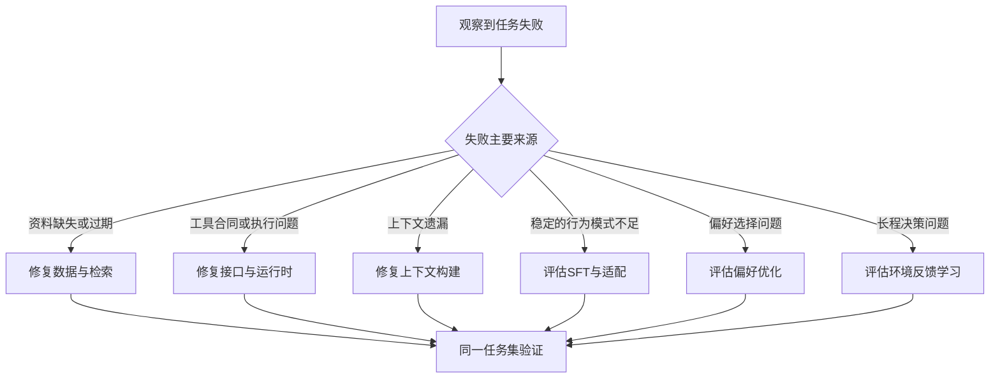
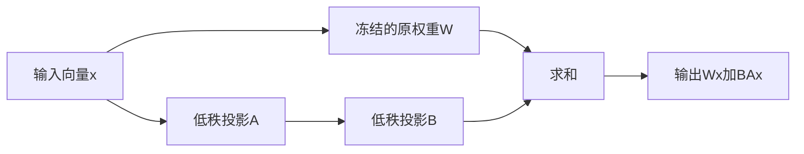

# 微调、偏好优化与 Agent 学习

<div class="book-meta">第 24 章 · 进阶与求职 · 约 2,761 字 · 建议精读 13 分钟（含图解）</div>

<p class="chapter-lead">先用评测定位问题，确认训练能解决，再投入训练成本。</p>


当一个 Agent 经常答错，最自然的想法可能是“再训练一下”。但错误可能来自文档过期、工具接口含糊、上下文丢失、权限配置或评分器设计。训练只能改变模型的行为分布，不能自动补齐业务数据链路，也不能让外部工具获得事务保障。

学习训练方法之前，应先能回答：希望模型改变什么行为，现有系统为什么做不到，怎样证明改变有效。对应用工程岗位，一次规模适当、对照清楚的实验，比未经评测的大规模训练更有说服力。

## 先判断问题来自知识还是行为

最新库存、订单状态和刚发布的手册属于可变外部事实，通常应通过工具或检索取得。固定领域的分类、输出格式和工具选择模式可能适合监督微调。用户偏好需要作用域、版本和删除能力，通常应由 memory 服务保存，而不是写进共享模型权重。



这张图不表示方法互斥。RAG、memory 和训练可以组合，但每个组件都应有明确职责。先修复数据再训练，往往能避免模型把错误资料学成稳定习惯。

## SFT 学的是示例中的行为分布

监督微调使用输入与目标输出，让模型提高示例输出的似然。对 Agent，可以训练工具选择、参数生成、证据组织或特定领域响应。数据不只是问答对，还可能包含工具调用与环境返回，但格式必须符合目标模型和训练接口的要求。

数据质量比数量更早成为问题。重复案例会扭曲分布，错误轨迹会固化坏习惯，缺少失败示例会让模型只会走顺利路径。每条样本应明确来源、许可、清洗版本和标注依据。不要把生产对话未经审核直接作为训练集，尤其其中可能包含秘密、越权行为或用户撤回的信息。

训练、验证与测试应在任务层隔离。若同一模板换几个订单号后分别进入训练与测试，模型可能只是记住模板。可以按时间、文档、用户或任务家族划分，并保留真正未知的组合。训练集损失下降只说明拟合更好，不证明工具使用更可靠。

## LoRA 为什么能减少训练参数

对一个权重矩阵 `W`，LoRA 用低秩矩阵乘积表示增量：`W' = W + B A`。若 `W` 的形状是 `d_out × d_in`，则可以令 `A` 为 `r × d_in`，`B` 为 `d_out × r`，其中 `r` 远小于原始维度。原始权重通常冻结，只训练增量参数。

以一个 `4096 × 4096` 矩阵为教学例子，原矩阵约有 1678 万参数。取 `r=8`，两个增量矩阵合计 `8×4096 + 4096×8 = 65536` 个参数，约为原矩阵的二百五十六分之一。这只是在一个矩阵上的参数比较，不等于整次训练显存也按同样比例下降。



图中主路径保留原模型，旁路学习增量。rank、目标层、学习率和训练步数共同影响效果，不能只按“rank 越大越好”选择。推理时是否合并、是否支持动态 adapter、以及量化组合的限制，都应查看具体实现。

## 从一个小实验开始

可以选“将故障描述映射到受限工具参数”作为实验任务。先建立 prompt-only 基线，再使用同样的训练数据预算进行适配。比较格式有效率、业务有效率、任务成功率和越权倾向，而不是只看生成文本与参考答案的字面相似度。

以下是训练记录的合同示意，不是可直接提交到所有供应商的通用格式。

```json
{
  "sample_id": "train_041",
  "task_family": "incident_triage",
  "input": {
    "service": "payment",
    "symptom": "连接池等待超时",
    "allowed_tools": ["search_runbook", "query_metrics"]
  },
  "target": {
    "tool": "query_metrics",
    "arguments": {"service": "payment", "metric": "pool_wait"}
  },
  "annotation_source": "reviewed_example",
  "dataset_version": "triage-v1"
}
```

实验记录还应保存模型基线、适配配置、数据切分、随机种子、硬件和依赖版本。随机种子有助于控制变化，但分布式训练和底层算子仍可能存在非确定性，报告时不要承诺所有环境逐位复现。

## 偏好优化与强化学习的差别

偏好数据描述同一输入下哪个输出更合适。DPO 等方法利用成对偏好调整相对选择，不要求把每个好坏判断都写成唯一参考答案。它适合有清晰偏好标注的场景，但标注者偏差、长度偏好和不一致标准仍会进入模型。

强化学习使用奖励反馈优化策略。对 Agent，策略不仅输出一句话，还会选择工具、观察结果并继续行动。训练系统可能包含 rollout、环境、奖励计算和策略更新。延迟奖励使信用分配更困难：最终任务失败，不代表每一步都错；最终成功，也可能走了昂贵或越权的路径。

奖励设计尤其需要防止作弊。如果奖励只看“生成了工单 ID”，模型可能编造一个；如果只看测试通过，代码 Agent 可能修改测试；如果只看用户点击满意，系统可能迎合而忽视事实。奖励应尽量绑定独立的环境终态，并将权限和资源约束作为明确条件。

| 方法 | 主要改变 | 适合的证据 | 典型风险 |
| --- | --- | --- | --- |
| Prompt 调整 | 当前调用的指令与示例 | 少量明确失败与回归集 | 提示词膨胀、局部修复引发退化 |
| SFT / LoRA | 稳定的任务行为模式 | 高质量输入输出或轨迹 | 过拟合、数据泄漏、遗忘 |
| 偏好优化 | 多种回答之间的选择 | 一致的成对偏好 | 风格偏差、标注标准不清 |
| Agent RL | 环境中的行动策略 | 可交互环境与可信奖励 | 奖励作弊、训练成本、环境差距 |

## 训练后的验收不能只看领域成绩

适配模型可能在目标任务上提升，却在一般指令、工具拒绝或安全边界上退化。应同时运行领域集、通用回归集、工具契约集和安全测试，并查看长尾与无答案情况。对于基线本来表现良好的任务，确认训练没有引入额外风险。

还要计算总成本。训练需要数据整理、标注、算力和实验时间；部署可能增加 adapter 管理与模型版本。便宜模型通过适配达到质量要求，才可能降低长期费用；如果只节省少量 token，却引入复杂的维护系统，收益未必成立。

上线时记录基座模型与 adapter 的组合版本，保留可回滚路径。回滚模型不会自动撤销错误训练造成的外部动作或 memory 写入，因此训练发布仍需进入完整的 Agent 发布与评测流程。

## 从研究结果到真实 Agent 的差距

仿真环境通常比生产更整洁：工具返回固定格式、没有权限变化、状态可重置、失败容易分类。训练出的策略可能依赖这些条件，一旦遇到真实延迟、缺字段或新工具就失效。应逐渐加入环境扰动，并明确哪些成绩来自模拟、哪些来自真实接口，避免将基准成功率直接当作上线可靠性。

研究实验还应保留失败与无效结果。如果增加规划步骤没有提升，可能意味着任务无需规划，也可能意味着奖励没有区分过程质量。通过消融定位原因，比继续扩大训练规模更有信息价值。论文复现要比较相同数据、预算与评分器；无法匹配条件时，应诚实说明差异和结论范围。

## 练习、验收与面试追问

选择一个可以确定验证的工具参数任务，准备训练集与独立保留集。先做 prompt 基线，再设计一次 LoRA 实验；没有适合硬件时，也可以先完成数据审查、评测器和实验方案，但应明确没有实际训练结果。不要将计划中的改进写成已发生的成绩。

验收要求包含数据来源、切分策略、基线、配置、各类结果和负面案例。至少解释一个训练没有解决的问题，并判断它应由检索、上下文、工具还是业务服务修复。

**面试追问：微调能替代 RAG 吗？** 两者职责不同。微调主要调整模型行为与任务分布，RAG 提供可更新、可引用的外部证据。是否组合应由失败来源和评测结果决定，而不是把它们当作互相排斥的路线。

## 原始资料

- [LoRA 原论文](https://arxiv.org/abs/2106.09685)
- [Hugging Face PEFT：LoRA](https://huggingface.co/docs/peft/en/conceptual_guides/lora)

<!-- PROJECT_DEPTH_V2 -->

## 项目落地：何时才值得微调

参考系统先用确定性基线验证工程边界，再允许真实模型选择工具。只有确认失败来自模型的稳定行为缺口，而不是证据缺失、工具描述错误或数据权限，才考虑微调。

### 训练目标与业务目标要对齐

如果模型经常输出错误 Decision 格式，SFT 可以学习合同；如果它在同样证据下过于武断，需要高质量偏好或纠错数据；如果缺少企业最新运行手册，首先应修检索与数据更新。微调不是把动态知识塞进权重后就不再维护。

训练样本可以包含目标、受控观察和正确决策，但不要依赖不可获得的私有思维链。需要保留无答案、请求澄清和失败处理样本，避免模型只学习“无论怎样都生成工单”。把同一事故的近重复样本随机拆到训练与测试中，会高估泛化。

### 评测必须保留系统约束

微调前后使用相同工具与执行器，比较任务成功、格式合法、引用真实性、成本和延迟。即使成功率提高，也不能删除权限和审批检查。模型更擅长调用工具，可能同时让错误动作更有效，因此执行边界仍然必要。

当前工程未执行 SFT、LoRA 或 DPO 训练，也没有提供虚构分数。你可以用失败轨迹整理数据卡、划分训练/验证/测试，再按硬件与许可证选择模型。先证明收益，再承担训练与模型发布的维护成本。

<!-- END_PROJECT_DEPTH_V2 -->
