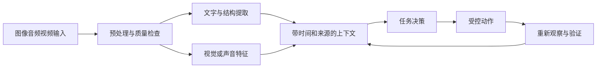
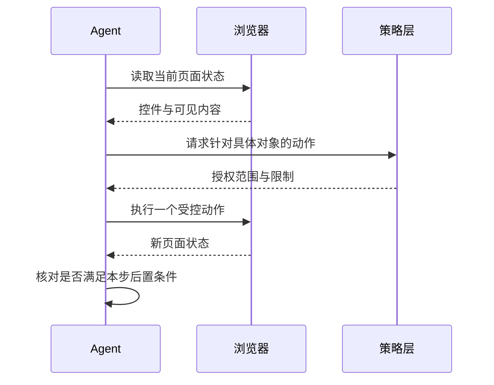

# 多模态、浏览器与 Coding Agent

<div class="book-meta">第 25 章 · 进阶与求职 · 约 2,699 字 · 建议精读 12 分钟（含图解）</div>

<p class="chapter-lead">当工具能看屏幕、操作网页或执行代码，验证与隔离更重要。</p>


当 Agent 从调用业务 API 走向看屏幕、听语音和编辑代码，输入输出不再只是文本。网页会重排，截图可能过期，用户会打断语音，代码执行又会改变环境。系统必须在每次动作后重新观察，并通过独立证据判断任务是否真的完成。

这些场景仍然遵循目标、状态、工具、反馈与验证的闭环，但观测质量和执行隔离变得更重要。本章把它们放在一起，是为了比较共同机制，并不意味着同一套视觉模型或工具可以无差别解决所有问题。

## 多模态任务先定义需要保留的信息

图像任务可能需要文字内容、对象位置或图表关系。若只保留 OCR 文本，表格的列对应关系和图上的箭头可能丢失；若只缩小整张图，细小数字可能无法辨认。应根据任务选择原图、局部裁剪、OCR 和结构解析的组合，并保留可追溯的页面与区域位置。

音频任务除了转写文本，还可能需要说话人、时间戳、语气和打断边界。视频任务又增加时间顺序：某帧出现一个按钮，不代表后续仍在相同位置。采样频率和片段长度需要根据动作变化速度设计，不能把孤立图片的结论直接拼成完整事件叙述。



图中预处理不是简单压缩文件，而是保留任务所需信息。时间、页码和区域坐标属于证据的一部分，丢掉它们会让后续验证非常困难。

## 浏览器 Agent 的观察层如何选择

DOM 和可访问性树提供结构、文本、角色与控件关系，通常适合定位按钮、输入框和表格。截图能看到画布、图像和视觉状态，但坐标操作更容易受分辨率、滚动和布局变化影响。实际系统可以组合多种观察方式，并按页面能力选择最稳定的动作接口。

定位应尽量依靠可访问名称、标签、稳定标识和当前状态。选择器找到某个元素，并不代表它可点击或属于当前任务；应检查可见性、禁用状态和上下文。页面发生跳转、弹窗或动态刷新后，旧观察需要更新。不要根据一分钟前的截图盲点“确认”。

浏览器自动化还需要区分“动作已发出”和“页面已完成”。点击提交后，应观察明确的完成状态、记录 ID 或结果页面；网络层返回成功可能只是接受了异步任务。对于真实写入，最好进一步通过业务数据验证，而不是只看一个可能延迟或过早出现的提示。

## 让动作与观测形成小步闭环

动作计划可以包含多个步骤，但执行时不应把所有步骤一次性盲跑。输入字段后检查格式和目标对象；导航后重新定位；提交前核对具体内容；执行后确认终态。这样会增加部分观察开销，却能缩短错误连续传播的链条。



关键是最后的后置条件。若预期进入详情页，实际却弹出了登录窗口，就应该停止旧计划并处理身份状态，而不是继续在错误页面输入数据。

下面是框架无关的浏览器任务合同示意，真实实现需绑定具体浏览器 API。

```python
async def execute_ui_step(browser, step, policy):
    before = await browser.observe()
    target = resolve_target(before, step.target_description)
    await policy.authorize(step.action, target, step.payload)
    await browser.perform(target, step.action, step.payload)
    after = await browser.observe()
    if not step.postcondition(after):
        return {"status": "needs_replan", "observation": after}
    return {"status": "completed", "evidence": after.summary}
```

## Coding Agent 的环境与验证

代码 Agent 的典型流程是理解需求、检查仓库、定位相关实现、修改文件、运行检查、审查差异并解释结果。它需要知道仓库当前状态和既有约束，不能假设工作区中所有改动都属于自己。独立工作目录或适合的隔离机制可以减少相互干扰。

执行环境应限制网络、文件系统、进程和资源。代码可能从依赖安装、测试脚本或构建脚本间接执行，因此只限制主命令名称并不充分。生产凭证不应默认进入测试容器；需要真实集成时，通过受控测试身份和专门环境提供最小能力。

测试通过也不是完整验收。Agent 可能修改测试、删除失败路径、硬编码答案或扩大改动范围。独立验收器、受保护的测试基线和 diff 审查可以降低这些风险。业务需求可能包含性能、安全和兼容性，单元测试未必覆盖全部。

| 环节 | 需要观察什么 | 常见错误 |
| --- | --- | --- |
| 定位 | 相关代码、调用关系、已有测试 | 只按关键词改到表面位置 |
| 修改 | 文件范围、接口合同、依赖变化 | 为修一处问题重写无关模块 |
| 验证 | 原有测试与新增行为证据 | 删除测试后声称全部通过 |
| 交付 | 差异、运行结果、限制 | 只描述计划，没有真实验证 |

## 语音实时交互的特殊约束

实时语音通常需要处理端点检测、转写、决策、工具等待和语音合成。用户说话中途打断时，系统要停止过时的播报，并判断尚未执行的动作是否仍然有效。已提交的业务动作不能因为用户打断就假装没有发生。

转写错误会改变参数，例如日期、金额或设备编号。对于高影响操作，应以可确认的方式重复关键字段，或在屏幕上展示结构化摘要。模型可以从上下文纠正部分语音错误，但不应把“听起来像”当作最终授权证据。

延迟优化应按链路拆分：收音与端点判断、识别、模型、工具和播报分别耗时多少。过早判断用户说完，可能降低首响应延迟，却频繁打断用户；等待太久又会显得迟钝。需要在真实噪声、口音和网络条件下测体验，而不是只在安静环境演示。

## 评测要覆盖状态变化

浏览器任务集应包含元素重排、弹窗、空结果、登录过期、异步加载和网络失败。代码任务应覆盖多文件修改、依赖冲突、失败测试和不可运行环境。多模态任务还要包含模糊图像、OCR 错误、缺失音频和时间顺序冲突。

每个任务的成功条件应尽量读取真实环境。例如文件确实包含正确修改、测试在独立环境通过、网页记录已经创建。轨迹可以辅助诊断，但不能只按“操作步骤看起来合理”评分。多条路径可能都正确，因此评分器应围绕约束与终态，而不是要求完全模仿参考点击序列。

## 常见故障与恢复策略

如果浏览器定位失败，先重新观察当前页面，判断是状态变了、控件不可见还是语义定位不足，再决定替代方法。连续重复点击同一坐标通常没有诊断价值。对于验证码、身份问题或不明确的高影响提交，应进入清晰的人工接管状态。

如果代码运行失败，先区分代码错误、环境缺失和测试基础设施问题。缺少依赖不能直接解释为业务实现错误；测试无法运行也不能写成已经通过。保留命令、退出码和必要错误摘要，同时避免把密钥和敏感配置复制到报告中。

## 练习、验收与面试追问

选择一个专门的测试网站，实现查询、填写草案和确认提交的闭环，再加入布局变化与登录过期。另一条路线是在隔离仓库修复一个已知 bug，保留修改前失败、修改后通过以及 diff 审查记录。不要在未授权的真实业务系统中练习写操作。

验收要求能从轨迹重现每一步观察和后置条件；失败后不会继续使用旧页面状态；代码任务不修改受保护的验收规则；最终报告明确哪些检查实际执行、哪些因环境限制未执行。

**面试追问：为什么浏览器 Agent 不应只用坐标操作？** 坐标与当前布局绑定，容易因滚动和重排失效。结构化定位更稳定，但也必须基于当前可见状态；两种方式都需要动作后验证。

## 延伸阅读

- [Anthropic：Building effective agents](https://www.anthropic.com/research/building-effective-agents)
- [OWASP：LLM Top 10](https://genai.owasp.org/llm-top-10/)

<!-- PROJECT_DEPTH_V2 -->

## 项目落地：多模态和浏览器能力会新增哪些边界

当前系统只读取结构化指标和文本手册。若加入告警截图，应记录图片来源、时间、分辨率和 OCR/视觉模型输出；数值识别错误可能直接改变诊断。对关键指标仍应优先使用监控 API，图片作为辅助证据。

浏览器 Agent 如果要打开内部控制台，必须继承明确的用户会话与页面权限，并区分读取、填写和最终提交。页面上的文案与第三方脚本不能自我授权，让 Agent 导出凭据或变更生产配置。每次关键动作应绑定具体对象与结果验证。

### Coding Agent 的产物不等于可上线变更

自动生成修复补丁，需要独立工作区、受限执行环境、依赖来源检查、测试和代码审查。测试命令本身可能执行仓库脚本，不能把“只是跑测试”当作没有副作用。外部网络、宿主目录和密钥挂载需要按任务限制。

本项目没有偷偷接入浏览器操作、任意 shell 或生产修复能力。扩展这些功能时，应复用当前 action/approval/result 的思想，但重新设计沙箱、产物扫描和回滚策略。不要因为工单创建可恢复，就假设任意代码执行也具有相同语义。

<!-- END_PROJECT_DEPTH_V2 -->
