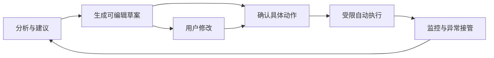
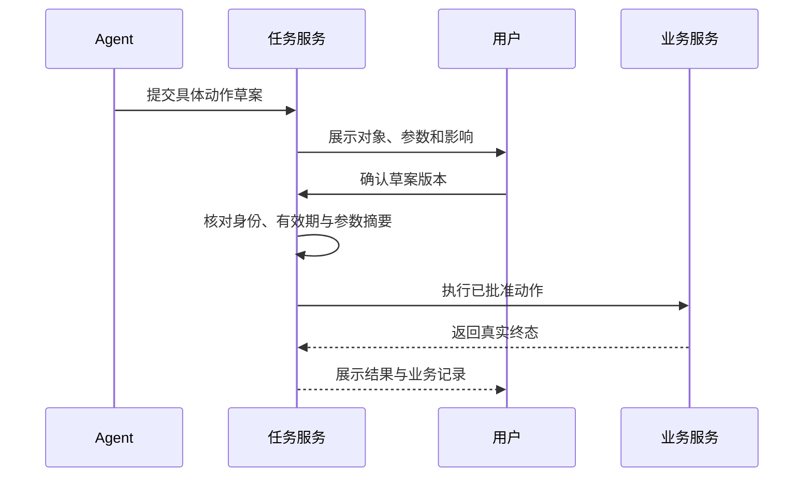

# 产品体验与人机协作

<div class="book-meta">第 26 章 · 进阶与求职 · 约 2,728 字 · 建议精读 12 分钟（含图解）</div>

<p class="chapter-lead">可靠的 Agent 产品让用户理解正在发生什么，并能在关键位置接管。</p>


一个 Agent 可以在技术上完成很多动作，却仍然让用户不敢使用。原因可能是用户看不出它查了什么、不知道哪些操作已经生效，或者每一步都被迫点击确认。产品体验的核心，是把系统真实状态与授权边界表达清楚，让用户能判断、纠正和接管。

对后端工程师而言，这不是额外的装饰工作。任务状态、事件合同、审批对象和取消语义都会直接决定前端能否提供可信体验。模型输出的流畅解释不能替代这些系统事实。

## 自治程度是一项产品决策

可以把系统能力分成建议、草案、确认后执行和限定范围自动执行。建议只提供分析；草案产生可修改产物；确认执行需要用户批准具体动作；自动执行则要求预先明确可操作范围、预算与例外。每一级都应有不同的监控和接管条件。

选择自治程度时，考虑错误影响、是否可逆、是否容易验证，以及用户是否具备审查能力。重复读取公开资料与删除生产数据的风险完全不同。不能因为用户点击了一次“开启 Agent”，就把所有后续工具调用都解释为无限授权。



这不是必须不断升级的成长阶梯。某些业务长期停留在草案模式就有足够价值；高影响场景保留确认，可能比追求最大自主性更符合产品目标。

## 界面状态必须来自运行时

任务提交后，用户需要知道请求是否已接受、是否排队、正在执行哪类工作、是否缺少信息，以及何时需要自己操作。前端应消费结构化事件，例如 task_started、retrieval_completed、approval_required 和 task_finished，而不是从“我正在处理”这样的生成文本推断状态。

“已完成”的含义也要具体。生成了工单草案不等于创建了工单，提交了创建请求不等于业务库已经持久化。界面应区分草案、提交中、已确认完成与结果未知，并展示真实记录标识。状态越清晰，用户越容易在异常时作出正确选择。

| 状态 | 用户应该看到 | 不应发生的误导 |
| --- | --- | --- |
| 排队 | 已接收、等待资源、可取消 | 假装模型已经开始工作 |
| 执行中 | 当前阶段与可验证进展 | 编造思考内容或百分比 |
| 待确认 | 具体对象、变化与影响 | 只显示一个泛化“继续”按钮 |
| 部分完成 | 已完成与未完成清单 | 统一显示失败并隐藏副作用 |
| 结果未知 | 正在核对终态与下一步 | 直接重试可能已生效的写入 |

## 让确认真正表达授权

确认页面至少应展示目标对象、动作类型、关键参数、可能影响和可撤销性。用户修改草案后，旧审批应失效或重新绑定新参数。审批等待期间业务资源可能改变，恢复执行前还需要检查版本与有效期，避免用户批准的是旧状态下的方案。

例如用户批准为 payment 服务创建工单，随后模型改成重启服务，这已经是不同动作。即使两者都被模型认为有助于解决故障，也不能复用原确认。批准应绑定结构化合同，而不是一段随时可能变化的聊天上下文。



这张图把确认放在任务服务中保存，而不是只存在于浏览器状态。页面刷新、worker 重启或用户重新登录后，系统仍能解释哪一版动作被谁批准。

## 少打扰与可控之间如何取舍

每次只读查询都弹窗，会让用户机械同意；从不确认，又可能越过用户预期。可以建立明确的操作政策：允许在指定数据范围内自动读取，允许在预算内生成草案，对外部发送、删除或不可逆变更再次确认。政策应让用户理解，也要由执行器强制落实。

对重复任务，可以使用范围清晰、期限明确的授权，但必须说明对象和例外。例如“本次任务可读取这三个服务的监控”比“以后都允许访问内部系统”更容易审查。需要扩大范围时，应在新的边界处请求决定，而不是把原有授权无限延伸。

用户还需要能纠正 Agent。纠正可能针对当前答案、任务计划或长期偏好，界面应区分这些作用域。“这次请用英文”不应自动覆盖长期语言偏好；“以后都用英文”则可以成为明确记忆候选。系统应让用户看到和修改长期记录。

## 处理失败与不确定性

无结果、无权限、工具故障和证据冲突需要不同提示。无结果时可以解释搜索范围并请求补充；无权限时说明所需访问而不泄露受限内容；工具故障时给出可重试或人工路径；证据冲突时呈现来源和时间，而不是强行合成一个确定答案。

错误提示应包含用户能采取的行动。只写“出错了”没有帮助，直接暴露数据库堆栈也不合适。可以展示任务标识、已完成部分、当前阻碍和下一步选项。对于技术用户，可以提供受权限控制的详细日志链接；普通用户则需要业务语言解释。

取消也要诚实。取消请求收到后，系统会停止后续步骤，但已经完成的外部操作可能仍然存在。界面应明确列出这些结果，并在适用时提供独立的撤销或补偿流程。不要把“取消成功”当作所有事情都恢复原状。

## 流式输出如何服务理解

流式文本可以缩短等待感，但不应提前宣称任务成功。可以先展示查到的来源、正在执行的工具类别和已验证产物，再流式生成解释。对必须等待终态的操作，状态栏应保持提交中，直到业务服务确认。

前端事件需要稳定 ID，断线重连后按游标补发并去重。事件重复只影响展示，不应再次触发业务动作。工具结果、文本增量与状态变化最好使用不同类型，避免前端把一段文本中的“完成”识别为正式终态。

以下是一个界面事件合同示意，字段可以按业务扩展。

```json
{
  "event_id": "evt_073",
  "run_id": "run_102",
  "type": "approval_required",
  "timestamp": "2026-11-05T08:00:00Z",
  "payload": {
    "action_id": "ACT-001",
    "draft_version": 3,
    "operation": "ticket.create",
    "resource": "service/payment",
    "summary": "创建排查连接池耗尽的工单"
  }
}
```

## 产品指标要反映完成任务

聊天轮数、生成字数和调用量容易统计，却未必代表价值。用户聊得更久，可能只是系统一直没解决问题。更有用的指标包括任务完成率、用户修正量、人工接管原因、端到端解决时间和重复使用情况，并结合业务实际定义。

效率收益还要扣除人工审核成本。如果 Agent 生成一份报告只需一分钟，但专家核查需要半小时，不能简单宣称节省了全部撰写时间。应测量从任务开始到可用结果的完整过程，比较相同质量标准下的基线。

反馈也需要审核。用户点赞可能是礼貌，否定可能是偏好差异；恶意反馈可能试图污染 memory 或训练数据。将反馈转成评测案例前，应确认任务、证据和正确结果。产品闭环不是自动把每条意见写进系统规则。

## 练习、验收与面试追问

为运维 Copilot 画六个页面状态：提交、排队、执行、待确认、部分失败和完成。让一位未参与开发的同伴操作，观察他能否说清哪些动作已发生、哪些仍是草案、如何取消和纠正。记录误解，再修改状态与文案。

验收要求包括审批绑定具体版本、断线后可恢复展示、取消不掩盖副作用，以及用户可以查看与更正长期偏好。界面中的进度和结果应能对应真实事件，不依赖模型临时编造。

**面试追问：如何减少确认次数又保持安全？** 对低风险且已明确授权的操作建立范围清晰的政策，对高影响、越界或参数变化的动作再确认。关键是授权粒度与执行层约束，而不是机械地每步弹窗。

## 延伸阅读

- [Anthropic：Building effective agents](https://www.anthropic.com/research/building-effective-agents)
- [LangGraph：Persistence](https://docs.langchain.com/oss/python/langgraph/persistence)

<!-- PROJECT_DEPTH_V2 -->

## 项目落地：把不确定性呈现在正确的位置

用户应该看到任务进度、证据、诊断假设、具体草案和最终业务 ID。不要让界面只显示模型持续生成的文字，掩盖系统实际停在等待工具、审批或对账。

### 审批需要可审查的对象

界面应展示 service_id、title、body、channel、证据及资源版本，再提交对应 args_hash。参数发生变化时必须重新展示；不能只弹出一个“是否继续”的按钮。拒绝要有明确效果，重复点击不能产生多个业务意图。

等待审批是一种正常状态，不应不断消耗模型 token。事件推送可以显示 draft_ready，用户稍后返回仍能查询同一持久草案。当前演示使用 CLI 与 API 文档，未实现完整业务 Web UI，但 API 已保留这些交互边界。

### 失败提示应帮助下一步行动

needs_input 要说明缺什么；budget_exhausted 要说明做到了哪里；reconciliation_required 要说明远端结果未知，需要查询原动作；cancelled 不应被渲染成“所有历史效果已撤销”。这些区别直接决定用户能否安全重试。

练习让不熟悉代码的人按输出走一次正常任务与缺证据任务，观察他是否知道什么时候需要批准、何时已经完成、失败后该做什么。清晰交互和可靠后端需要使用同一套状态语义。

<!-- END_PROJECT_DEPTH_V2 -->
