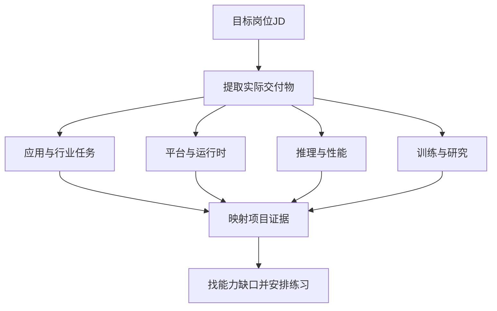

# 求职准备、系统设计与持续进阶

<div class="book-meta">第 27 章 · 进阶与求职 · 约 3,057 字 · 建议精读 14 分钟（含图解）</div>

<p class="chapter-lead">用可复现的工程证据证明能力，并围绕目标岗位补深度。</p>


你已经会 Python，也有 Java 后端开发经验，转向 Agent 工程并不意味着重新从编程语法开始。最重要的变化，是学会把概率性模型接入确定性的业务边界，并用评测证明系统的质量。工具调用、权限、幂等、异步任务和可观测性，正是后端经验可以发挥作用的地方。

求职准备不应变成收集框架名称。招聘方更容易判断的证据，是你能否解释一个真实问题、完成一条业务链路、定位失败、做出取舍，并让别人复现结果。知识广度帮助你理解边界，项目深度帮助你证明能力。

## 先判断岗位到底交付什么

“Agent 工程师”可能指业务应用、运行平台、推理基础设施或训练研究。应用岗位关注工具、知识、评测和用户流程；平台岗位关注状态、调度、沙箱、权限与治理；推理岗位关注模型服务和性能；算法岗位关注训练、规划、记忆方法与实验。

同一职位名在不同公司可能差别很大。阅读 JD 时，先圈出动词和交付物，例如构建业务助手、搭建执行平台、优化 GPU 服务或研究强化学习，再标出技术和级别要求。不要因为职位提到 LLM，就自动认为需要预训练经验；也不要把算法研究岗位当作框架集成岗位准备。



图中的证据映射比技术清单更重要。要求“具备可靠性经验”，可以对应写后崩溃恢复演练；要求“熟悉 RAG”，可以对应检索对照报告，而不只是 README 中写了一句使用向量数据库。

## 为你的背景选择主线

建议先以应用 Agent 工程为主线，用 Java 业务工程能力形成差异化。Python 负责快速实验、模型适配与评测，Java 可以承接既有身份、业务规则、事务和工具接口。也可以采用 Java 单栈，只要能清楚说明团队能力、生态需求与维护成本。

你需要重点补齐模型限制、上下文工程、检索与记忆、非确定性评测，以及 Agent 特有的安全边界。原有数据库、并发、网络、测试和部署知识仍然重要。面试时不要只谈新增概念，应主动说明这些传统能力怎样保护模型产生的动作。

| JD 中的要求 | 可以提供的项目证据 | 常见无效表达 |
| --- | --- | --- |
| Agent 编排 | 有界循环、状态机、异常终态 | 熟练使用多个框架 |
| RAG | 标注集、召回对照、引用验证 | 接入了向量数据库 |
| Memory | 冲突、隔离、过期和删除测试 | 保存了聊天记录 |
| 生产部署 | 压测、回滚、故障演练与 SLO | Docker 能启动 |
| 优化能力 | 同集 A/B、成本与失败切片 | 效果显著提升 |

## 一个主项目应该做到多深

以“可审计运维 Copilot”为例：输入告警，读取监控和运行手册，分析近期变更，提出带证据的建议，生成工单草案，确认后提交，并展示真实结果。这个范围足以串起模型、RAG、工具、状态、权限和用户体验，不必一开始就加入很多 Agent。

第一版用固定工作流或单循环建立基线；第二版加入检索与证据；第三版加入状态恢复、幂等和审批；第四版补评测、观测、成本与部署。每次只增加能解决已观察问题的能力，并保留前一版的对照结果。这样你能讲清系统为什么演变，而不是展示一张复杂但没有依据的架构图。

项目应包含失败演示。让 worker 在业务提交后崩溃，展示恢复不会创建第二张工单；给检索文档植入恶意指令，展示工具网关拒绝；更正用户偏好，展示旧记忆不再注入。这些证据比正常路径的视频更能体现工程深度。

## 作品集的交付合同

README 应说明解决什么问题、适用范围、运行方法、数据来源、权限边界和已知限制。评测目录应有案例、评分器、版本和报告；架构文档应解释关键决策；部署说明应让他人能启动系统。真实密钥、私人对话和公司数据不能为了演示方便进入仓库。

```text
agent-copilot/
  agent/               # 上下文、模型适配、工具与状态
  business-service/    # Java业务规则、授权和幂等
  evals/               # 任务集、评分器、结果与失败切片
  tests/               # 契约、状态和故障测试
  infra/               # 容器与配置示例
  docs/                # 架构决策、数据流与复盘
  README.md            # 问题、运行、证据和限制
```

演示环境可以使用脱敏或合成数据，但应明确标记。性能数字必须写清硬件、模型、输入输出长度、并发、样本数和测量边界。没有测过的结果就不要填数字，更不要把教程的示例阈值当成自己的项目成绩。

## 简历如何表达真实贡献

一条有效经历可以按“问题—责任—方案—证据—限制”组织。比如说明你负责了哪部分工具与恢复逻辑，在什么任务集上测量，修复了哪种失败，代价是什么。团队项目要区分个人工作与团队成果，避免让面试官追问时发现你无法解释关键实现。

“采用 LangGraph、向量数据库和某模型构建智能体”只说明选型。更有信息的是“为长任务增加稳定动作 ID 与恢复流程，通过指定崩溃点演练验证没有重复工单”。如果确有成功率、时延或成本改善，可以填入真实数据，并说明分母与对照条件。

技术博客也是作品的一部分，但内容应展示判断。记录一个失败如何定位、一项复杂技术为何没有采用，往往比罗列热门术语更能体现独立思考。公开文章应移除内部地址、业务细节和个人信息。

## 系统设计面试的展开顺序

面对“设计一个企业 Agent”，先问用户、任务、数据、权限、可执行动作、规模、延迟预算和成功条件。接着画主链路与信任边界，再深入最关键的风险。不要先列十种数据库和三个框架，最后才发现题目只需要一个只读助手。


这条顺序帮助面试官理解你的推理。若时间有限，可以明确选择深入幂等恢复、检索权限或成本容量中的一个问题，并说明其余部分的接口。系统设计不是把所有知识一次性背出来，而是根据约束分配注意力。

以四十五分钟练习为例，前五分钟澄清，接下来七分钟画主链路，约十三分钟深入关键机制，十分钟讨论故障，最后十分钟说明评测与取舍。时间分配是训练方法，不是固定规则；面试官追问时应及时调整。

## 编码和基础知识如何补齐

Python 重点练异步 I/O、并发限制、类型和运行时校验、异常与取消；Java 重点练线程与并发、事务、幂等、HTTP 客户端和流式响应。算法题仍要按目标公司的面试形式准备，但应避免把全部时间用于刷题而没有可讲的 Agent 项目。

模型基础要能解释 token、attention、上下文、采样和训练推理差别；检索要能区分召回与重排；memory 要能解释写入、作用域和删除；评测要能解释样本偏差与真实终态。遇到不了解的实现细节，说明边界和验证方法，比凭术语编造答案更可靠。

## 面试追问如何答出深度

回答“为什么使用某框架”时，先说明需要解决什么状态或恢复问题，再比较手写与框架的成本。回答“怎样降低成本”时，给出账本和质量约束。回答“如何防止提示注入”时，解释可信身份、工具网关、最小权限与沙箱，而不是只说优化提示词。

项目追问通常会沿失败深入：如果工具超时但已经写入怎么办？如果旧记忆覆盖新指令怎么办？如果索引没有及时撤权怎么办？每个问题都可以用自己的测试或复盘回答。没有做过的部分应明确承认，再给出合理设计，不把设想说成经验。

## 持续进阶与练习验收

完成主项目后，选择一个分支做深。平台方向研究调度、沙箱、多租户与持久化；推理方向研究 GPU、KV、批处理与压测；算法方向研究训练、规划、记忆和实验设计；应用方向深入行业流程、连接器与评测。广泛阅读有价值，但每阶段最好有一个可复现的输出。

练习时，用十分钟讲解主项目，再让同伴追问四个故障问题。整理一页证据索引，把简历每项成果链接到代码、报告或演示。验收标准是别人能够运行项目、核对结果，而你能解释关键取舍和未覆盖范围。

**面试追问：没有预训练经验可以做 Agent 工程吗？** 可以定位应用或平台岗位，证明模型集成、工具、状态、评测和交付能力。训练研究岗位的要求不同，应以目标 JD 为准，系统补齐数学、训练与研究证据。

## 岗位样本与阅读

- [Anthropic：Applied AI Engineer, Enterprise 岗位样本](https://job-boards.greenhouse.io/anthropic/jobs/5057647008)
- [Anthropic：Building effective agents](https://www.anthropic.com/research/building-effective-agents)

岗位样本仅用于观察职责组合，不代表所有地区和公司的招聘要求。本章的路线是面向当前背景的学习建议，不构成录用或薪资保证。

<!-- PROJECT_DEPTH_V2 -->

## 项目落地：把这套工程讲成可验证的作品

你的主线可以是“我用 Python 实现有界执行器，用 Java 维护业务真源，通过状态机、具体参数审批和原子幂等处理模型不确定性与分布式故障”。随后用实际代码与测试展开，而不是按工具名逐个罗列。

### 五分钟演示的顺序

先提交支付告警，看证据与草案；批准后检查真实工单 ID。再提交缺手册的 inventory，展示系统停止而不是编造。最后展示写后崩溃测试：Java 已提交、新 Worker 恢复、工单仍只有一条。三个场景分别证明业务价值、边界与可靠性。

### 系统设计追问怎么回答

被问到“多机怎么扩”，指出 SQLite 的限制、PostgreSQL 短事务领取与 fencing 迁移，并承认该适配器尚未实现；被问到“Memory 用什么向量库”，先解释事实槽位、版本、删除和作用域，再说明小型偏好为何暂不需要向量；被问到“模型效果如何”，区分当前系统测试与尚待执行的真实模型评测。

### 简历只写已有证据

可以写实现 Python/Java 完整闭环、参数绑定审批、业务幂等和故障恢复，并附测试报告。不要写实际未测的 QPS、百分比提升、生产用户量或 GPU 成本下降。若要量化成果，自己运行固定负载、保留原始结果和对照基线。

后续最值得深化的是一个明确方向：应用岗继续补真实模型任务评测与产品交互；Memory/RAG 岗补数据规模、混合检索和生命周期；平台岗补 PostgreSQL、多租户配额、可观测与部署恢复。共同底座已经可以运行，接下来让每个新增能力都有实验和失败案例。

<!-- END_PROJECT_DEPTH_V2 -->
