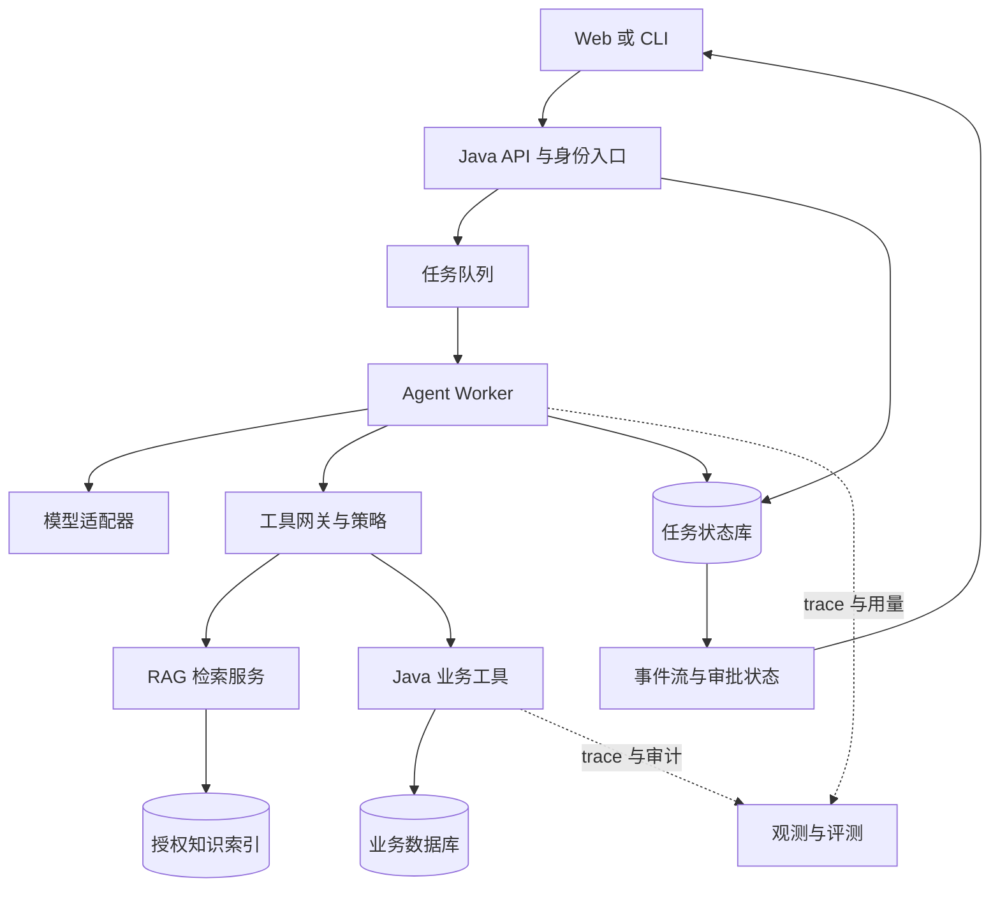
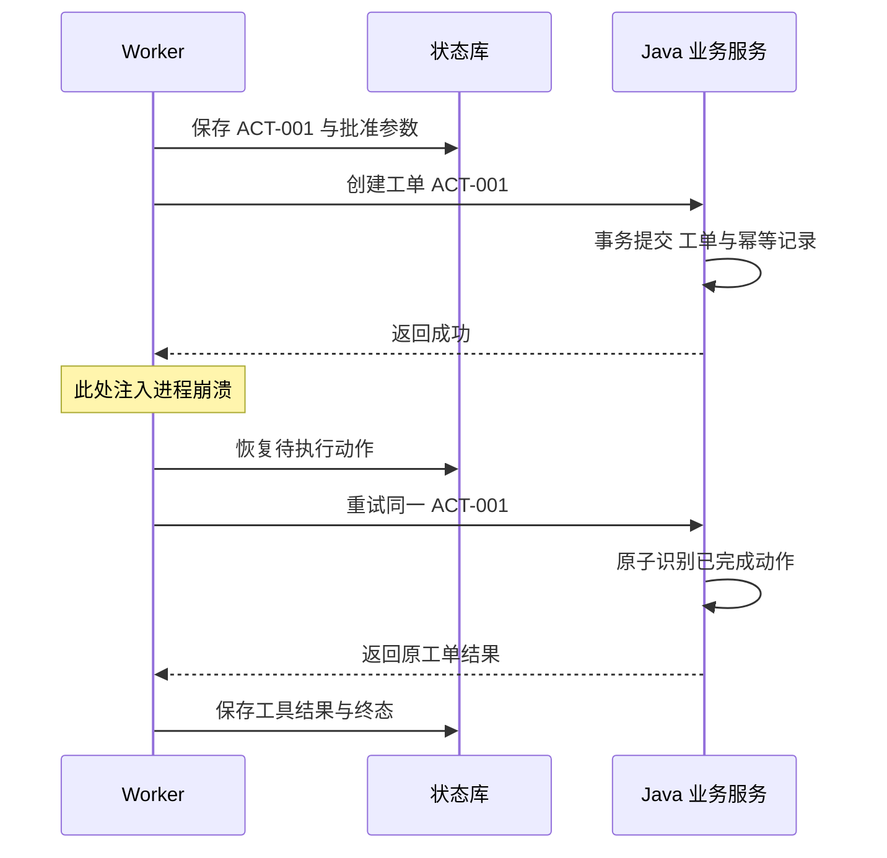

# 毕业项目：可审计的运维 Copilot

::: tip 已提供可运行参考工程
请先阅读 [项目实战：业务设计与完整实现](/project/overview)。现有实现包括 Python/Java 服务、本地数据库、审批、Memory、幂等和故障测试。下文保留的是更大范围的毕业项目设计蓝图，其中多机调度、向量检索、企业身份和规模评测需要继续实现，不应计入当前已验证能力。
:::

这个项目用于把全书知识串成一个完整作品。目标不是演示“模型会聊天”，而是在固定业务范围内完成可验证的任务，并明确异常和人工接管方式。你可以将运维替换为客服、订单、供应链或内部审批，但保留相同的工程问题。

## 1. 先定义范围和验收

输入为服务 ID、告警 ID 和用户补充说明。系统可读取该用户有权访问的监控、运行手册与变更记录；可以生成诊断和工单草案；只有在用户确认具体草案后才创建工单。第一版不直接修改生产配置，也不自动执行任意 shell。

最终成功要同时满足：证据来自授权范围；诊断没有超出证据支持；工单字段合法；被授权的写入恰好形成预期业务效果；用户得到真实工单 ID。无证据时，正确澄清或转人工也可能是成功。

| 项目目标 | 如何验证 | 示例门禁 |
| --- | --- | --- |
| 任务完成 | 检查最终业务状态和证据 | 按任务类别设成功率目标 |
| 权限边界 | 跨用户、跨租户、撤权用例 | 关键测试中越权为 0 |
| 幂等性 | 重复消息与写后崩溃 | 相同业务动作不重复建单 |
| 可恢复性 | 杀 worker、审批后重启 | 从持久状态继续或安全结束 |
| 成本与延迟 | 固定负载下测量 | 达到自己预先声明的预算 |

这里的“为 0”是测试集验收条件，不是对生产永远不发生风险的保证。报告必须写清样本、环境、版本、重复次数和未覆盖范围。

## 2. 参考架构与简化顺序



图中每个框代表职责，不要求从第一天就拆成独立服务。初版可以是一个 Python 服务、一个 Java 服务和 PostgreSQL；检索与工具网关先以模块实现。只有团队边界、容量或隔离要求出现后再拆分部署。

如果全部业务都在 Java，使用 Java 单栈也是合理方案。双栈的收益是 Python 的实验生态与 Java 的业务资产可以结合，代价是跨语言合同、部署与追踪复杂度增加。作品中要解释这个选择，不能把“双栈”当作质量本身。

## 3. 先做四个明确工具

建议第一版只提供 `get_service_metrics`、`search_runbook`、`list_recent_changes`、`create_ticket_draft`。把最终的 `commit_ticket` 放在审批后的受控路径，避免模型为了完成任务直接调用提交接口。

每个工具合同至少包含：参数类型、资源范围、单位与时区、返回字段、空结果、错误码、超时与重试条件。工具描述要说明何时使用，避免多个工具含义相近却返回结构不同。

```json
{
  "name": "search_runbook",
  "description": "查询当前服务已授权且有效的运行手册，返回内容、来源和版本。",
  "parameters": {
    "type": "object",
    "properties": {
      "service_id": {"type": "string"},
      "query": {"type": "string"},
      "limit": {"type": "integer", "minimum": 1, "maximum": 8}
    },
    "required": ["service_id", "query"],
    "additionalProperties": false
  }
}
```

这是通用 JSON Schema 风格的教学示例，具体供应商可能支持不同子集。`tenant_id`、用户角色和授权范围不在模型参数中；它们从可信身份注入。即使 service_id 格式合法，服务端仍需检查资源存在且用户有权访问。

## 4. 数据模型怎样拆

| 实体 | 核心字段 | 主要不变量 |
| --- | --- | --- |
| Run | run_id、tenant_id、user_id、status、deadline、budget、version | 同一版本只由一个推进者更新 |
| Step | run_id、step_id、type、input_ref、output_ref、status | 已完成步骤有可审计结果 |
| Action | action_id、run_id、tool、args_hash、status、result_ref | 相同 action_id 绑定相同业务意图 |
| Approval | action_id、args_hash、resource_version、approver、expires_at | 批准只适用于明确参数和有效条件 |
| Memory | scope、key、value、source、version、expires_at | 能更正、隔离、过期和删除 |
| Evidence | source_id、source_version、location、hash、acl_ref | 引用能回到当时的可信内容 |

Run 的成功与工单服务的事务提交不是同一个事件。业务库是工单事实的真源；运行库保存 Agent 如何到达这个结果。两者可能在故障窗口中暂时不一致，因此需要稳定动作标识与结果查询。

## 5. API 与事件流

推荐任务型 API：创建执行返回 `run_id`；查询接口返回状态；事件接口持续推送进度；取消接口请求停止；审批接口提交对具体动作的决定。

```text
POST /runs
GET  /runs/{run_id}
GET  /runs/{run_id}/events?after={event_id}
POST /runs/{run_id}/cancel
POST /runs/{run_id}/actions/{action_id}/decision
```

SSE 事件可以包含 `event_id`、`run_id`、`step_id`、`type`、`timestamp` 与 `payload`。前端按 event_id 去重，重连后补读事件。事件是状态观察，不应该在重放到前端时再次触发业务写入。

不要用模型生成的“已经完成”作为 UI 的最终状态。UI 应读取服务器确认的 `succeeded`、`failed`、`cancelled` 或 `waiting_approval`，并展示对应证据和业务 ID。

## 6. 必做的崩溃演练



演练必须在“业务已经提交、任务结果尚未保存”的窗口触发。只在调用前杀进程，验证不到最关键的问题。恢复时 action_id 不能重新随机生成；如果同一个 ID 对应了不同参数，应拒绝而不是返回旧结果。

Java 业务层需要把幂等记录与业务写入放在同一事务边界中，处理并发重复请求与唯一约束冲突。对于不可参与本地事务的外部系统，查询结果、业务补偿与人工对账可能比声称“exactly-once”更诚实。

## 7. 分四个里程碑实施

### 里程碑 A：只读助手

先完成有界循环、三个只读工具和二十条任务样本。验证工具 schema、无结果、超时和步数耗尽。模型可以不同，工具环境和评测合同保持一致，建立可比较基线。

### 里程碑 B：知识与记忆

摄入三十份脱敏文档，保存来源、版本和 ACL；做关键词、向量、混合与重排对照。只记住明确、值得保留的用户偏好，并加入矛盾更新、过期、跨用户与删除用例。

### 里程碑 C：业务提交与恢复

接入草案、审批和最终提交，加入 checkpoint 与业务幂等。演练重复消息、审批过期、资源版本变化和写后崩溃。使用真正的数据库终态评分，而不是只检查文字答案。

### 里程碑 D：质量与交付

扩展到五十至一百条任务，至少区分正常、无答案、长尾、安全和故障类别。贯通 trace 与版本，测 p95、成功任务成本和失败分布。用容器部署，写明启动、配置、数据初始化、回滚和恢复方式。

## 8. 评测报告应该长什么样

先说明任务集怎么来的、哪些数据被保留、是否有调参泄漏。然后报告每个版本的成功数量与样本数、重复次数、延迟分位数、费用、关键安全结果和代表性失败。所有值都来自实际运行；没有执行的指标写“未测”。

至少展示一个改进与一个负结果。例如增加 memory 后偏好遵循改善，但复杂任务因上下文拥挤下降；把原始记忆改成受控检索后，重新比较。这比只展示最终高分更能说明你知道如何做工程研究。

## 9. 仓库与演示

```text
agent-copilot/
  README.md
  agent/                 # 模型、上下文、工具、运行时
  business-service/      # Java 权限、事务、幂等与业务真源
  evals/                 # 任务集、评分器、报告与版本
  tests/                 # 状态、策略、契约与故障
  data/                  # 脱敏样本与来源记录
  infra/                 # 容器与环境配置示例
  docs/                  # 架构决策、数据流、故障复盘
  .env.example           # 变量名和说明，无真实密钥
```

五分钟演示建议展示正常任务、无答案、审批、写后崩溃恢复和越权阻断。十分钟技术讲解则围绕一个关键取舍展开：为什么选择当前编排、如何保证业务写入、评测如何证明效果、哪些场景仍需人工。

你最终交付的是别人能够审查的工程作品。能运行只是第一步，能解释、能验证、能复现失败，才构成完整证据。
