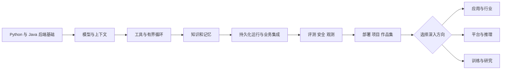
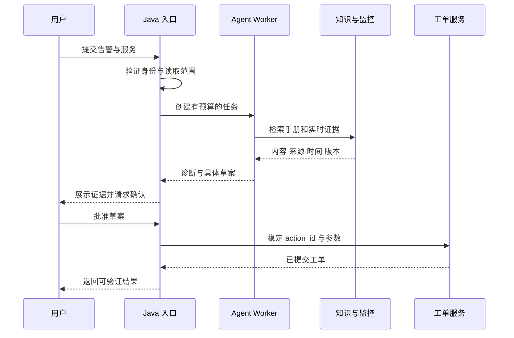

# 如何使用这本手册

这是一份以工程机制为主线的知识博客。它面向已经会 Python、有 Java 后端开发经验，希望进入 Agent 应用或平台岗位的人。你可以沿章节顺序阅读，也可以先从一个实际问题进入：工具重复执行、记忆串用户、RAG 引用错误、任务中断无法恢复，或者推理成本超预算。

每章围绕一个具体问题，解释概念边界、运行机制、实现合同与设计取舍，再用流程图、代码、故障案例和练习验证理解。正文可以完整阅读，不需要先操作实验控件。

## 你最终需要具备什么能力

Agent 工程的交付对象是一套系统。它接受业务目标，让模型参与部分决策，通过工具影响环境，并在可控边界内完成任务。模型只是其中一个组件：数据、权限、状态、接口、部署、评测与成本共同决定结果。

图中箭头表示建议的学习依赖。评测与安全虽然画在后半段，实践中应该从第一个原型就开始：先定义任务样本与允许动作，随后每次增加能力都做回归。

应用工程师需要能独立实现完整闭环；平台工程师需要把闭环做成别人也能安全使用的基础设施；推理工程师需要深究模型服务性能；研究工程师需要通过实验验证新的方法。你不需要在第一次求职前把所有分支都做到同样深。

## 如何把后端经验迁移过来

| 既有能力 | 在 Agent 系统中的用途 | 需要增加的判断 |
| --- | --- | --- |
| 接口与参数校验 | Tool schema、模型输出校验、连接器合同 | 格式合法与语义正确是两件事 |
| 事务与幂等 | 工具副作用、恢复与重放、审批提交 | 业务已经成功但任务状态未知时如何处理 |
| 数据库设计 | Run、step、action、memory、证据版本 | 原始事实、推测、历史与当前状态如何区分 |
| 消息队列 | 长任务、重试、事件流与 worker 调度 | 取消、预算、至少一次投递和重复消费 |
| 权限管理 | 工具范围、检索 ACL、租户隔离 | 模型输出不能改变可信身份 |
| 监控与压测 | Trace、任务质量、token 成本和推理性能 | 成功率与延迟都需要按任务类别切分 |

这些经验不会过时。但模型带来的不确定性意味着：单元测试还需要配合任务评测；接口成功还需要检查最终业务状态；日志还需要关联模型、prompt、工具和数据版本。

## 三遍阅读法

第一遍关注边界。每章读完，尝试回答“这个组件负责什么，不负责什么，依赖哪一层”。例如 memory 负责保存和选择交互信息，KV cache 负责复用计算，二者不应因为都叫“缓存”就混在同一设计里。

第二遍关注执行过程。沿着时序图走一遍，从请求进入系统开始，明确谁持有身份、谁保存状态、谁真正执行操作、谁确认结果。遇到代码示意，不急着复制；先指出它省略了哪些生产要求。

第三遍关注失败。用一条真实失败检验理解：把工具响应延迟、让文档过期、模拟写后崩溃，或者让两个用户拥有相同资源 ID。能解释预期行为，并用测试重现，才算形成了可迁移的知识。

::: tip 每章的阅读结果
留下三个东西：一张你能重新画出来的系统图、一段你能实现的接口合同、一条你能复现的失败案例。它们比摘抄术语更适合求职与实战。
:::

## 贯穿全书的业务案例

我们使用“企业运维 Copilot”连接各章：用户提交告警，系统查询指标、运行手册与变更记录，形成带证据的诊断，生成工单草案；经过明确授权后，由 Java 业务服务创建工单。

选择这个案例，是因为它同时包含只读分析与写入动作、知识检索与实时工具、长任务与人工协作。教学中使用虚构或脱敏数据，不要求你接入真实生产系统。

这张图最重要的边界在最后三步：模型可以提出草案，但创建工单由业务服务检查权限、验证状态并执行。用户看到的“完成”应该来自已确认的业务结果。

## 学习前准备

应用主线需要 Python、JDK、Git、一个数据库以及可调用的模型。建议以容器管理本地依赖，使用脱敏运行手册和可重置的模拟业务服务。密钥放在环境变量或专用密钥存储中，仓库只放配置样例。

无需为了开始学习就购买 GPU。托管接口足以练习 Agent、memory、RAG、评测和业务集成；学习推理基础设施时再选择可用硬件做实测。模型接口和硬件都有成本，先设用量预算，再运行批量实验。

本博客本身不需要模型密钥。正文、图表、搜索和附录实验全部在本地工作；原始资料链接在点击时才访问外部网站。

## 怎样判断已经可以投递

不要用“看过多少篇文章”作为判断标准。你应该能够独立展示一条业务任务，解释关键接口和数据模型，给出基线与改进后的评测，复现一次故障恢复，并说明安全与成本边界。

对于没有掌握的分支，说明目前理解到哪里、什么条件下需要进一步研究。一个能清楚解释自己做过什么、验证过什么、没有验证什么的工程师，比用框架名称覆盖所有问题更容易建立可信度。

接下来可以阅读 [全书目录](/guide/catalog)，或者直接进入 [岗位定位与问题定义](/chapters/01)。
