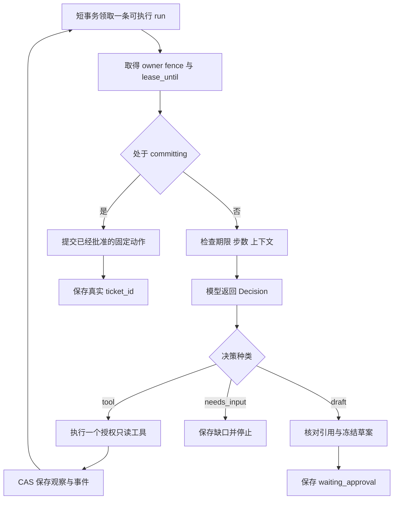
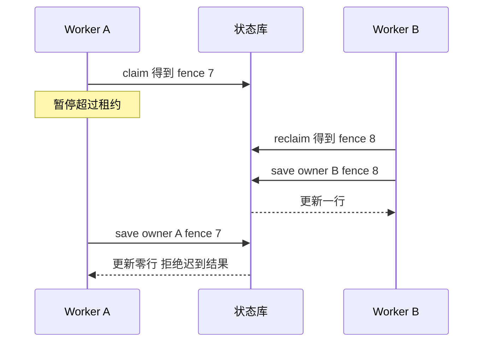

# Agent 运行时：逐步执行、持久化与恢复

本篇对应 `worker.py`、`store.py`、`model.py` 和 `contracts.py` 的完整实现。请先运行一次任务，再打开[源码目录](/project/source-index)对照阅读。最需要理解的不是 while 循环本身，而是每个事实由谁确认、何时持久化，以及出错后允许重做什么。

## 1. 为什么每次领取只推进一步

长任务如果在一个函数里持续运行到结束，很容易把进度只留在内存。参考实现把一步定义为“一次模型决策，以及至多一次只读工具调用”，随后立即保存观察和事件、释放租约。下一步可以由同一 Worker，也可以由另一个 Worker 领取。

这样做的代价是每步一次数据库事务和重新构造上下文；收益是恢复边界清楚、排队公平性更容易分析、测试可以在任意步骤插入故障。它不等于全量 event sourcing：`runs.state` 是当前状态，`events` 是进度与审计事件，代码没有实现根据任意事件流重建整个状态机的功能。

不要把“模型决定查指标”和“指标已取得”写成同一个状态。参考实现只有在工具返回并被解析后，才写入 `observations.metrics`。如果响应丢失，重新执行只读请求通常可接受；但如果读取的是变化中的数据，重新读到的版本可能不同，因此证据仍要记录版本。

## 2. 状态转换是运行时的公开合同

| 当前状态 | 可接受事件 | 后继状态 | 必须保证的事实 |
| --- | --- | --- | --- |
| queued | 有效领取 | running | owner、fence、租约一起更新 |
| running | 只读工具成功 | queued | 观察与事件在同一事务提交 |
| running | 有效草案 | waiting_approval | 参数被冻结并计算 hash |
| waiting_approval | 同一草案获准 | committing | 身份、动作、hash、期限被签名 |
| committing | Java 返回业务结果 | succeeded | 真实 ticket_id 已保存 |
| running | 缺少证据 | needs_input | 不产生未获准的业务副作用 |
| committing | 网络重试耗尽 | reconciliation_required | 结果未知，不宣称没有提交 |

`needs_input` 在当前可运行版本中是本次任务的停止状态：补充数据后新建 run。若业务需要在原 run 上继续，应新增有版本的输入事件和恢复转换，而不是让客户端直接修改 `state`。同样，等待审批的清理任务、自动续租和人工对账 UI 是明确的扩展点，不能把状态名存在当作这些能力已经实现。

## 3. 领取竞争：锁保护选择，fence 保护结果

SQLite 领取使用 `BEGIN IMMEDIATE`。这个短事务先选择可执行且租约到期的 run，再写 owner、lease_until 与递增 fence，防止两个进程在同一时刻领到同一行。事务提交后才进行 HTTP 调用，因此不会用一把数据库写锁等待模型。

但是领取时没有竞争，不代表旧进程永远不会回来。设 Worker A 领取 fence=7，随后暂停超过租约；B 领取同一任务，fence=8；A 恢复后得到模型结果。若只按 run_id 更新，A 会覆盖 B 的状态。`Store.save` 同时检查 run_id、owner、fence、未过期租约以及允许状态，更新零行就抛出 LostLease。

fence 保护的是状态库写入，不会神奇地撤销 A 已经发出的外部请求。因此对工单写入仍必须采用稳定 action_id 和下游原子幂等；两种机制保护不同边界，不能互相替代。

## 4. 决策协议必须比自然语言窄

`Decision` 只允许 tool、draft、needs_input 三类结果。tool 限定为 metrics、runbook、changes；额外字段被拒绝。模型不能指定租户、用户、URL、任意 SQL 或 shell。工具参数中的 service_id 也来自已保存任务，而不是让模型重新生成。

协议缩窄会减少灵活性：这个 Agent 不能临时发明新工具，也不能处理所有运维问题。但第一版目标是验证一个有限业务闭环。后续若增加 `query_logs`，应先增加参数合同、资源权限、日志脱敏、超时和成本限制，再加入工具目录与评测样本。

草案还要经过二次验证。引用必须是本 run 真实观察到的证据 ID，且至少覆盖指标、变更和手册三种来源。这能阻止编造来源，却不证明诊断语义正确：模型仍可能从真实证据得出错误结论。参考实现因此把诊断明确写成待人工复核的假设，语义准确性另做任务评测。

## 5. 无进展检测和预算是控制器责任

如果同一工具已在 observations 中，当前实现拒绝再次执行。这适合本案例的静态证据，也能快速捕获模型反复查相同指标的循环。对于需要持续观察新时间窗的系统，应把动作签名升级为工具名、参数、数据时间窗与资源版本，而不能简单禁止一切重复。

预算目前包含 max_steps、步骤边界检查的任务截止时间、HTTP 阶段超时和每步三次网络尝试。配置要求 `LEASE_SECONDS` 大于两倍 `HTTP_TIMEOUT`，因为一个 step 可能先调模型再调工具；这只是示例保护条件。HTTPX 的阶段超时不是整个请求的绝对时间上限，当前实现也不会在 deadline 到达的瞬间强制中断已发出的调用。超过租约的结果会被 fencing 拒绝；生产还要增加整体 deadline、可取消调用、带 fencing 的续租或更细粒度异步调度。

代码没有宣称实现 token 级强预算。真实模型模式限制单次输出长度，并对总步数设上限；若要控制费用，必须记录实际 usage、调用前预留额度、调用后结算，并规定超时未知用量如何保守处理。不能把字符数当 token 数，也不能把供应商报价写死到运行时。

## 6. 重试分两种，终态也要区分

参数错误、未知工具、伪造引用属于不可重试的逻辑问题，直接失败。网络故障和上游 5xx 可以有限重试。重试等待写入 `available_at`，Worker 不通过长时间 sleep 独占一个执行槽；抖动避免多个失败任务同时醒来。

对只读调用，重复读取通常不会新增副作用。对 committing，重试必须复用同一 action_id、同一草案和同一批准签名。三次网络尝试后仍不知道结果，就进入 reconciliation_required：此时业务可能已经提交，只是响应丢了。正确操作是查询原动作结果，绝不能重新随机生成一个动作再试。

## 7. 本章应该能独立解释的测试

`test_two_workers_cannot_claim_same_live_run` 检查领取互斥；`test_fencing_rejects_stale_worker_and_keeps_action_id` 检查迟到结果；`test_repeated_tool_stops_without_loop` 检查无进展；集成测试真正让 Worker 在业务成功后退出，再通过新进程恢复。

建议增加一次自己的实验：把只读工具人为延迟到超过租约，观察旧 Worker 回写被拒绝，再评估是否需要续租。不要直接调大所有超时，因为那会扩大故障检测时间。用观察解释参数，才是 Agent 工程调试。
