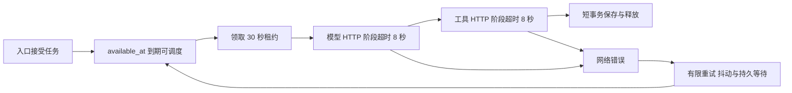
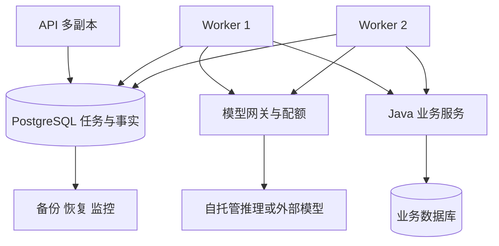

# Infra 实战：单机运行、部署设计与扩容边界

可运行版本使用本机 SQLite 与 H2，目的是让你在不启动额外基础设施的情况下验证完整闭环。容器配置和 PostgreSQL SQL 作为可审查的交付文件保留，本次没有启动 Docker、PostgreSQL 或 GPU 服务。下面把已实现能力、部署步骤和需要补齐的工程工作分开说明。

## 1. 先列出数据丢失后的影响

| 数据 | 当前存放位置 | 丢失后能否重建 |
| --- | --- | --- |
| run、审批、动作、事件 | SQLite `var/copilot.db` | 不能仅凭模型重新推断，需备份恢复 |
| Memory 事实与 tombstone | 同一 SQLite | 不能把向量索引当唯一恢复源 |
| Memory 派生索引 | 同一 SQLite | 可从有效事实重建 |
| 运行手册 | 版本化 JSON 与摄入表 | 可从受控源文件重新摄入 |
| 工单业务结果 | H2 `var/business.mv.db` | 业务真源，需独立备份策略 |
| 模型服务 KV cache | 不在当前项目内 | 通常可重算，不是工单恢复依据 |

最重要的结论是：重启应用可以恢复进程，但不等于恢复事实。把所有服务都标成 restart=always，仍然不能替代持久卷、备份和恢复演练。

## 2. 单机进程部署怎样管理

`scripts/dev.py` 是开发启动器，负责按依赖顺序启动、健康检查和退出清理。长期单机部署应由系统进程管理器管理 API、Worker 和 Java，分别记录 stdout/stderr，并把配置与数据目录固定在服务用户可访问的位置。不要让一个开发终端成为唯一监管者。

健康检查需要区分三件事：进程活着、依赖就绪、任务有进展。当前 Python `/health` 检查状态库可访问，Java `/health` 表示业务 HTTP 已启动；它们并不证明 Worker 正常消费。要一起观察 `/metrics` 的 pending age、各状态数量和 memory outbox 积压。

HTTP 慢不一定是模型慢。先按阶段拆开：API 排队、Worker 等待领取、模型响应、工具网络、数据库锁等待和终态保存。参考 Worker 日志包含 run_id、tenant、fence 和 step elapsed_ms；这只是基础结构化日志，完整跨服务 tracing 还需传播 trace context 与接入采集器。

## 3. 租约、超时和重试如何配套

30 秒和 8 秒是本地配置，不是通用默认答案。一个 step 最多包含模型和工具两次调用，因此租约要覆盖两者和提交余量。若真实模型经常推理一分钟，就需要续租协议或异步请求跟踪，不能保留 30 秒租约再把 HTTP timeout 改成 120 秒。

还要注意 HTTPX 的 timeout 按连接、读取、写入和连接池等待阶段生效，并不是整个请求的绝对墙钟上限。两倍超时检查只是配置保护，不能证明所有 step 都在租约内完成；响应分段持续到达时，总耗时仍可能更长。当前实现依靠过期租约拒绝迟到回写，生产需要额外的整体 deadline、可取消调用或带 fencing 的续租。相关行为可核对 [HTTPX 超时文档](https://www.python-httpx.org/advanced/timeouts/)。

网络失败的指数退避带随机抖动，等待时间持久化到 available_at，重启后也不会把所有任务立刻重放。上游 429 在当前实现中尚未特殊重试；接入真实供应商时应解析其限流语义和 Retry-After，并与租户配额协调，不能简单把所有 4xx 当可重试。

## 4. 什么时候必须迁移 PostgreSQL

SQLite 的短写事务在本机练习中可解释、可复现，但写入互斥限制吞吐，也不适合多机共享文件访问。当你需要多台 Worker、跨主机故障转移、集中备份或更复杂运营查询时，应迁移服务端数据库。

迁移不是替换一个连接字符串。要实现独立 Store 适配器，把 JSON 文本变成合适的 JSONB 或规范化表，统一数据库时钟，设计索引与事务隔离，替换 SQLite 的 BEGIN IMMEDIATE，并重跑并发、取消、fencing、恢复和迁移测试。

`infra/postgres-queue.sql` 展示短事务领取：FOR UPDATE SKIP LOCKED 选择可执行行，再更新 owner、fence 和 lease_until。它适用于队列式竞争消费，不表示业务查询获得一致快照。这个语义可核对 [PostgreSQL SELECT 文档](https://www.postgresql.org/docs/current/sql-select.html)。文件中的命名参数是驱动绑定占位符，不是已经完成的生产适配器。

即使任务领取分布式了，Java 幂等仍不可省略。旧 Worker 可能在失去租约后完成远程请求；PostgreSQL 行锁只能保护 PostgreSQL 中的行，不能保护整个世界。

## 5. 容器配置怎么读、怎么部署

交付 `compose.yaml` 与两个 Dockerfile，供你以后按需使用。Python 镜像含 API 和 Worker，Java 使用多阶段构建；运行用户为非 root；数据库放入命名卷；映射到宿主的端口限制为 127.0.0.1。此配置仍是单主机教学拓扑，不能直接 scale 到多主机共享 SQLite。

在你明确决定启动容器的环境中，准备真实配置、审查端口与卷路径后，可执行 `docker compose up --build`。本次制作没有执行这条命令。生产镜像需要锁定 digest、扫描漏洞、分离运行与测试依赖，并验证目标架构的包可用性。交付依赖锁文件来自实际本机验证，但这不等于 Linux 镜像已经构建通过。

上线前先建立小流量环境，执行健康检查和完整业务 smoke test，再切流。回滚应用时要考虑状态 schema 是否向后兼容；若新版本写入旧版本无法识别的字段或状态，回滚二进制可能导致更大故障。推荐 expand-contract 迁移，兼容窗口结束后再删除旧字段。

## 6. 备份和恢复必须验证业务语义

SQLite WAL 模式下，不要只复制主 db 文件。`scripts/backup.py` 使用 SQLite backup API 产生一致快照，并执行 integrity_check。H2 最简单的练习方式是在服务停止后复制文件；在线备份应使用数据库提供的受支持机制。

恢复到独立目录和端口后，先校验 schema、记录数与任务状态，再运行只读查询和幂等恢复测试。某个任务快照停在 committing 时，恢复后应复用原 action_id 查询或重试。若同时恢复了更早的业务库备份，原工单可能不存在，必须按灾难恢复策略对账；单库备份不能自动保证两个数据库的时间点一致。

删除过的记忆也可能在旧备份中存在。恢复流程必须重放删除标记或采用对应的保留策略，再开放读取。只证明文件能打开，不能证明恢复后权限和遗忘语义仍成立。

## 7. 容量估算从一次任务的放大倍数开始

假设每秒进入 2 个任务，平均执行 6 秒，根据 Little 定律，稳定条件下平均在途约 12 个。若把执行槽利用率目标设为 65%，粗略需要约 19 个槽；这个估算不包含突发、长尾和串行依赖，必须再做负载测试。

工具 QPS 与模型 QPS 还要乘每任务调用次数，重试会继续放大。数据库连接数也不能跟 Worker 数无上限增长。`scripts/capacity.py` 同时提供 KV cache 估算：32 层、8 个 KV heads、head_dim 128、8192 token、FP16 时，单序列理论 KV 约 1 GiB，未计权重、激活、分页和碎片。GQA 下应使用 KV heads，不能误用 query heads。

任务级 p95、每成功任务成本、队列最老年龄和失败比例，比只看平均 token/s 更接近用户体验。推理服务的高吞吐如果以长尾等待和频繁重试为代价，最终业务吞吐可能反而下降。
