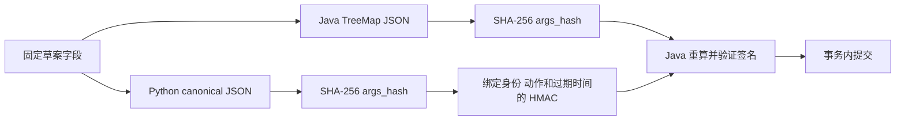
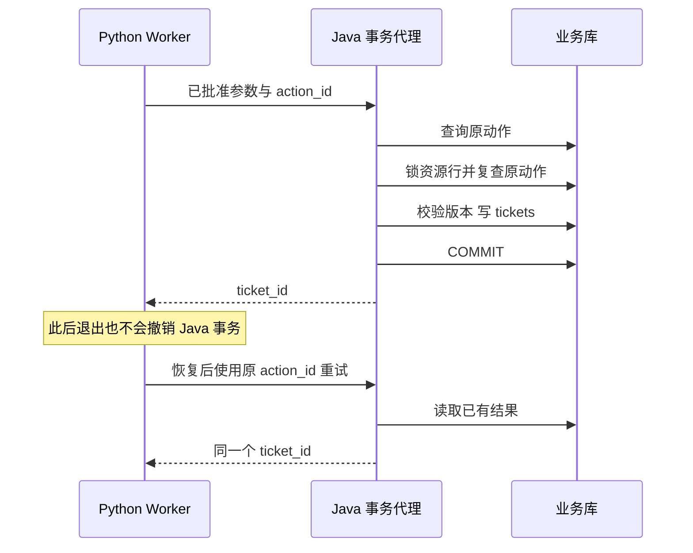

# Java 业务边界：审批、事务与幂等

对于有 Java 后端经验的你，这部分是把原有能力迁移到 Agent 场景的关键。模型增加了输入的不确定性，但资源权限、事务、并发、幂等和可审计性依然由服务端承担。完整实现见 `BusinessController.java`、`Contracts.java` 和 `TicketService.java`。

## 1. 为什么写入不由模型直接调用

三个只读工具可以让模型决定顺序，提交工单则必须在 waiting_approval 后进入 committing。Python API 用 HMAC 签名绑定 tenant、actor、action_id、args_hash 和 expires_at；Java 重新验证签名及当前角色，而不是相信请求中有一个 `approved=true`。

这里的签名是两个可信服务之间的教学授权凭据，不是用户身份认证的完整替代。用户凭据仍需验证，审批服务本身仍要受保护。生产可采用短期授权令牌与独立密钥管理，但要保留相同的参数绑定语义。

## 2. 两种语言如何得到同一个摘要

Python 对草案使用键名排序、UTF-8 和紧凑 JSON；Java 构造 TreeMap，把相同的五个字段转换成 JSON 字节后计算 SHA-256。草案字段是 body、channel、service_id、service_version、title，版本为整数，避免浮点数字序列化的跨语言歧义。

如果未来增加金额、时区、可选 null 或复杂嵌套对象，必须把规范化方法升级为明确合同，并增加跨语言测试。不能依赖“两个 JSON 看起来差不多”。当前集成测试包含中文和换行，可以发现编码、转义与排序不一致的问题。

## 3. 原子幂等放在哪里

`tickets` 同时存业务内容、action_id 和 args_hash，唯一约束为 `(tenant, action_id)`。把幂等记录和业务结果放在同一张事务表中，避免“先写去重缓存，后建单失败”或“先建单，后写去重缓存崩溃”的分离窗口。

`TicketService.create` 是独立 Spring Bean 的公开事务方法，由控制器通过代理调用。它先验证身份和签名，再查询已有动作；若相同动作已存在且参数 hash、actor 一致，就返回旧 ticket_id。不存在时才继续检查审批期限和服务版本。

并发请求可能都在第一次查询中看到不存在。实现对相应 service 行执行 `SELECT ... FOR UPDATE`，获得锁后再查一次幂等记录；第一个请求提交后，后来的请求读到已有结果。最后数据库唯一约束仍是防线，而不是仅依赖应用检查。

这个方案的代价是同一服务的建单会串行化。当前低吞吐业务可以接受；如果未来热点服务每秒创建大量工单，应改为按动作去重的插入竞争或专用意图表，并正确处理唯一冲突事务回滚。不要为了提高并发删掉唯一约束。

## 4. 并发重试与不同意图复用同一键

| 请求关系 | 处理方式 | 原因 |
| --- | --- | --- |
| 同 tenant、同 action、同 hash | 返回原 ticket_id | 同一次业务意图的重试 |
| 同 action、不同参数 hash | 409 | 客户端错误复用了标识 |
| 同 action、不同 actor | 拒绝 | 不能借另一个人的意图读取结果 |
| 新 action、批准过期 | 409 | 尚未提交的动作需要新授权 |
| 已提交 action、原批准过期 | 验签和身份通过后返回原结果 | 对账不会新增业务副作用 |

最后一行容易遗漏。响应丢失后，客户端可能在批准过期之后才恢复。如果服务一看到过期就拒绝所有请求，客户端无法通过原动作恢复结果。先确认这是已存在的相同动作，再返回旧结果，不会绕过新写入的期限要求。

## 5. 资源版本防止批准过时方案

读取指标时附带 service_version，草案将它冻结。Java 提交前锁住服务行并比较版本。假设用户看草案时版本为 3，随后业务配置已由另一个工程师修改为 4，此时原草案可能不再适用，应返回 409，重新查证并产生新草案。

锁等待期间审批也可能过期，因此代码在拿到锁后再次检查期限。这个检查顺序展示了 TOCTOU 的实质：在“检查”与“使用”之间，时间和资源都可能发生变化。把第一次检查挪得很早，不能替代最终提交边界的验证。

## 6. 为什么不把事务跨到模型调用

数据库事务只覆盖权限相关资源读取、锁定、幂等检查与工单写入。没有模型 HTTP 调用，也没有等待用户批准。长时间持有事务会占用连接和锁，在模型慢、限流或用户离线时放大成业务系统故障。

如果真实工具要调用外部工单 SaaS，Java 的本地事务不能包住对方系统。需要对方支持业务幂等键，或保存待执行意图、可靠查询和补偿策略。本项目保证的是本地工单表边界内的一次业务效果，不声称解决任意远程系统的 exactly-once。

## 7. 你应能展示的证据

集成测试同时发出四个相同动作，断言只有一个 ticket_id、只有一次返回 replayed=false；换参数后仍用原 action_id，断言 409；没有有效签名、过期批准、错误资源版本和 viewer 角色都不能提交。

面试时用这组证据解释你的事务设计：先给出失败窗口，再指出唯一约束和锁的作用，最后说明吞吐代价及迁移方案。仅展示 `@Transactional` 注解无法证明业务语义正确。
