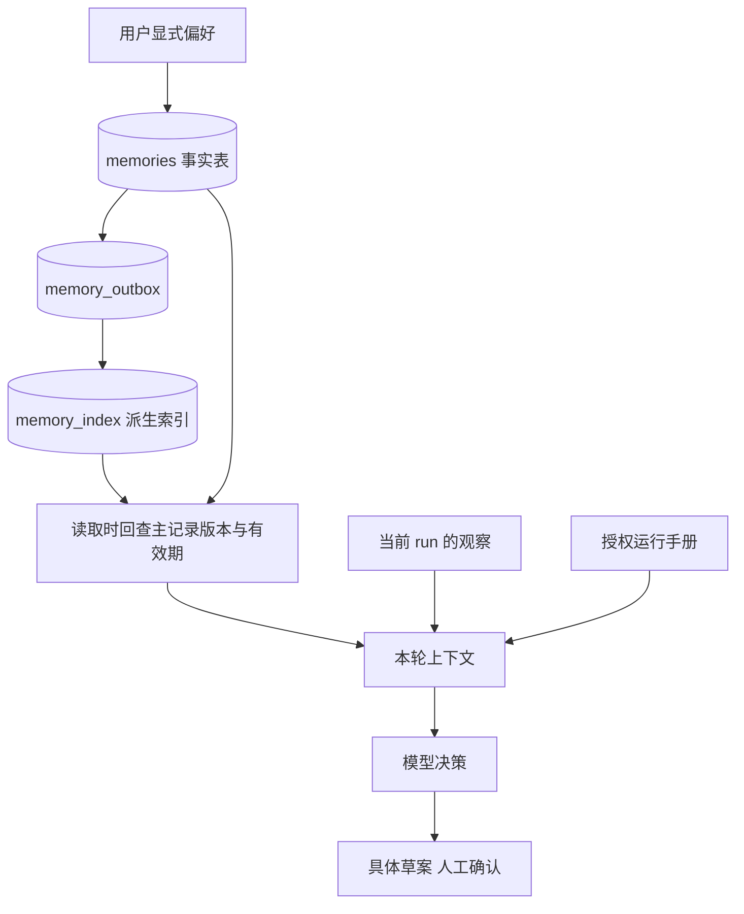
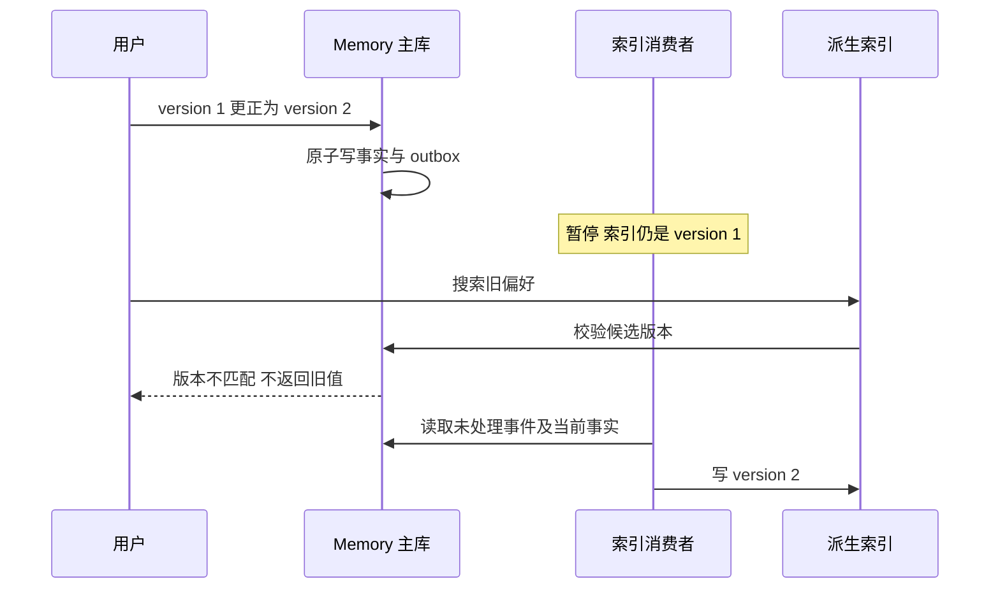

# Memory 实战：版本、作用域、遗忘与索引一致性

本篇把第 08、09 章的概念落到 `memory.py`。我们先实现“通知渠道”和“语言”两种显式偏好：值域有限，来源可解释，容易验证正误。复杂自由文本记忆可以在此基础上扩展，但不能跳过这里的版本和生命周期设计。

## 1. 四类数据，四种真源

`runs.state.observations` 是当前任务取得的证据；`memories` 是用户跨任务的偏好；`runbooks` 是组织知识；Java `tickets` 是业务记录。工单已经创建的事实应查询 tickets，而不是让“长期记忆里好像写过”来裁决。模型 KV cache 则只是推理缓存，不属于这些业务事实中的任何一种。

这张图最容易被忽略的箭头是索引之后回查主记录。搜索索引可能滞后，但删除和权限不应该等待召回系统“慢慢同步”才生效。这里允许暂时漏召回新记忆，拒绝继续返回已经失效的旧值。

## 2. 一个事实槽位怎样定义

主键是 `(tenant, actor, scope, key)`。acme 的 alice 在 global 范围偏好 email，可以同时在 payment 范围偏好 in_app。读取上下文时先应用全局值，再用具体服务范围覆盖。bob 即使使用同样的 key，也处于另一个事实槽位。

每条记录还带 version、source、occurred、expires、deleted。version 用于并发控制；occurred 表示声明发生时间；expires 表示自动失效；source 由受认证 API 生成，标明这是用户主动写入。这个 source 不是伪造的聊天引用，也没有声称实现了聊天消息存档系统。

| 字段 | 解决的问题 | 不能代替什么 |
| --- | --- | --- |
| version | 检测读后写期间的并发变化 | 不能判断新值语义是否正确 |
| occurred | 防止迟到的旧事件覆盖新声明 | 不能无限信任客户端未来时间 |
| scope | 区分服务与全局偏好 | 不能代替身份权限 |
| expires | 读取时判断生命周期 | 不能代替显式删除 |
| source | 解释这条偏好如何进入系统 | 不自动证明模型推断可靠 |

## 3. 写入为何必须要求 expected_version

假设两个浏览器同时读到 version=1，一个要改成 email，另一个要改成 in_app。如果双方直接执行 UPDATE，最后提交者会覆盖另一方，用户并不知道发生竞争。参考 API 要求每次提交带 expected_version。事务读取到当前版本不匹配，就返回 409，客户端重新读取后决定是否继续。

第一次创建使用 0，成功后返回 1；更正使用 1，成功后返回 2。这个比较发生在 SQLite 写事务内，不能先在事务外查一次、稍后再无条件写入。删除同样需要 expected_version，避免用户在旧页面点击删除时，误删另一设备刚写的新事实。

删除或过期后，正常记忆列表不返回旧值，但事实槽位的版本仍在。新客户端可以调用 GET `/memories/global/notification_channel/version` 取得自己的版本元数据，再明确提交新偏好。这样既支持合法的重新创建，也不会为了方便而把版本重置为 0、允许旧请求复活。该接口不返回已删除的值，且同样按身份过滤。

对迟到事件还有单独检查：新 occurred 不能小于或等于当前记录的发生时间。接口限制过远的未来时间。实际接入消息系统时，应由可信消息记录提供事件时间与事件 ID，并对重复事件做去重；不应把模型生成的时间戳直接当事实顺序。

## 4. outbox 和事实写在同一事务

一旦更正成功，事实表和 memory_outbox 同时提交。即使 Worker 立即退出，未消费事件也不会丢失。索引消费者领取 outbox 后不盲信事件里复制的一份旧值，而是重新读取该槽位的当前真源，再更新索引。这让旧事件重放不会覆盖较新版本。

当前 SQLite 索引和事实在同一个数据库，但代码仍刻意模拟派生索引的异步生命周期。生产把向量索引拆到外部服务后，原理不变，事务边界却变了：写远端索引成功但 outbox 未确认时会重复投递，消费者需要按事实 ID 与版本实现幂等 upsert。

## 5. 删除不只是执行一条 DELETE

参考实现清空 value 和 source，设置 deleted，递增 version，并同步删除本地派生索引。保留最小 tombstone，是为了阻止旧任务用 expected_version=0 把槽位当成从未存在。审计表只保留操作、版本和时间，不复制被删除的值。

尚未消费的 outbox 只包含槽位引用，消费者之后看到 tombstone，就不会重新创建索引。这正是 `test_delete_and_old_outbox_cannot_resurrect_memory` 验证的内容。测试不仅检查 GET 为空，还检查主记录 value/source 已清空，以及旧更新事件消费后仍不能复活。

这不等于删除了世界上所有历史痕迹。SQLite WAL、数据库快照和此前批准的业务工单可能仍有历史数据。共享生产环境必须定义备份保留、删除标记恢复、审计最小化和业务记录保留政策。当前实现保证在线读取不再把删除偏好注入后续任务，没有实现对历史备份的物理擦除。

## 6. 读取与注入为什么分开

`Memory.list` 负责身份、scope、deleted 和 expires 的硬过滤。`Memory.context` 把有效记录折叠成一个小型偏好包。运行时每个决策步重新读取，避免在 run 创建时拷贝一份记忆后永远使用。持久 run 中只保留使用的版本引用，减少长期复制个人偏好。

但草案属于一个新的业务产物：如果通知渠道已进入待审批草案，之后修改 Memory 不应该暗中改变用户正在看的草案。要么明确重新生成并计算新 hash，要么让用户批准已经展示的原值。这就是 Memory 与审批一致性相遇的地方。

当前项目实际使用 notification_channel 影响草案；language 是可存储并注入真实模型上下文的偏好，确定性基线不会因此切换诊断文案语言。实现边界要写清，不能因为表里有字段就宣称所有功能都已生效。

## 7. 向量化和自动抽取应怎样接入

下一步若记忆变成大量自然语言，先增加候选表，再接模型抽取。候选至少带原始来源、主体、作用域、发生时间、建议 key 和可信度说明。只有经策略接受的候选才能写入事实表。金额、身份和授权等信息应使用业务真源，而不是依赖抽取器自动“记住”。

向量索引的职责是召回候选 ID，不是最终判定事实有效。embedding 模型变更需要索引版本与重建流程；向量距离不是事实可信概率；冲突的两个高相似结果应进入仲裁，而不是随意选分数较高的一个。对本案例两个离散偏好，精确槽位读取更简单，也更容易验证。

## 8. Memory 评测要按生命周期组织

至少执行“写入 → 跨任务使用 → 更正 → 迟到事件 → 删除 → 索引重放 → 跨用户读取”的成组测试。只测一次问答无法暴露版本和遗忘问题。除了召回命中，统计错误写入、失效值返回、跨域泄漏、删除后复活和最终业务偏好遵循。

把无 Memory 的基线、仅显式偏好的版本和自动抽取版本放在同一任务集上比较。自动记忆更多未必更好：误抽取、过期内容和上下文拥挤可能抵消召回收益。实验应允许得出“这个场景不需要更复杂的记忆系统”的结论。
