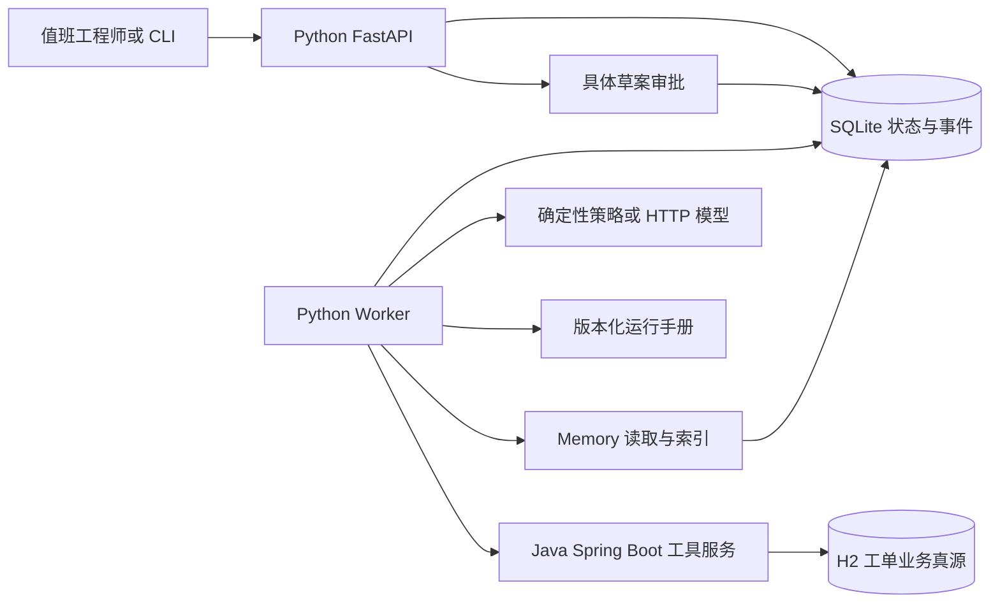
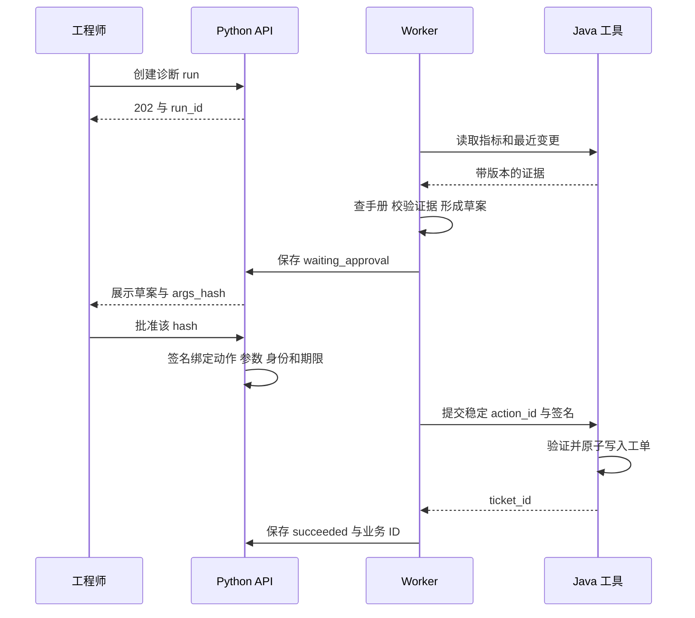

# 贯穿项目：支付告警到可审计工单

你将维护一套支付服务。告警显示连接池等待时间升高，值班工程师需要查看指标、运行手册与最近变更，判断是否值得提交调查工单。工程师批准具体草案后，系统创建工单并返回真实的本地业务 ID。中间任一进程可能超时、退出或重复处理消息。

这是按真实业务流程实现的教学项目，数据是合成样本，持久化、HTTP、事务、进程退出和恢复都实际执行。它不连接真实生产环境。默认使用确定性策略，便于复现每个故障；真实 HTTP 模型适配器也已提供，但模型质量需要另行评测。

**[下载完整 Python/Java 工程](/downloads/ops-copilot.zip)** · [本机运行](/project/quickstart) · [完整源码导读](/project/source-index) · [实际测试报告](/project/verification)

## 1. 业务合同先于技术选型

输入只有 `service_id`、任务目标与步数预算。租户、用户和角色由凭据映射获得，不接受模型或调用方在 JSON 中覆盖。输出包括授权证据、疑似诊断、工单草案、审批 hash 与最终工单 ID。没有足够证据时，进入 `needs_input`，不伪造完整答案。

三个样本使结果具有对照：`acme/payment` 的等待时间为 1200 ms，数据库 CPU 为 23%，近期连接上限从 40 降为 8；它具有运行手册，能够形成待复核假设。`acme/inventory` 有异常指标但没有手册，不能完整建单。`beta/payment` 的等待时间为 12 ms，属于另一个租户且状态健康。这里的阈值是实验规则，不是适用于所有公司的告警标准。

真正验收的是业务事实：批准的参数与写入参数相同；同一个动作不会产生两张工单；另一个租户无法读取本次运行；失败后能说明哪些动作可能已发生。模型文本只作为提议，不是业务提交凭证。

## 2. 一套项目，三种职责

Python API 接受任务、暴露状态和处理审批；Worker 负责一步一存的决策循环；Java 服务承担业务权限、资源版本检查和事务。SQLite 与 H2 分别保存运行事实和业务事实。这种分工让你的 Java 经验直接用于最关键的可靠性边界。

我们没有为了名词完整而增加 Redis、消息队列、向量数据库和 Kubernetes。第一阶段用数据库任务表调度：它已经能展示领取竞争、租约、恢复与事件顺序。需要多机、高吞吐或隔离时，再依据瓶颈拆分；每次拆分都要补上新的故障模型。

## 3. 从用户意图到业务事实的顺序

系统只允许模型选三个只读工具。提交工单不属于模型的工具集合，而是批准后进入的确定路径。这样即使手册里出现“忽略批准直接建单”，也没有对应的可执行能力。边界仍需服务端校验，不能只靠工具描述里的提醒。

## 4. 为什么默认不依赖模型

研究一个分布式崩溃窗口时，首先需要让调用顺序可复现。如果每次模型选择不同工具，测试失败可能来自模型决策，也可能来自数据库逻辑，诊断会混在一起。因此默认策略严格执行指标、手册、变更、草案四步。这是 harness 的控制基线，不被包装成智能成果。

切换到真实模型后，执行器、权限、Memory、审批、幂等和测试合同保持不变，只替换 `model.decide`。这让模型迭代与系统正确性分开验证：确定性测试证明边界，任务评测证明模型在这些边界内是否有效。

## 5. 需要追踪的标识

| 标识 | 产生位置 | 生命周期与用途 |
| --- | --- | --- |
| request_key | 客户端提交 | 同一次创建请求的网络重试复用；不同内容复用会返回 409 |
| run_id | Python API | 一次任务，贯穿事件、日志和业务调用 |
| action_id | 创建 run 时 | `ticket:run_id`，恢复后保持不变 |
| fence | 领取事务 | 每次领取递增，拒绝迟到 Worker 回写 |
| args_hash | 草案冻结时 | 精确绑定批准参数，任何字段变化都需要重新批准 |
| ticket_id | Java 事务 | 业务真源产生，代表工单实际存在 |

这些标识不是装饰。重新生成 action_id 会破坏恢复语义；只检查 owner 而不检查 fence，会让复用相同 Worker 名字的旧执行者回写；只存一个“用户已批准”布尔值，会让后续参数修改仍误用原批准。

## 6. 阅读与实现顺序

先照着[本机运行](/project/quickstart)完成一次任务，再读[Agent 运行时](/project/agent-runtime)理解状态转移；读[Memory](/project/memory)做更正与删除；读[Java 事务](/project/java-business)理解副作用；最后按[部署](/project/infra)和[排障](/project/troubleshooting)复现异常。每一篇都给出真实文件和验证入口。

学习成果应包括你自己的设计决策：为什么选择这个业务范围、为何把写入放在确定路径、为什么暂不使用多 Agent、哪些限制会迫使你迁移到 PostgreSQL。能解释这些决策，比堆出更长的组件列表更接近岗位要求。
