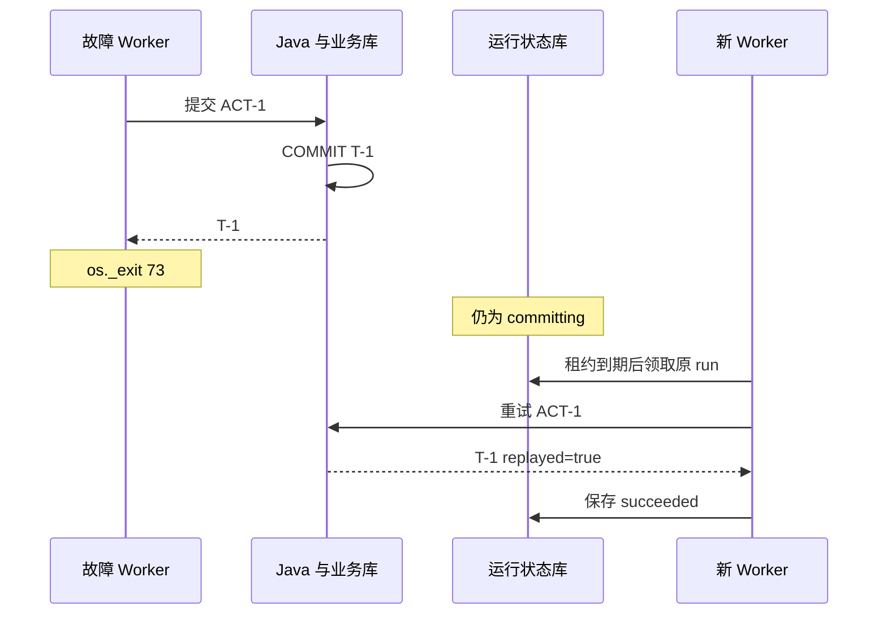

# 排障与故障演练：从症状追到提交边界

排障的第一步是确定系统现在知道什么，而不是立刻改提示词。用 run_id 串起 API、事件、Worker 和 Java 记录，判断问题发生在接受任务、调度、决策、工具、批准还是提交之后。下面的动作均针对本地教学数据。

## 1. 一张按症状组织的检查表

| 症状 | 先检查 | 常见原因 | 修复后如何验收 |
| --- | --- | --- | --- |
| 一直 queued | pending age、Worker 进程、available_at | 没有消费者、退避尚未到期、配置指向不同 db | 看到新的 claimed 与 tool_observed |
| 一直 running | lease_until、owner、fence、阶段耗时 | 慢模型、工具超时、进程暂停 | 租约到期后新 fence 能推进，旧结果被拒绝 |
| 等审批但无法批准 | 当前用户、args_hash、deadline | 角色错误、旧草案、任务已过期 | 合法身份与当前草案可以进入 committing |
| Java 返回 403 | 身份、角色、签名配置 | 两端 secret 不一致、viewer 操作、被改参数 | 验证正确签名通过，错误签名仍被拒绝 |
| Java 返回 409 | action 参数、资源版本、审批时间 | 幂等键复用、版本变更、批准过期 | 重新查证并获取新批准；不强行覆盖旧意图 |
| Memory 更正后搜索不到 | outbox 积压、当前版本 | 索引尚未更新 | 新版本最终出现，旧版本始终不返回 |
| 同一次任务出现两张工单 | action_id 是否稳定、事务唯一约束 | 恢复时新建了意图或去重不原子 | 并发与写后崩溃用例都只产生一个 ID |

不要把所有问题归结为模型能力。即使使用确定性策略，上表的大部分故障仍然存在，说明它们属于系统工程边界。

## 2. 最重要的一次演练：提交成功后 Worker 消失

`test_crash_after_java_commit_recovers_one_ticket` 会创建新任务，批准草案，等待 Java 事务提交，然后让 Worker 以退出码 73 结束。Python 任务状态仍为 committing，Java 表中已经有工单。这是最危险的“不知道结果”窗口。

随后启动没有故障参数的新 Worker，等旧租约到期，它再次领取原 run，使用原 action_id 与原草案调用 Java。Java 找到已提交记录，返回 replayed=true 和原 ticket_id。测试断言前后工单数量都为一。

只在调用 Java 之前杀 Worker，无法证明这个机制。只模拟抛一个 Python 异常，也不等同于进程突然退出，因为 finally 或异常处理可能会保存额外状态。测试选择真实进程退出，是为了把这个窗口验证清楚。

## 3. 结果未知时不要生成新的动作

如果 Java 在事务提交后响应持续丢失，三次重试后当前实现进入 reconciliation_required。此时应该通过原 action_id 查询 Java 工单列表或专用结果接口，确认是否存在原业务结果。当前示例用 GET `/tickets` 找到对应 action_id，生产应提供索引良好的按动作查询接口。

若找到相同 hash 的结果，可由受控对账流程补写运行终态；若确认未提交且原批准已过期，应重新让用户审查。不要为了“重试方便”删除原动作记录，也不要随意把状态改回 queued 后生成新 action_id。

手工对账接口在当前项目中没有实现，文章描述的是运营处理流程。直接改数据库前应先保存快照并记录原因，生产应通过有审计的管理操作执行。

## 4. Memory 故障要分别定位写入和读取

若偏好不生效，先 GET 主记录确认值、scope、version、expires，再检查草案是否在更正之前生成。若主记录正确但搜索为空，检查 outbox；在索引追赶期间暂时无结果是预期的保守行为。若旧值仍返回，检查 JOIN 是否同时匹配版本、身份和有效状态。

删除后还读到旧值时，不要仅删除向量库一条记录就结束。检查缓存、摘要、历史任务快照以及恢复的备份。本实现将值留在独立事实表，run 只保存版本引用，减少派生副本，但已经生成的工单仍具有独立业务生命周期。

建议用两名用户和两个 scope 复现，不要只用一个账号测试。单账号结果完全正确，也无法证明多租户隔离。

## 5. 区分模型错误、协议错误和环境错误

模型输出未知工具或额外 tenant 字段，是协议边界失败；请求 HTTP 超时，是环境或容量问题；引用真实证据却推断错误，是语义质量问题。三类失败需要不同修复：schema 与工具描述、超时与负载、任务数据与模型能力。

先把真实模型切回确定性基线复现。如果仍失败，优先排查系统层；若只有真实模型失败，检查原始响应在脱敏后是否符合 Decision，观察工具选择是否有进展，再做任务级评测。不要在日志中保存密钥，也不要无限记录原始用户上下文。

## 6. 如何写一篇有工程价值的复盘

记录发生时间、用户影响、系统已确认的事实和仍未知的部分；用时间线说明哪个提交先发生；给出直接原因与放大条件；最后给出修复、回归测试和仍未覆盖的范围。不要把“加了一个 try/except”当作结论。

例如“工单重复”复盘应明确：旧版本在每次恢复时新建 action_id，Java 因此认为是不同意图；修复为创建 run 时持久化动作；回归同时覆盖并发重复请求和业务提交后进程退出。证据是工单数量及 ID，不是模型回答里写了“仅创建一次”。

## 7. 结束演练后的收尾

完整测试使用临时目录和随机端口，finally 会关闭子进程。手动 `dev.py` 运行时按 Ctrl+C，数据仍保留在 var；下次启动可以继续查看历史运行。删除本地演示数据前应知道它包含哪些任务和 Memory，优先备份，再按自己的需要清理。

对照[实际测试报告](/project/verification)辨别“已经验证的故障”与“留作进阶实验的故障”。本次没有执行机器断电、磁盘损坏、PostgreSQL 主从切换、跨地域网络分区或 GPU OOM 演练，因此不能把这些覆盖范围写进简历。
